# 快速入门使用维度科技2d/3d-定位/导航模块，以及简单测试其功能

## 快速入门：连接模块和使用上位机

### 1. 准备和接线

印有logo为模块顶面，侧面USB/网口用于连接雷达，MX1.25端子用于串口输出/连接飞控，TX30用于连接5V-26V电源；接口及供电规格以实际设备为准。

1. 准备模块、配套雷达、电源、电脑及对应版本上位机。MID360/MID360S 使用前需按设备配置设置雷达 IP；安装姿态等参数也需与实际安装一致。
2. 断电连接雷达与模块对应的 USB 或网口，按设备接口标识连接电源。旧设备使用 TX30 电源口，直流 5–26 V，开机电流需求约 2.5 A；接电前请确认本机接口和供电规格。
3. 需要串口连接时，使用电平兼容的 USB 转串口模块：模块 TX 接转接器 RX，模块 RX 接转接器 TX，双方 GND 相连。串口为 115200、8N1；模块与转接器分别使用合适电源。
4. 确认接线后给模块上电，等待初始化。旧教程约需 15 秒，实际等待时间以设备为准。

模块接口和 N10 雷达连接示例

<table>
  <tr>
    <td style="border: 10px solid black; padding: 0;">
      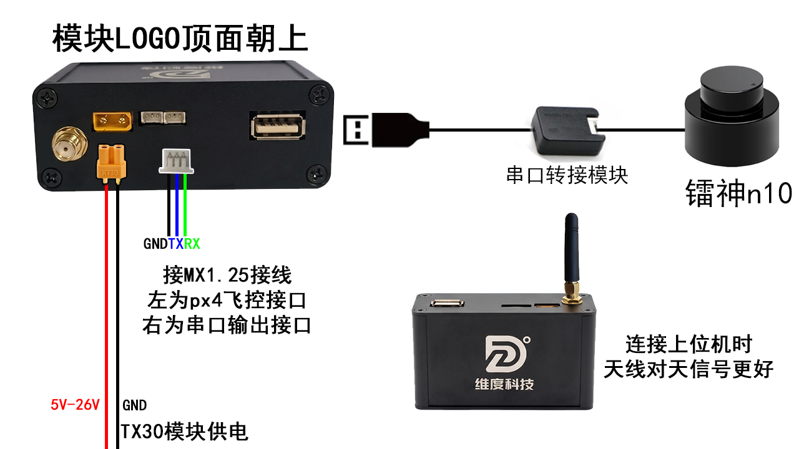
    </td>
  </tr>
</table>

上图为 N10 雷达和 TX30 供电的接线示例；其他雷达及设备按实际接口连接。串口接线时，模块 TX 接对方 RX、模块 RX 接对方 TX，双方 GND 相连。

MID360 网口和模块接口示例，实际接线及供电按设备核对

<table>
  <tr>
    <td style="border: 10px solid black; padding: 0;">
      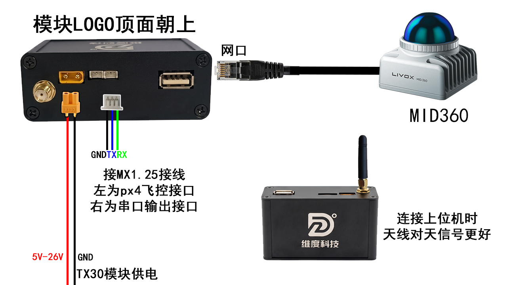
    </td>
  </tr>
</table>

模块与 USB 转串口接线示例。请确认转接器电平与模块兼容。

<table>
  <tr>
    <td style="border: 10px solid black; padding: 0;">
      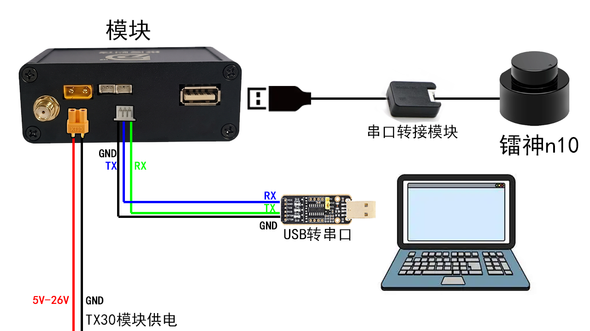
    </td>
  </tr>
</table>

### 2. 连接上位机

下载[对应版本的上位机](https://github.com/kikiYang03/SerialPortAssistant3D/releases)，选择与模块匹配的版本，如图：

<table>
  <tr>
    <td style="border: 10px solid black; padding: 0;">
      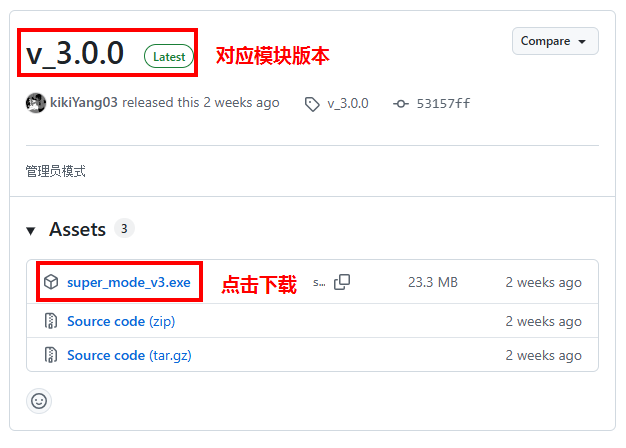
    </td>
  </tr>
</table>

#### 2.1 网络连接

1. 在电脑连接模块热点。旧设备热点密码为 `12345678`，热点名称和密码以本机配置为准。
2. 启动[对应版本的上位机](https://github.com/kikiYang03/SerialPortAssistant3D/releases)，进入连接界面，使用 TCP，填写模块实际 IP 和端口。模块默认监听端口为 `6666`；`0.0.0.0` 是模块监听地址，不能作为电脑连接目标。上位机显示的默认地址可能不是本机模块地址，按实际配置核对。若地址或端口不可编辑，使用软件中的 **管理员登录/退出** 登录后修改；若没有管理员入口或凭据，请向设备提供方确认配置。
3. 点击 **打开连接**，查看连接状态及接收数据。连接不上时检查热点、模块地址、端口和供电。

电脑连接模块热点示例；热点名称以实际设备为准。

<table>
  <tr>
    <td style="border: 10px solid black; padding: 0;">
      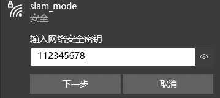
    </td>
  </tr>
</table>

网络区域显示 TCP 已连接及通信测试成功，地址为示例；顶部状态显示未连接，待核对

<table>
  <tr>
    <td style="border: 10px solid black; padding: 0;">
      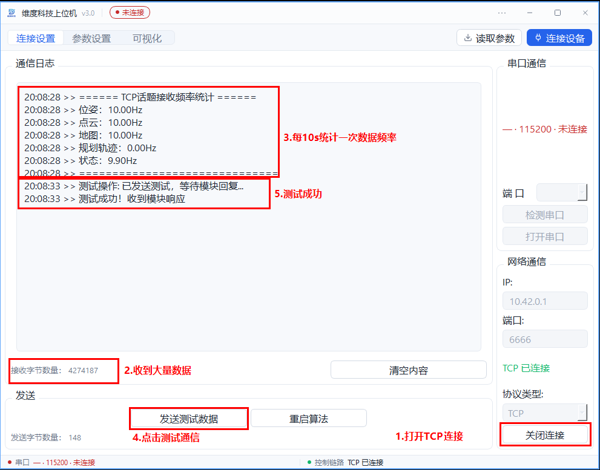
    </td>
  </tr>
</table>

#### 2.2 串口连接

1. 按 1.3 接好 USB 转串口，启动上位机，在串口通信区域点击 **检测串口**，选择对应端口。上位机固定使用 115200、8N1，无需选择波特率。
2. 点击 **打开串口**，查看串口状态和接收区的位姿数据。串口直连不需要连接热点。
3. 切换到网络前先关闭串口；切换到串口前先关闭网络连接。

串口与网络均可进行通信测试、保存地图、获取和写入参数以及重启算法。地图和点云可视化、下载地图使用网络连接；串口不支持地图下载。串口数据格式及主控接入见[当前通信协议](https://github.com/weisama/super_mode/blob/v3.0/upper/config/通讯协议.md)和 [STM32 v3.0 说明](https://github.com/weisama/super_mode/blob/v3.0/stm32例程/5_mode_v3.0/README.md)。

串口连接及位姿接收，COM 端口以实际设备为准

<table>
  <tr>
    <td style="border: 10px solid black; padding: 0;">
      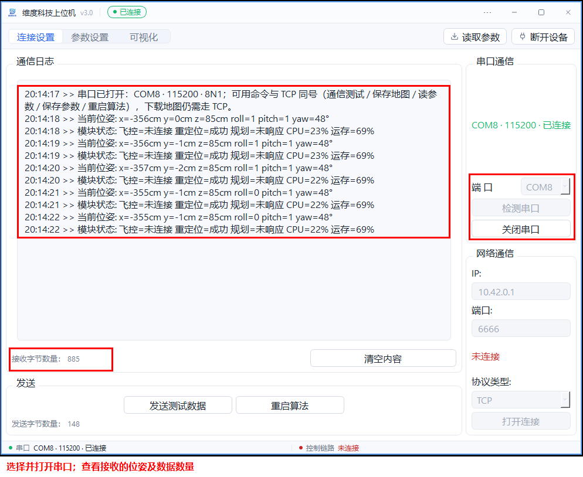
    </td>
  </tr>
</table>

### 3. 测试通信和设置参数

1. 连接后点击 **发送测试数据**。接收区出现“测试成功！收到模块响应”表示通信测试收到回包；若超时，检查连接、供电和接线后重试。
2. 进入参数界面，点击 **获取参数**，等待参数收齐，再检查模块类型、雷达型号及安装参数是否与设备一致。未收齐或超时时先检查链路。
3. 修改需要的参数，点击 **写入参数**，等待保存和回读比对结果。出现不一致或超时，应检查提示并重新读取确认，不要当作写入成功。
4. 修改需要重启生效的配置后，点击 **重启算法**，等待模块重新启动并重新连接；再点击 **获取参数**，确认改动已读回。重启回显只表示模块收到请求，不表示算法已经重新启动完成。

常用模式参数：`0x13` 模式，0 为建图、1 为定位；`0x14` 导航使能，0 为关闭、1 为开启；`0x15` 为模块点云过滤半径，单位 cm。导航版启用导航会强制使用定位模式：建图存图前先关闭导航。参数的完整含义、取值及其他配置见[当前通信协议](https://github.com/weisama/super_mode/blob/v3.0/upper/config/通讯协议.md)。

参数界面、模式与导航使能示例；右侧保存提示未完整显示

<table>
  <tr>
    <td style="border: 10px solid black; padding: 0;">
      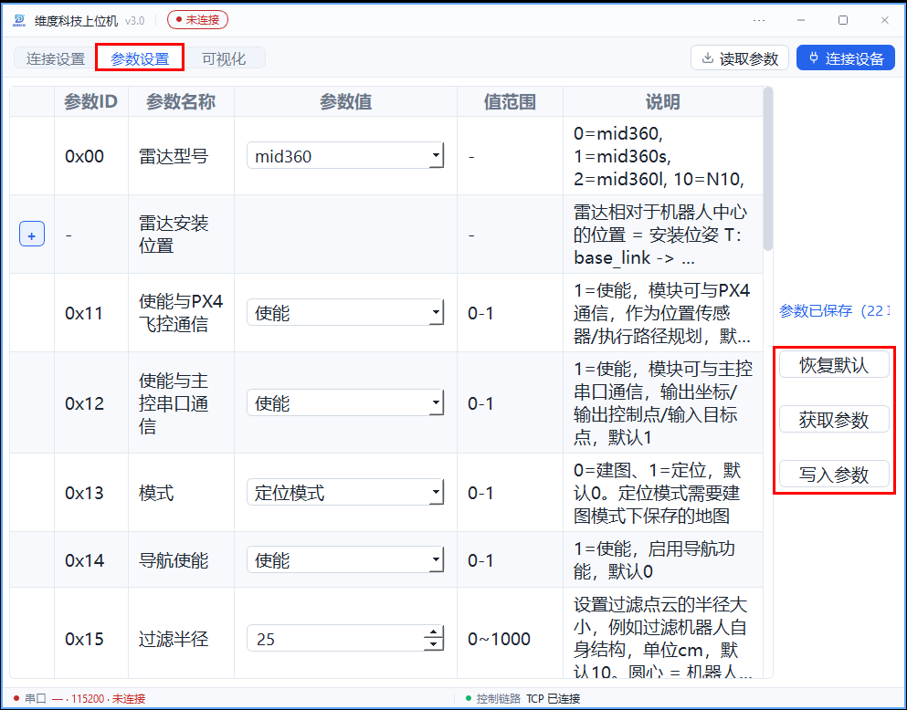
    </td>
  </tr>
</table>

### 4. 查看可视化和模块状态

1. 通过网络连接模块，进入可视化页面，查看 **机器人坐标**、实时点云及地图。可用左键旋转、右键平移、滚轮缩放视角；按需勾选 **实时点云**、**地图点云**。
2. 查看 **模块状态**中的飞控、重定位、路径规划、CPU 和运存。重定位与规划状态分别为进行中、成功、失败、未响应；未响应表示尚未收到对应状态，不等于正在进行或失败。`—` 表示没有可用读数，不是 0%。飞控未连接时显示未连接属于正常现象。
3. 建图时的图原点是建图那次开机时机器人中心的位置。定位模式重定位后，机器人坐标和目标点按图原点系解释；**开机点**显示本次开机位置在图中的位置，两者不一定相同。
4. 如需建图或导航，先关闭导航并建图、保存地图，再切换定位及启用导航、重启并等待重定位成功。地图保存需收到成功结果；未收到回显可能是保存失败、定位模式拒绝或通信问题。目标回显只表示收到目标，不代表规划成功或已到达。

点云、机器人坐标和模块状态；重定位成功，路径规划未响应

<table>
  <tr>
    <td style="border: 10px solid black; padding: 0;">
      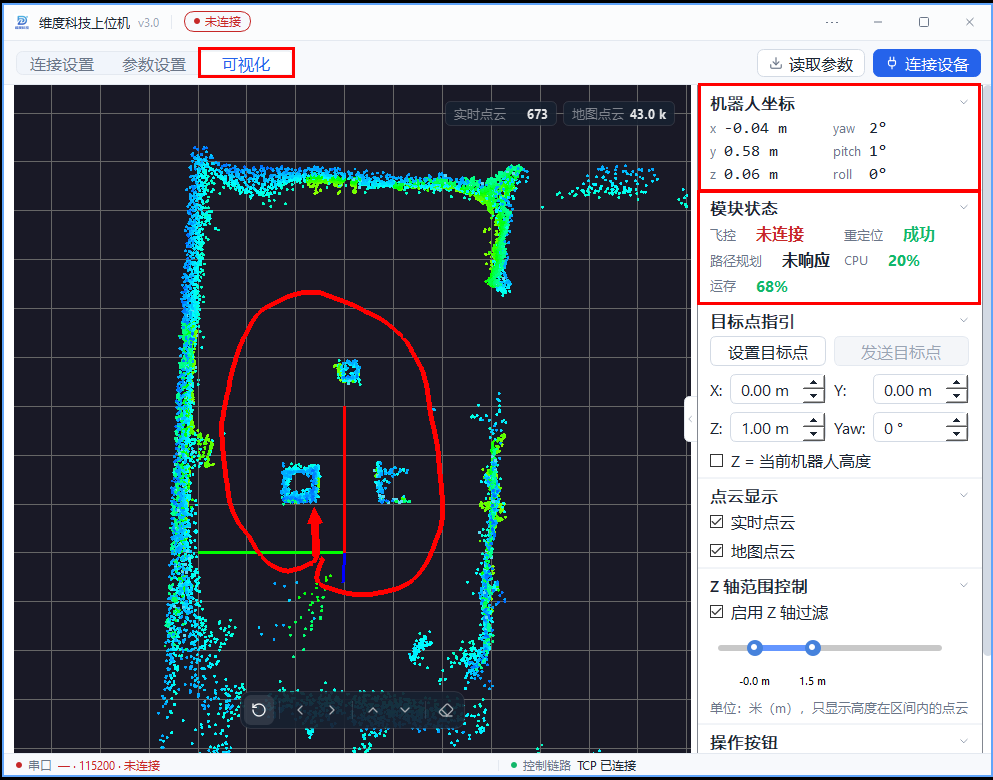
    </td>
  </tr>
</table>

---

## 地图、定位与导航

开始前按[快速入门](1.快速入门.md#快速入门连接模块和使用上位机)连接模块和上位机，确认雷达及安装参数正确。查看地图、轨迹和下载地图需要网络连接；导航步骤适用于导航版模块。

### 1. 建图并保存

1. 在参数界面点击 **获取参数**，将 `0x13` 模式设为 `0`（建图），`0x14` 导航使能设为 `0`（关闭）。点击 **写入参数**，确认保存和回读比对成功，再点击 **重启算法**，等待重启并重新连接。
2. 进入可视化页面，缓慢移动设备扫描需要使用的区域，查看实时点云和地图是否覆盖场地。
3. 在 **操作按钮**中点击 **保存地图**，等待“保存地图成功”提示。模块核对保存产物后才回显成功；超时或未收到回显可能是保存失败、处于定位模式被拒绝或通信问题，检查后重试。保存地图也可通过串口操作。

新版地图画面；截图显示重定位成功，不能作为建图过程的证明

<table>
  <tr>
    <td style="border: 10px solid black; padding: 0;">
      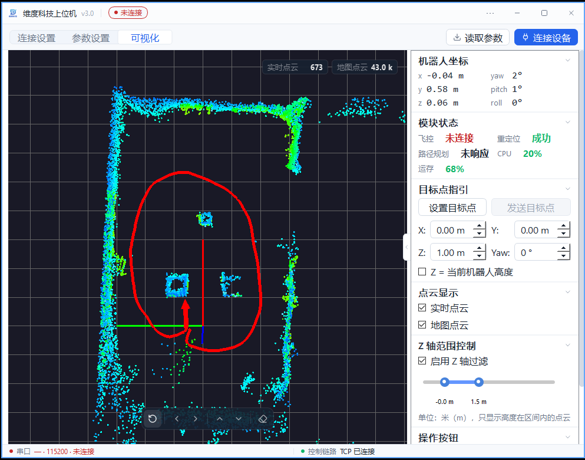
    </td>
  </tr>
</table>

保存地图和下载地图按钮；未展示保存成功

<table>
  <tr>
    <td style="border: 10px solid black; padding: 0;">
      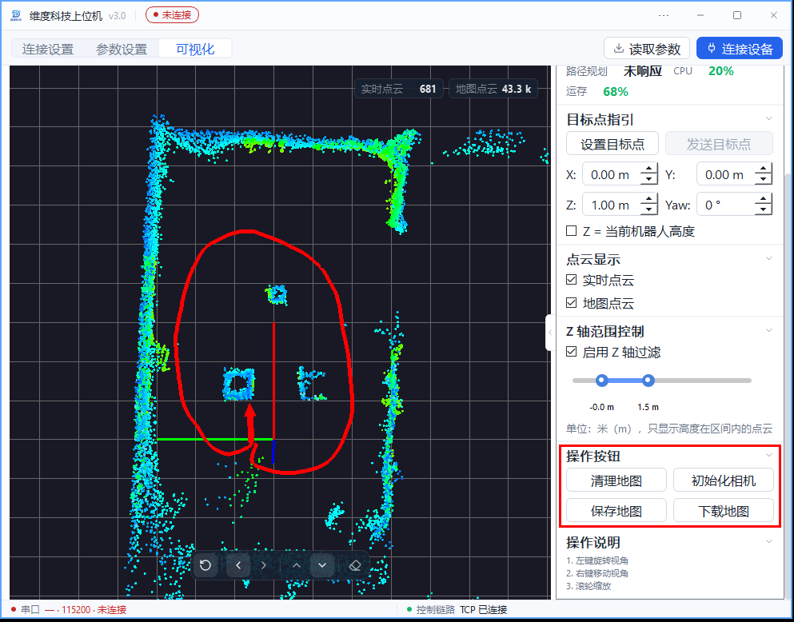
    </td>
  </tr>
</table>

### 2. 切换定位并启用导航

1. 确认地图已保存。在参数界面获取参数，将 `0x13` 设为 `1`（定位）；需要导航时将 `0x14` 设为 `1`（开启）。2D 导航版的 `0x25` 规划模式只支持 `0`（2D 平面路径规划）；其他导航版按设备和使用场景选择规划模式。
2. 点击 **写入参数**，确认保存和回读比对成功，再点击 **重启算法**。等待模块重新启动并重新连接；重启指令的回显只表示请求已收到。
3. 查看可视化页面的 **模块状态**，等待 **重定位**显示成功，再设置目标。进行中表示尚在处理，失败表示本次未成功，未响应表示尚未收到对应状态。失败或持续未响应时，先检查地图、雷达、设备位置及连接，再重试。

导航版启用导航后，运行时会强制使用定位模式，即使 `0x13` 回读仍为 `0`，也不能在该状态保存地图。需要重新建图时，关闭导航、将 `0x13` 设为 `0`，写入并重启后再保存。

图原点是建图那次开机时机器人中心的位置；重定位后，机器人坐标和目标点都按图原点系解释。**开机点**是本次开机位置在图中的位置，不一定与图原点重合。

### 3. 设置目标并查看结果

1. 重定位成功后，在可视化页面展开 **目标点指引**，点击 **设置目标点**，在地图内按住鼠标左键拖动生成目标箭头，再点击 **退出指点模式**确认目标；也可调整 X、Y、Z 和 Yaw。坐标单位为米，Yaw 为度，箭头方向表示目标朝向。按需要选择 **Z = 当前机器人高度**。
2. 确认目标位置和朝向后点击 **发送目标点**，查看 **模块状态**中的路径规划状态和地图上的轨迹。规划成功、失败、进行中和未响应分别表示不同结果；若失败，检查目标、障碍物和规划参数后重新设置。
3. 规划出轨迹不等于设备已到达目标，应结合设备实际运动和位置确认到达。通过串口发送目标时，目标回显只表示模块收到目标，也不表示规划成功或到达。

2D 导航版使用平面规划。串口目标的 Z 会被替换为配置的起飞高度；网络目标在规划时若与起点不在同一高度层，会被调整到起点所在层。因此不要把界面输入的 Z 当作该模式的最终规划高度。

目标箭头与坐标设置；路径规划未响应，未显示规划轨迹

<table>
  <tr>
    <td style="border: 10px solid black; padding: 0;">
      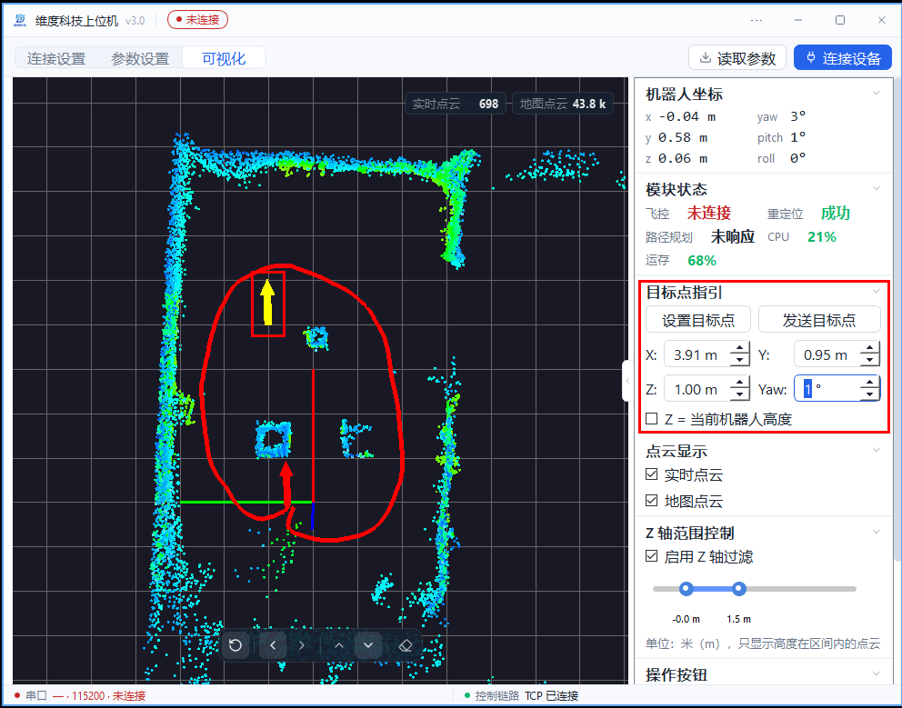
    </td>
  </tr>
</table>

规划成功及轨迹示例；规划成功不代表已到达目标

<table>
  <tr>
    <td style="border: 10px solid black; padding: 0;">
      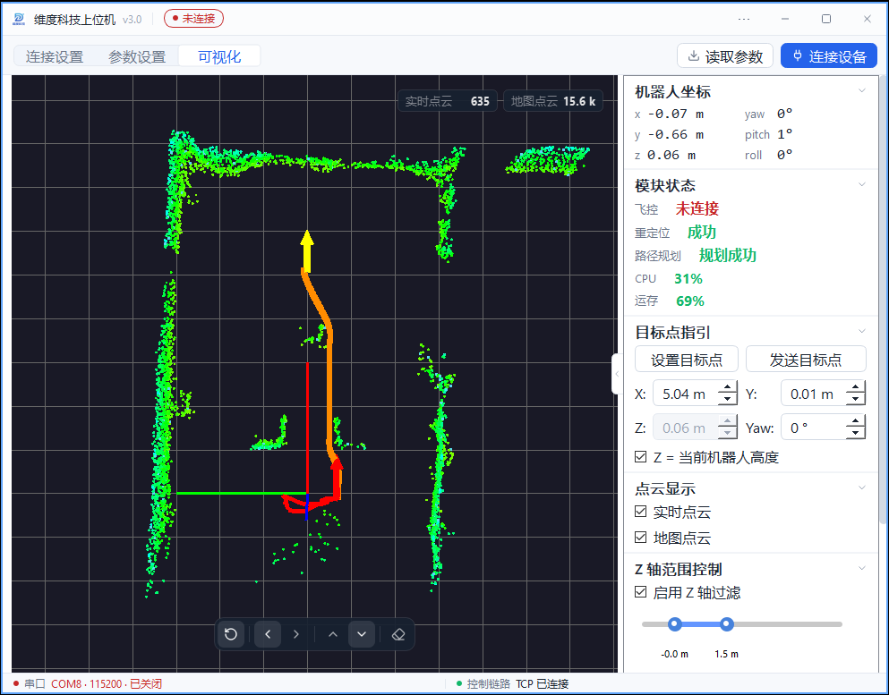
    </td>
  </tr>
</table>

### 4. 下载已保存的地图

1. 使用网络连接，在可视化页面点击 **下载地图**。下载的是模块磁盘上已保存的地图，并非当前尚未保存的扫描结果；串口不支持下载。
2. 等待接收和校验完成，在 **保存地图包**对话框选择路径并保存 ZIP。出现“地图下载成功”及保存路径后，到所选位置查看；取消保存不会生成文件。下载失败或超时时，检查连接和模块上是否已有可用地图，再重试。

参数与协议详情见[当前通信协议](https://github.com/weisama/super_mode/blob/v3.0/upper/config/通讯协议.md)。以上流程依据当前协议及上位机整理；实测范围和证据缺口见[教程实测核对记录](https://github.com/weisama/slam_mode_book/blob/4266a4ff79595940dd1130cd5c7c55f3b811dc38/教程实测核对记录.md)。

---
