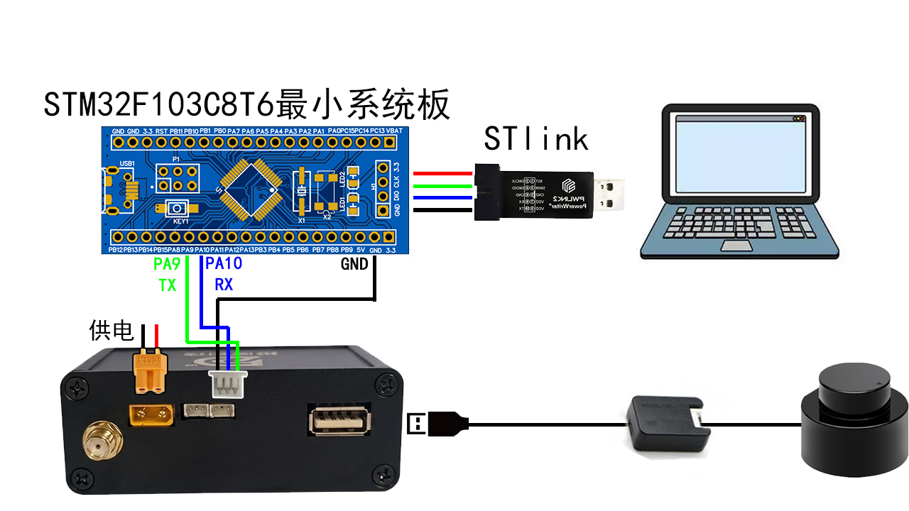
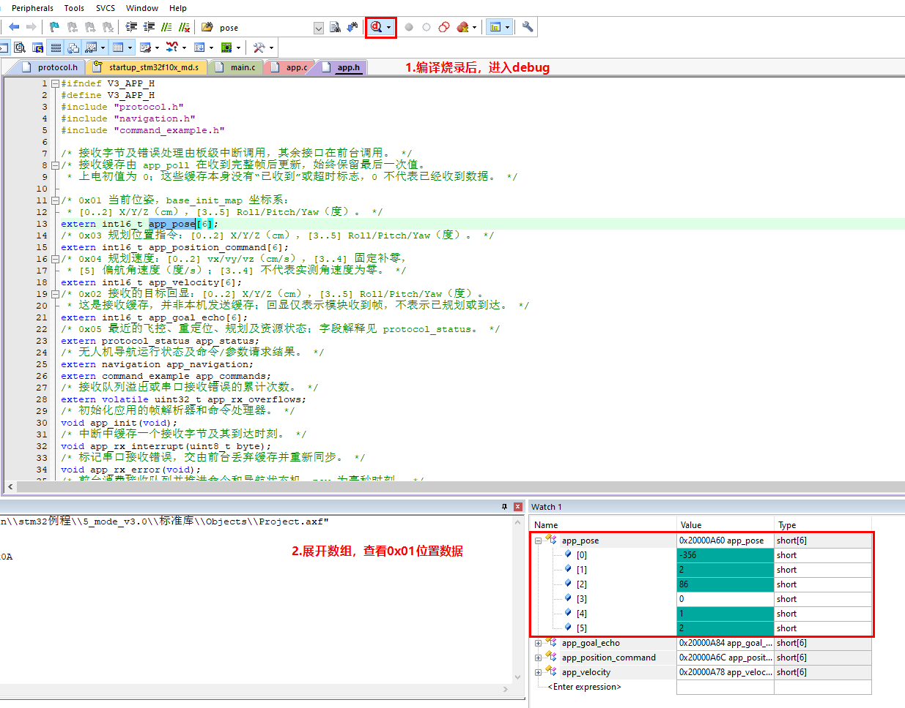
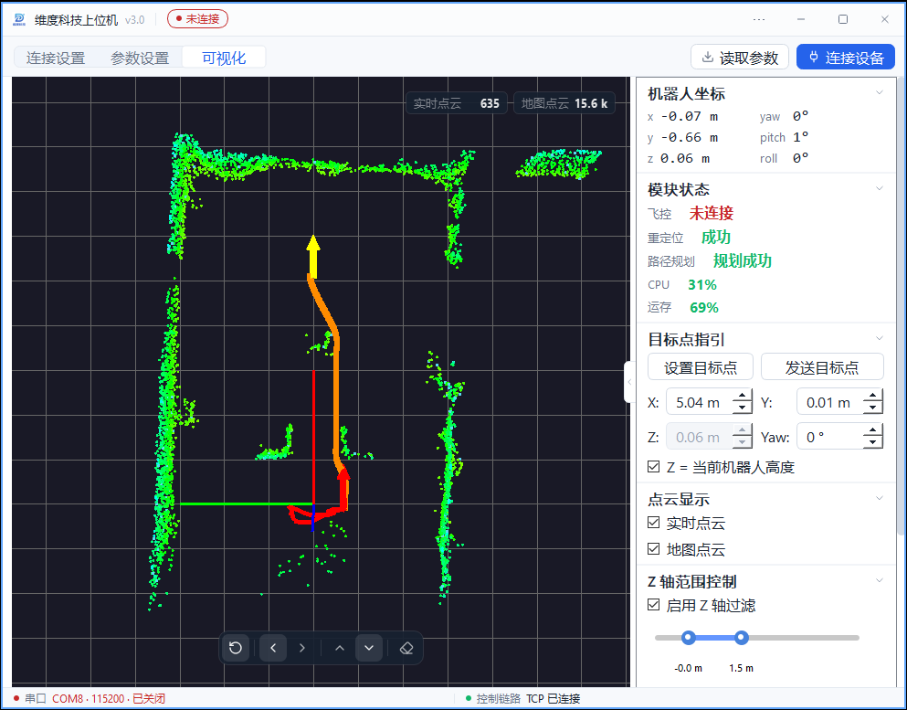

# 使用STM32和模块通信

## **1.通信协议格式**

### 1.1串口消息 ID 定义

**定位版输出ID=0x01的当前位姿数据和0x05状态，导航版还支持目标点、位置控制指令和实时速度；命令帧和参数帧见下文**

| 消息 ID | 消息类型 | 方向 | 发送频率 | 说明 |
| --- | --- | --- | --- | --- |
| **0x01** | 当前位姿数据 | 模块 → 单片机 | 10Hz | 模块输出机器人在地图中的位姿 |
| **0x02** | 导航目标点 | 单片机 → 模块 | 事件触发 | 模块接收目标点，模块收到后会**原封不动回发一次**作为应答 |
| **0x03** | 位置控制指令 | 模块 → 单片机 | 100Hz | 模块输出的规划指令,可以直接控制机器人跟随该轨迹 |
| **0x04** | 实时速度 | 模块 → 单片机 | 100Hz | 输出规划的vx、vy、vz和偏航角速率，线速度单位cm/s，偏航角速率单位度/s |
| **0x05** | 模块状态 | 模块 → 单片机 | 1Hz | 输出飞控、重定位、规划、CPU和运存状态 |
| **0x00** | 命令帧 | 双向 | 事件触发 | 通信测试、保存地图、读参数、保存参数及重启算法 |
| **0x10** | 参数帧 | 双向 | 事件触发 | 写参数、读参数应答和保存参数回显 |


### 1.2一帧数据格式如下（固定为15字节）

**波特率115200，字节格式为8N1**

| 字节序号       | 名称      | 长度     | 说明        | 单位       | 备注        |
| ---------- | ------- | ------ | --------- | -------- | --------- |
| **Byte 0** | 帧头      | 1 byte | 固定 `0xAA` | —        | 起始标志      |
| **Byte 1** | 消息 ID    | 1 byte | 0x01 / 0x02 / 0x03 | —        | 本表为位姿、目标点和位置指令格式  |
| **Byte 2** | X 高字节   | 1 byte | X 坐标高 8 位 | **cm**   | int16 高字节 |
| **Byte 3** | X 低字节   | 1 byte | X 坐标低 8 位 | **cm**   | int16 低字节 |
| **Byte 4** | Y 高字节   | 1 byte | Y 坐标高 8 位 | **cm**   | int16 高字节 |
| **Byte 5** | Y 低字节   | 1 byte | Y 坐标低 8 位 | **cm**   | int16 低字节 |
| **Byte 6** | Z 高字节   | 1 byte | Z 坐标高 8 位 | **cm**   | int16 高字节 |
| **Byte 7** | Z 低字节   | 1 byte | Z 坐标低 8 位 | **cm**   | int16 低字节 |
| **Byte 8** | roll 高字节 | 1 byte | 翻滚角高字节    | **°（度）** | int16 高字节 |
| **Byte 9** | roll 低字节 | 1 byte | 翻滚角低字节    | **°（度）** | int16 低字节 |
| **Byte 10** | pitch 高字节 | 1 byte | 俯仰角高字节    | **°（度）** | int16 高字节 |
| **Byte 11** | pitch 低字节 | 1 byte | 俯仰角低字节    | **°（度）** | int16 低字节 |
| **Byte 12** | yaw 高字节 | 1 byte | 航向角高字节    | **°（度）** | int16 高字节 |
| **Byte 13** | yaw 低字节 | 1 byte | 航向角低字节    | **°（度）** | int16 低字节 |
| **Byte 14** | 帧尾      | 1 byte | 固定 `0x0A` | —        | 结束标志      |

### 模块状态帧格式（适用于 `0x05`）

| 字节序号 | 名称 | 长度 | 说明 | 备注 |
| --- | --- | --- | --- | --- |
| **Byte 0** | 帧头 | 1 byte | 固定 `0xAA` | 起始标志 |
| **Byte 1** | 消息 ID | 1 byte | 固定 `0x05` | 状态帧标识 |
| **Byte 2** | 飞控状态枚举 | 1 byte | 详细定义见下表 | 取值范围 `0x00` ~ `0x04` |
| **Byte 3** | 重定位状态 | 1 byte | 0=进行中，1=成功，2=失败，3=未响应 | 未响应不表示正在运行或失败 |
| **Byte 4** | 路径规划状态 | 1 byte | 取值同重定位状态 |  |
| **Byte 5** | CPU占用 | 1 byte | 0~100为百分比，0xFF为未知 | 不是255% |
| **Byte 6** | 运存占用 | 1 byte | 0~100为百分比，0xFF为未知 | 不是255% |
| **Byte 7~13**| 预留字段 | 7 bytes | 补零 (`0x00`) | 保持 15 字节帧长对齐 |
| **Byte 14** | 帧尾 | 1 byte | 固定 `0x0A` | 结束标志 |

| 枚举值 | 状态名称 | 含义说明 | 底层建议处理逻辑 (STM32) |
| --- | --- | --- | --- |
| `0x00` | **未连接/通信丢失** | ROS模块与飞控断连，或底层超 2 秒未收到心跳 | 🔴 **拦截目标点发送**，触发安全保护 / 熄灭指示灯 |
| `0x01` | **未解锁 (Unarmed)** | 飞控通讯正常，在地面处于安全加锁状态 | 🔴 **拦截目标点发送**，指示灯慢闪提示 |
| `0x02` | **已解锁，地面待命** | 电机已转动，但仍未起飞离开地面 | 🔴 **拦截目标点发送**，指示灯快闪警告 |
| `0x03` | **空中悬停 (Hovering)** | 飞机已起飞，处于定点等模式等待指令 | 🟢 **允许下发目标点**，指示灯常亮 |
| `0x04` | **执行航点 (Offboard)** | 飞机在空中，正在自动飞往 Ego-Planner 目标点 | 🟢 **允许下发目标点**，指示灯常亮 |


## 2.例程stm32f103c8t6串口1连接模块

**注意需要设置参数0x12使能与主控串口通信**

<table>
  <tr>
    <td style="border: 10px solid black; padding: 0;">
      
    </td>
  </tr>
</table>

USART1接线：PA9（TX）接模块RX，PA10（RX）接模块TX，双方GND相连，串口为115200、8N1。先断电接线，并确认双方串口电平兼容，STM32为3.3V。

## [2.提供stm32f103c8t6例程（点击下载v3.0例程压缩包）](mode_v3.0_stm32f103c8t6.zip)

保留完整的5_mode_v3.0目录，HAL打开`HAL/MDK-ARM/stm32f103c8t6.uvprojx`，标准库打开`标准库/Project.uvprojx`。两个工程共用app和protocol目录，2d/3d共用，不需要分别选择雷达类型。

在所选工程的main.c中修改SELECTED_EXAMPLE：EXAMPLE_LOCALIZATION为定位接收，EXAMPLE_CAR为小车手动发点，EXAMPLE_DRONE为无人机航点。默认是EXAMPLE_CAR，开机不自动读取参数。

#### 2.1运行代码(定位版)

将SELECTED_EXAMPLE设为EXAMPLE_LOCALIZATION：

```c
#define SELECTED_EXAMPLE EXAMPLE_LOCALIZATION
```

编辑完代码，编译烧录进stm32f103c8t6，然后进入debug模式。

在窗口一展开app_pose可观察到解析出的消息0x01当前位姿数据：

<table>
  <tr>
    <td style="border: 10px solid black; padding: 0;">
      
    </td>
  </tr>
</table>

**接收到的数据xyz单位为厘米，yaw单位为度**

**建图时以机器人上电位置和朝向建立图原点系，红色坐标轴（机器人前方）为X+方向，绿色坐标轴（机器人左方）为Y+方向，蓝色坐标轴（机器人上方）为Z+方向；定位模式重定位后，机器人坐标和目标点都以保存地图的图原点系为准**

**姿态角yaw：以图原点系X+方向为0度，向右顺时针转动范围0到-180度，向左逆时针转动范围0到180度；pitch，roll同理**

#### 2.2运行代码(导航版)

通过修改SELECTED_EXAMPLE，可以选择小车手动发点：

```c
#define SELECTED_EXAMPLE EXAMPLE_CAR
```

可自行设置目标点，六个值依次为x、y、z、roll、pitch、yaw，单位为cm和度：

```c
static const int16_t goal[6] = {200, 0, 100, 0, 0, 0};
```

在主循环的按键或其他明确操作入口调用`app_send_goal(goal, board_now_ms())`发送目标点，调用间隔至少1000ms；返回1表示本机已发送，返回0表示发送受限。不要直接放进循环中反复发送。

先按[快速入门](1.快速入门.md#4上位机测试路径规划功能导航版)完成建图、保存地图、切换定位和启用导航，等待重定位成功后再发点。首次测试应断开电机供电，先查看规划结果。

在场地内放置三个障碍物，坐标分别为(1,0)、(2,1)、(1,2)：

<table>
  <tr>
    <td style="border: 10px solid black; padding: 0;">
      
    </td>
  </tr>
</table>

模块连接雷达并上电，环绕一圈扫描整个场地，保存地图后切换定位、启用导航并重启，等待重定位成功：

<table>
  <tr>
    <td style="border: 10px solid black; padding: 0;">
      
    </td>
  </tr>
</table>

编辑完代码，编译烧录进stm32f103c8t6，然后进入debug模式

可以看见收到了：0x01当前位姿约10hz，0x02在发送目标后回显，0x03位置控制指令和0x04实时速度在规划输出时约100hz，0x05状态约1hz；分别查看app_pose、app_goal_echo、app_position_command、app_velocity和app_status


打开上位机，发送目标点后可以看见模块规划出前往目标点的路径

<table>
  <tr>
    <td style="border: 10px solid black; padding: 0;">
      
    </td>
  </tr>
</table>
目标回显只表示模块收到帧，不代表规划成功或已经到达；需要结合规划状态、轨迹和设备实际位置判断。接收变量会保留最后一次的值，上电初值0不代表已经收到数据。无人机航点示例见[飞控使用模块](3.PX4或APM飞控使用模块.md#22单片机控制无人机固定路线巡航例程)。

命令和参数操作入口见[工程说明](资料/STM32工程说明.md)及[协议示例](资料/串口开发说明.md)。
