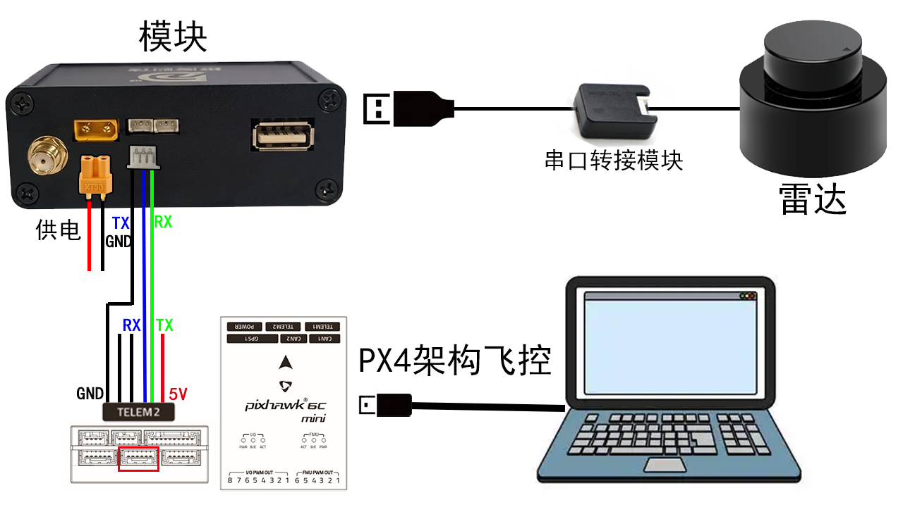
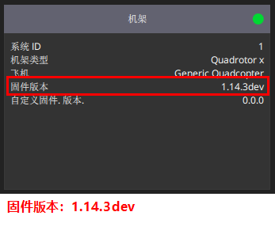
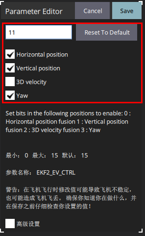

# PX4或APM飞控使用模块

## PX4 或 APM 飞控使用模块

### 1. PX4 1.14.3 连接与参数

准备已完成基本配置的无人机、QGroundControl（QGC）和模块。下面以 PX4 1.14.3、模块连接 TELEM1 为例；其他飞控的接口定义和占用情况须按实际设备核对。

1. 断电后，将飞控 **TELEM1** 连接模块的**飞控输出**接口，核对两端接口引脚，TX 接对方 RX、RX 接对方 TX、GND 共地；供电按设备要求连接，勿凭接口外形判断线序。现场用户确认的连接是 TELEM1 → 模块飞控输出，电脑通过飞控 USB 连接 QGC。现场飞控型号及模块在线配置仍需核对。
2. 按[快速入门](1.快速入门.md#快速入门连接模块和使用上位机)连接上位机，读取模块参数，设置 `0x11=1` 使能飞控通信，保存、重启并读回。核对模块类型、雷达型号和安装位姿与实际设备一致。
3. 用 QGC 连接飞控，确认固件为 PX4 1.14.3，检查 TELEM1 未与其他外设冲突。在参数页面设置下表的接口和外部位姿融合项；若使用其他接口或 MAVLink 实例，按实际映射调整，不能直接照搬实例号。

> 下图展示的是 TELEM2 接线示例。本节使用 TELEM1；仅参考 TX/RX 与共地关系，接口、引脚及供电以实际设备和正文为准。

飞控接线示例：图中接口为 TELEM2。

<table>
  <tr>
    <td style="border: 10px solid black; padding: 0;">
      
    </td>
  </tr>
</table>

| 参数 | TELEM1 示例及说明 |
| --- | --- |
| `MAV_0_CONFIG` | `101`（TELEM1），将 MAVLink 实例 0 指向模块接口。 |
| `MAV_0_MODE` | `2`（Onboard）。 |
| `SER_TEL1_BAUD` | `500000`；模块侧配置也须匹配。 |
| `EKF2_EV_CTRL` | 2D 示例 `9`：融合外部水平位置和偏航；3D 示例 `11`：额外融合外部垂直位置。 |
| `EKF2_HGT_REF` | 2D 按实际定高传感器选择；现场测距方案为 `2`（Range sensor）。3D 以模块高度为参考时为 `3`（Vision）。 |
| `EKF2_RNG_CTRL` | 2D 使用测距时按传感器与场地配置；现场为 `2`（连续融合），需确认地面条件和测距有效范围。3D 不使用测距时方案值为 `0`。 |
| `EKF2_EV_DELAY`、噪声和安装位置 | 按实际链路延迟、观测质量及安装测量配置，并通过日志核验；现场值不是通用值。 |

2D 模块的高度来自飞控，**需要额外定高传感器**，不能把模块返回的 Z 再作为独立外部高度融合。现场使用 N10P 和连接 TELEM2 的 MT-06；该传感器的供电、协议、接口及融合须单独检查。3D 模块的高度来自 3D 定位，可作为外部高度观测；两种方案均需检查高度方向、原点和持续有效性。

以上接口值参考[现场参数记录](https://github.com/weisama/super_mode/blob/v3.0/stm32例程/5_mode_v3.0/飞控参数/README.md)：2026-11-03 15:33 的 3D 快照读到 `EKF2_EV_CTRL=11`、`EKF2_HGT_REF=3`；[20:06 的 2D 快照](https://github.com/weisama/super_mode/blob/v3.0/docs/v3-user-manual/飞控现场记录-2026-11-03.md)读到 `9`、`2`、`EKF2_RNG_CTRL=2`。后者的 TELEM2 设置为 `MAV_1_CONFIG=102`、`MAV_1_MODE=0`、`SER_TEL2_BAUD=115200`。这些只是该机读值；3D 表中测距关闭是待验证方案，整机快照包含校准、机型和遥控配置，不要当作通用模板导入其他飞机。

4. 保存参数并按 QGC 提示重启飞控，再读回核对。确认模块已上电并完成初始化，在 QGC 的 MAVLink Inspector 查看外部位姿相关消息及变化；移动、转向模块，检查飞控本地位置、偏航和高度方向及原点，并确认估计器实际融合。2D 还要检查测距连续变化、实际距离与高度融合及遮挡或断开后的响应；3D 检查模块 Z 与飞控融合。收到消息不等于融合成功。

固件信息显示 1.14.3dev，与正式版 1.14.3 的关系待确认

<table>
  <tr>
    <td style="border: 10px solid black; padding: 0;">
      
    </td>
  </tr>
</table>

EKF2_EV_CTRL 值为 11 的设置示例，按实际固件与配置核对

<table>
  <tr>
    <td style="border: 10px solid black; padding: 0;">
      
    </td>
  </tr>
</table>

### 2. APM 接入

APM 按[旧教程的 APM 部分](https://github.com/weisama/slam_mode_book/blob/mode_v2.0/3.PX4或APM飞控使用模块.md#若机器人主控使用apm架构飞控设置参数如下可以进入loiter模式)配置，以下保留其参数作为入口。接口和参数名称须与实际 APM 固件和接线核对。

| 参数名称              | 设置值         | 说明                          |
| ----------------- | ----------- | --------------------------- |
| SERIAL2\_PROTOCOL | MAVLink2    | 将串口 2 协议设置为 MAVLink 2       |
| SERIAL2\_BAUD     | 500000      | 串口 2 波特率设置为 500000 bps      |
| BRD\_SER2\_RTSCTS | Disable     | 禁用串口 2 的硬件流控（RTS/CTS）       |
| AHRS\_EKF\_TYPE   | Enable EKF3 | 启用 EKF3 作为姿态估计器             |
| EK3\_SRC1\_POSXY  | ExternalNav | EKF3 主数据源：XY 平面位置使用外部导航数据   |
| EK3\_SRC1\_POSZ | 按实际高度来源设置 | 3D 使用外部高度；2D 根据额外定高传感器选择，具体枚举按固件确认 |
| EK3\_SRC1\_VELXY  | None | EKF3 主数据源：XY 平面速度无输入   |
| EK3\_SRC1\_YAW    | ExternalNav | EKF3 主数据源：航向角使用外部导航数据       |
| VISO\_TYPE        | MAVLink     | 视觉里程计类型设置为 MAVLink 协议       |

APM 接线和参数需按实际设备检查；2D 同样需要独立且有效的高度来源。先确认位置、高度和姿态融合，再验证 Loiter。

### 3. 定点、规划与飞行测试

1. 拆桨检查接线、传感器、外部位姿和估计器；按机体配置并验证遥控接管、紧急开关和失联动作。先确认飞控独立定点能力，再在合适场地验证模块定位下的定点，飞手保持接管能力。
2. 按[地图与导航](1.快速入门.md#地图定位与导航)完成建图、定位、导航使能和目标点测试，先观察规划结果。目标回显只表示收到目标，不代表规划成功或到达。
3. 如使用 STM32 航点，按[无人机航点示例](2.使用STM32和模块通信.md#5-无人机航点示例)配置并测试；操作人员负责解锁、起飞和降落。检查 Offboard 控制链及中断行为后，再逐步进行飞行测试。

[现场记录](https://github.com/weisama/super_mode/blob/v3.0/docs/v3-user-manual/飞控现场记录-2026-11-03.md)：2026-11-03 参数已读取；20:06 后约 12 秒监听未收到 `DISTANCE_SENSOR`，无法据此判断传感器是否工作或融合。用户于 2026-11-05 确认本轮 2D、3D 航点实飞通过，见[联调记录](https://github.com/weisama/super_mode/blob/v3.0/stm32例程/5_mode_v3.0/联调记录.md)；未提供飞行日志、最终参数及异常场景测试结果。参数快照或编译结果不能单独证明飞行通过。

---
