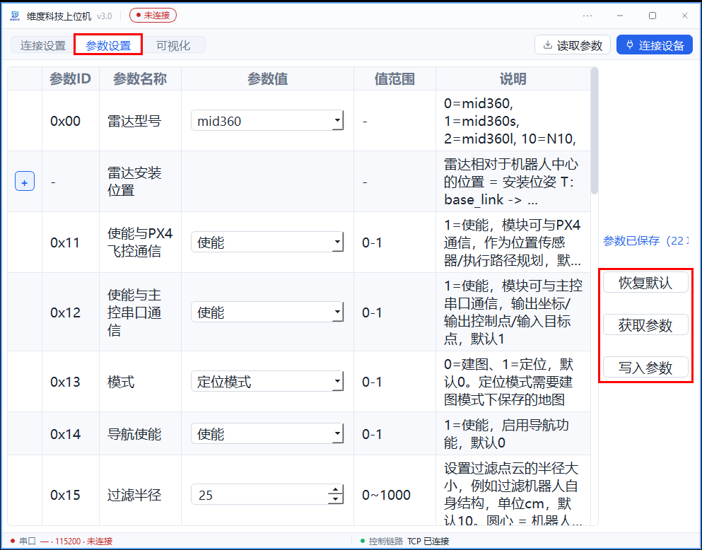
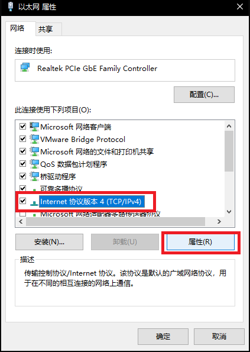
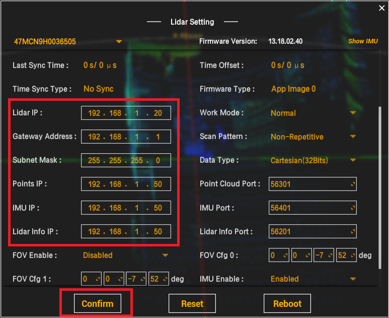
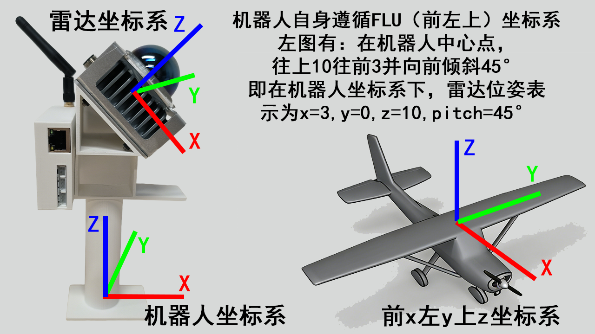
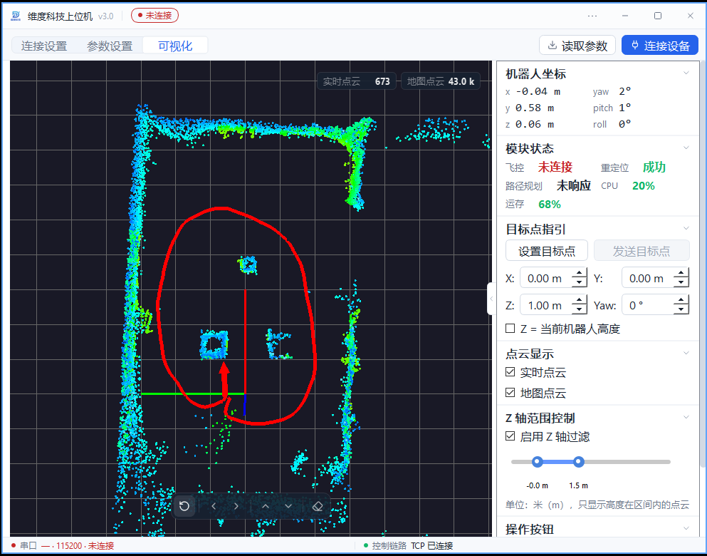

## 1.参数设置

首次使用需要设置雷达型号参数，模块上电连接上位机后，可以进入参数设置界面

⚠️参数设置后需要[写入参数]，写入并等待保存和回读比对结果，需要重启生效的设置重启后再[获取参数]查看是否修改成功

<table>
  <tr>
    <td style="border: 10px solid black; padding: 0;">
      
    </td>
  </tr>
</table>

| 参数 ID | 名称 | 范围和用途 |
| --- | --- | --- |
| `0x00` | 雷达型号 | 0=MID360、1=MID360s、2=MID360l、10=N10、11=N10_P；12/13 为占位。默认 0。 |
| `0x01`–`0x03` | 安装位置 X/Y/Z | -100～100 cm，默认 0；相对机器人中心。 |
| `0x04`–`0x06` | 安装角 Roll/Pitch/Yaw | -180～180°，默认 0；相对机器人坐标系。 |
| `0x11`、`0x12` | 飞控通信、主控通信 | 0 关闭、1 使能，默认 1。 |
| `0x13` | 模式 | 0 建图、1 定位，默认 0；定位需要已保存地图。 |
| `0x14` | 导航使能 | 0 关闭、1 开启，默认 0。导航版开启后运行时强制定位。 |
| `0x15` | 过滤半径 | 0～1000 cm，默认 10；3D 按机器人中心过滤，2D 用于扫描匹配的最小距离，见第 4 节。 |
| `0x21` | 最大移动速度 | 0～1000 cm/s，默认 100。 |
| `0x22` | 最大加速度 | 0～1000 cm/s²，默认 100。 |
| `0x23` | 起飞高度 | 0～1000 cm，默认 100；2D 串口目标 Z 使用此高度。 |
| `0x24` | 障碍膨胀半径 | 0～1000 cm，默认 10；协议名称为机器人半径，建议参考机器人半径加 10 cm 并按场地核对。 |
| `0x25` | 规划模式 | 0 平面、1 三维自由空间、2 三维贴地；默认 0，2D 导航版仅支持 0。 |
| `0x26` | 小车运动学模型 | 0 全向、1 差速，默认 0；仅规划模式 0 生效。 |
| `0x27` | 目标点容差 | 0～1000 cm，默认 15；小车模型判定到点的距离。 |
| `0x28` | 最大偏航角速率 | 0～1000 度/s，默认 43；用于小车模型。 |
| `0x29` | 最小转弯半径 | 0～1000 cm，默认 100；全向模型不生效。 |
| `0x99` | 模块类型 | 0  3D定位、1  3D导航、2  2D定位、3  2D导航；按实际设备核对。 |

具体说明及适用范围见[当前通信协议](https://github.com/weisama/super_mode/blob/v3.0/upper/config/通讯协议.md#参数id定义表)。旧版参数编号与 v3.0 不完全相同，不要按旧参数表写入。

## 2.设置览沃MID360雷达的IP

准备一台有网口的windows电脑，使用系统搜索找到网络连接

<table>
  <tr>
    <td style="border: 10px solid black; padding: 0;">
      
    </td>
  </tr>
</table>

找到以太网，右键属性

<table>
  <tr>
    <td style="border: 10px solid black; padding: 0;">
      
    </td>
  </tr>
</table>

修改IPv4协议属性

<table>
  <tr>
    <td style="border: 10px solid black; padding: 0;">
      
    </td>
  </tr>
</table>

电脑 IPv4 地址设为与雷达同网段且不冲突的地址，例如 `192.168.1.51`、掩码 `255.255.255.0`；记录原设置以便恢复。

览沃官网下载上位机

[下载连接](https://www.livoxtech.com/cn/downloads)

<table>
  <tr>
    <td style="border: 10px solid black; padding: 0;">
      
    </td>
  </tr>
</table>

雷达上电后网线连接电脑，打开览沃上位机，可以看到雷达点云，左上角点击设置

<table>
  <tr>
    <td style="border: 10px solid black; padding: 0;">
      
    </td>
  </tr>
</table>

设置雷达IP如图，点击确认，重新上电后再次核对。当前 MID360 配置中雷达地址为 `192.168.1.20`，模块接收地址为 `192.168.1.50`；其他设备以实际配置为准。

<table>
  <tr>
    <td style="border: 10px solid black; padding: 0;">
      
    </td>
  </tr>
</table>

## 3.非水平摆放雷达

3d模块可以适配任意位姿摆放的雷达，正确设置参数，可以使得得出的坐标为机器人自身坐标，而非仅仅只能得到雷达自身坐标。

例如：1️⃣为了感知前方障碍物，雷达向前倾斜以扫到前方环境；2️⃣室外无高大参照物，雷达倒装在无人机底部用地面建图定位。

### 3.1在机器人坐标系下得到位姿

机器人自身坐标系用FLU（front-left-up）即前左上坐标系描述，如图所示：无人机前为x，左为y，上为z。

坐标系的表示除了xyz位置，还有yaw/pitch/roll三个欧拉角：

| 角度 | 英文名 | 旋转轴 | 描述 |
|------|--------|--------|------|
| **偏航角** | Yaw  | Z轴 | 绕垂直轴左右转向（如机器人原地自转） |
| **俯仰角** | Pitch | Y轴 | 绕横向轴上下俯仰（如机器人抬头/低头） |
| **横滚角** | Roll | X轴 | 绕纵向轴左右翻滚（如机器人左右倾斜） |

<table>
  <tr>
    <td style="border: 10px solid black; padding: 0;">
      
    </td>
  </tr>
</table>

举例：如左图，定义雷达手持支架与桌面的接触点中心为原点，建立FLU机器人坐标系。

在机器人坐标系下，雷达位置可以表述为：**x=3，y=0，z=10，yaw=0，pitch=45，roll=0**

### 3.2正确设置模块参数

连接上位机后进入到参数设置界面，将机器人坐标系下雷达坐标的参数填入，点击写入参数，确认保存和回读比对结果，需要重启生效的设置重启后再次读取

<table>
  <tr>
    <td style="border: 10px solid black; padding: 0;">
      
    </td>
  </tr>
</table>

重启后，相较于默认全为0的参数，模块输出的坐标参考系变为机器人坐标系，而非默认的雷达坐标系

## 4.可视化界面过滤点云

上位机的可视化界面设置了z轴过滤，可以过滤掉z轴上非设定范围的点云，使环境结构更清晰。

如图，通过设置z轴上下限，过滤掉房间天花板和地板，只剩下物品和房间墙壁：

<table>
  <tr>
    <td style="border: 10px solid black; padding: 0;">
      
    </td>
  </tr>
</table>

该过滤只影响上位机显示，不改变模块收到的点云或规划障碍物；模块过滤半径参数 `0x15` 与此不同。
