# v3.0 使用手册

本手册介绍模块的连接、建图、定位、导航及飞控使用。设备接口、软件版本和参数应以实际配置为准。

- [快速入门](#快速入门连接模块和使用上位机)
- [地图、定位与导航](#地图定位与导航)
- [串口读取与 STM32 示例](#串口读取与-stm32-示例)
- [PX4 或 APM 飞控使用模块](#px4-或-apm-飞控使用模块)
- [进阶使用](#进阶使用)
- [常见问题与免责声明](#常见问题与免责声明)

---

## 快速入门：连接模块和使用上位机

### 1. 准备和接线

印有logo为模块顶面，侧面USB/网口用于连接雷达，MX1.25端子用于串口输出/连接飞控，TX30用于连接5V-26V电源；接口及供电规格以实际设备为准。

1. 准备模块、配套雷达、电源、电脑及对应版本上位机。MID360/MID360S 使用前需按设备配置设置雷达 IP；安装姿态等参数也需与实际安装一致。
2. 断电连接雷达与模块对应的 USB 或网口，按设备接口标识连接电源。旧设备使用 TX30 电源口，直流 5–26 V，开机电流需求约 2.5 A；接电前请确认本机接口和供电规格。
3. 需要串口连接时，使用电平兼容的 USB 转串口模块：模块 TX 接转接器 RX，模块 RX 接转接器 TX，双方 GND 相连。串口为 115200、8N1；模块与转接器分别使用合适电源。
4. 确认接线后给模块上电，等待初始化。旧教程约需 15 秒，实际等待时间以设备为准。

模块接口和 N10 雷达连接示例

<table>
  <tr>
    <td style="border: 10px solid black; padding: 0;">
      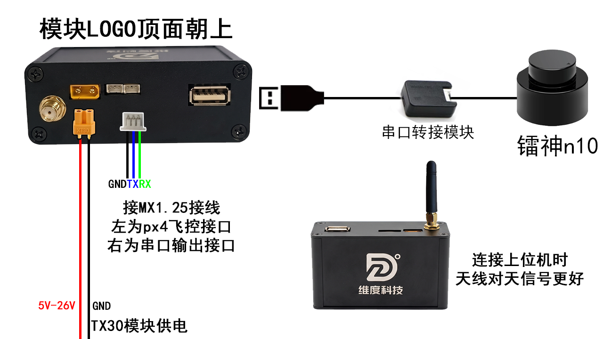
    </td>
  </tr>
</table>

上图为 N10 雷达和 TX30 供电的接线示例；其他雷达及设备按实际接口连接。串口接线时，模块 TX 接对方 RX、模块 RX 接对方 TX，双方 GND 相连。

MID360 网口和模块接口示例，实际接线及供电按设备核对

<table>
  <tr>
    <td style="border: 10px solid black; padding: 0;">
      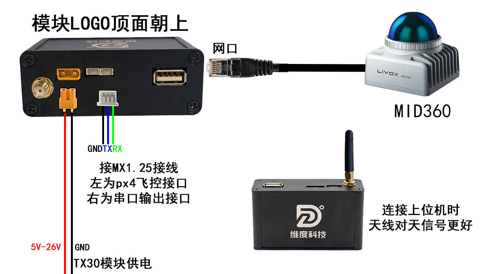
    </td>
  </tr>
</table>

模块与 USB 转串口接线示例。请确认转接器电平与模块兼容。

<table>
  <tr>
    <td style="border: 10px solid black; padding: 0;">
      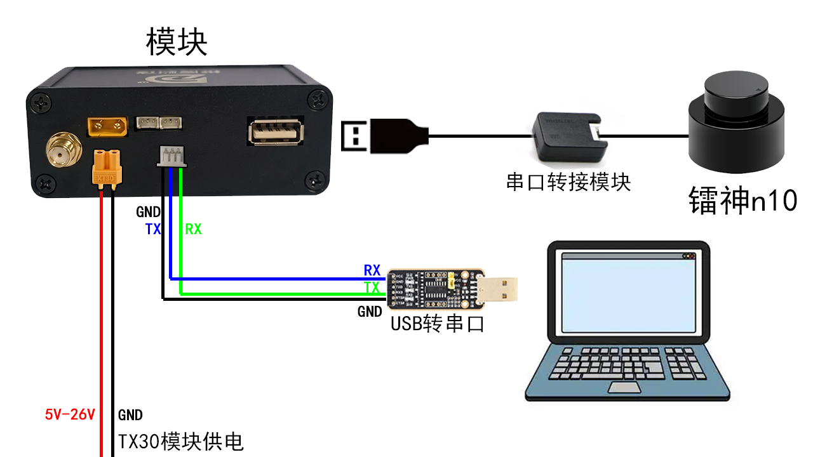
    </td>
  </tr>
</table>

### 2. 连接上位机

下载[对应版本的上位机](https://github.com/kikiYang03/SerialPortAssistant3D/releases)，选择与模块匹配的版本，如图：

<table>
  <tr>
    <td style="border: 10px solid black; padding: 0;">
      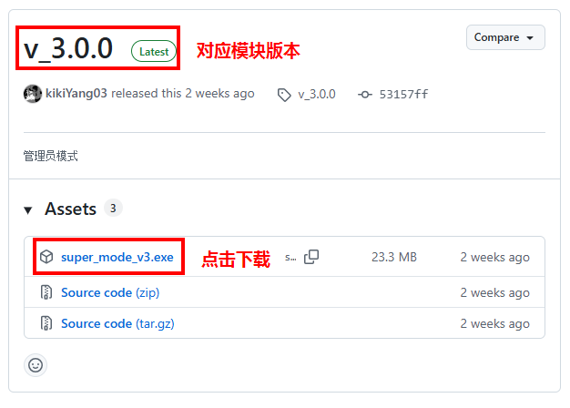
    </td>
  </tr>
</table>

#### 2.1 网络连接

1. 在电脑连接模块热点。旧设备热点密码为 `12345678`，热点名称和密码以本机配置为准。
2. 启动[对应版本的上位机](https://github.com/kikiYang03/SerialPortAssistant3D/releases)，进入连接界面，使用 TCP，填写模块实际 IP 和端口。模块默认监听端口为 `6666`；`0.0.0.0` 是模块监听地址，不能作为电脑连接目标。上位机显示的默认地址可能不是本机模块地址，按实际配置核对。若地址或端口不可编辑，使用软件中的 **管理员登录/退出** 登录后修改；若没有管理员入口或凭据，请向设备提供方确认配置。
3. 点击 **打开连接**，查看连接状态及接收数据。连接不上时检查热点、模块地址、端口和供电。

电脑连接模块热点示例；热点名称以实际设备为准。

<table>
  <tr>
    <td style="border: 10px solid black; padding: 0;">
      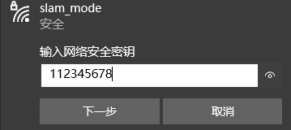
    </td>
  </tr>
</table>

网络区域显示 TCP 已连接及通信测试成功，地址为示例；顶部状态显示未连接，待核对

<table>
  <tr>
    <td style="border: 10px solid black; padding: 0;">
      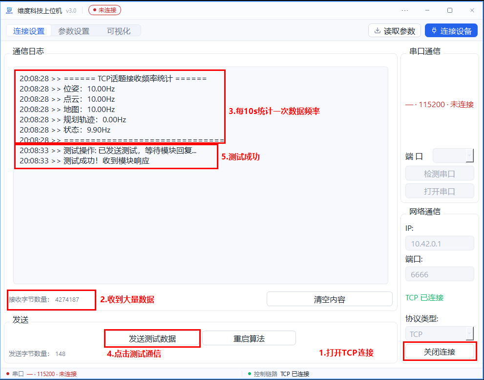
    </td>
  </tr>
</table>

#### 2.2 串口连接

1. 按 1.3 接好 USB 转串口，启动上位机，在串口通信区域点击 **检测串口**，选择对应端口。上位机固定使用 115200、8N1，无需选择波特率。
2. 点击 **打开串口**，查看串口状态和接收区的位姿数据。串口直连不需要连接热点。
3. 切换到网络前先关闭串口；切换到串口前先关闭网络连接。

串口与网络均可进行通信测试、保存地图、获取和写入参数以及重启算法。地图和点云可视化、下载地图使用网络连接；串口不支持地图下载。串口数据格式及主控接入见[当前通信协议](https://github.com/weisama/super_mode/blob/v3.0/upper/config/通讯协议.md)和 [STM32 v3.0 说明](https://github.com/weisama/super_mode/blob/v3.0/stm32例程/5_mode_v3.0/README.md)。

串口连接及位姿接收，COM 端口以实际设备为准

<table>
  <tr>
    <td style="border: 10px solid black; padding: 0;">
      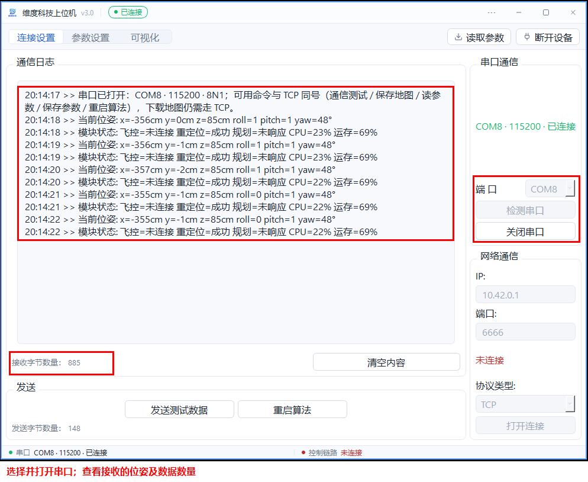
    </td>
  </tr>
</table>

### 3. 测试通信和设置参数

1. 连接后点击 **发送测试数据**。接收区出现“测试成功！收到模块响应”表示通信测试收到回包；若超时，检查连接、供电和接线后重试。
2. 进入参数界面，点击 **获取参数**，等待参数收齐，再检查模块类型、雷达型号及安装参数是否与设备一致。未收齐或超时时先检查链路。
3. 修改需要的参数，点击 **写入参数**，等待保存和回读比对结果。出现不一致或超时，应检查提示并重新读取确认，不要当作写入成功。
4. 修改需要重启生效的配置后，点击 **重启算法**，等待模块重新启动并重新连接；再点击 **获取参数**，确认改动已读回。重启回显只表示模块收到请求，不表示算法已经重新启动完成。

常用模式参数：`0x13` 模式，0 为建图、1 为定位；`0x14` 导航使能，0 为关闭、1 为开启；`0x15` 为模块点云过滤半径，单位 cm。导航版启用导航会强制使用定位模式：建图存图前先关闭导航。参数的完整含义、取值及其他配置见[当前通信协议](https://github.com/weisama/super_mode/blob/v3.0/upper/config/通讯协议.md)。

参数界面、模式与导航使能示例；右侧保存提示未完整显示

<table>
  <tr>
    <td style="border: 10px solid black; padding: 0;">
      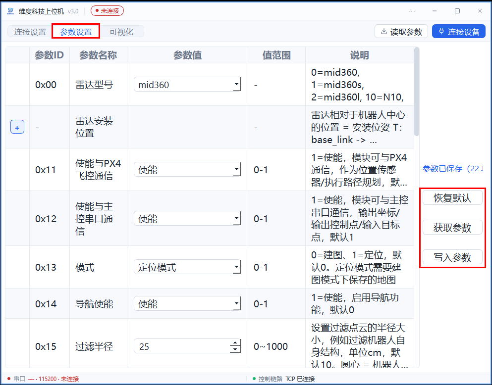
    </td>
  </tr>
</table>

### 4. 查看可视化和模块状态

1. 通过网络连接模块，进入可视化页面，查看 **机器人坐标**、实时点云及地图。可用左键旋转、右键平移、滚轮缩放视角；按需勾选 **实时点云**、**地图点云**。
2. 查看 **模块状态**中的飞控、重定位、路径规划、CPU 和运存。重定位与规划状态分别为进行中、成功、失败、未响应；未响应表示尚未收到对应状态，不等于正在进行或失败。`—` 表示没有可用读数，不是 0%。飞控未连接时显示未连接属于正常现象。
3. 建图时的图原点是建图那次开机时机器人中心的位置。定位模式重定位后，机器人坐标和目标点按图原点系解释；**开机点**显示本次开机位置在图中的位置，两者不一定相同。
4. 如需建图或导航，先关闭导航并建图、保存地图，再切换定位及启用导航、重启并等待重定位成功。地图保存需收到成功结果；未收到回显可能是保存失败、定位模式拒绝或通信问题。目标回显只表示收到目标，不代表规划成功或已到达。

点云、机器人坐标和模块状态；重定位成功，路径规划未响应

<table>
  <tr>
    <td style="border: 10px solid black; padding: 0;">
      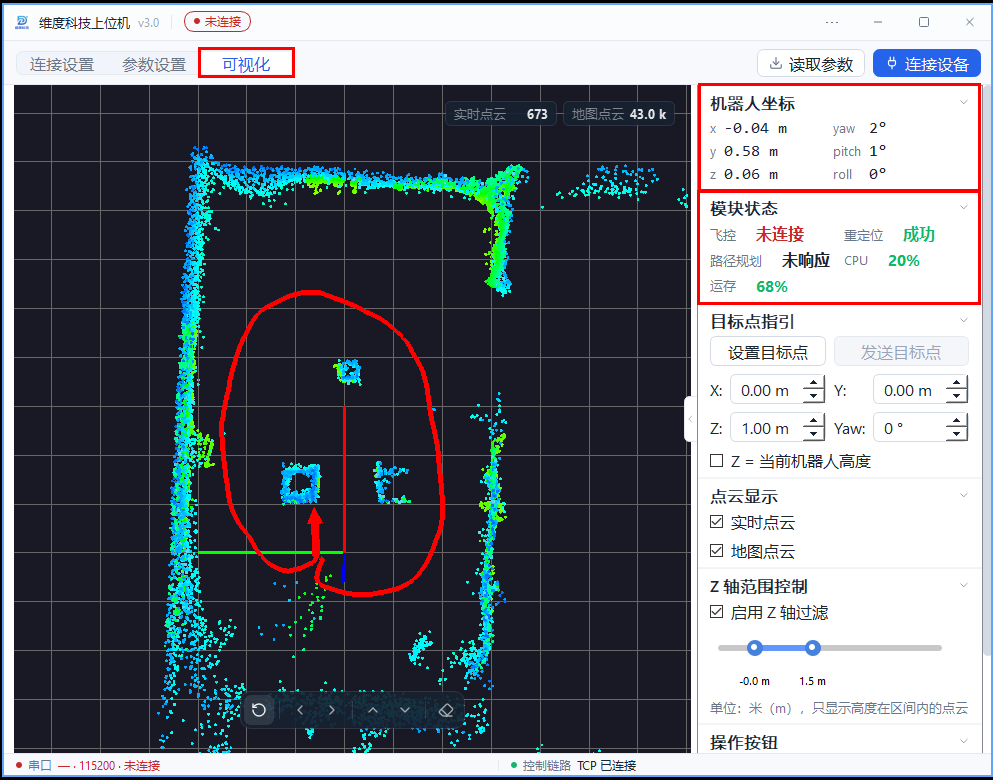
    </td>
  </tr>
</table>

---

## 地图、定位与导航

开始前按[快速入门](#快速入门连接模块和使用上位机)连接模块和上位机，确认雷达及安装参数正确。查看地图、轨迹和下载地图需要网络连接；导航步骤适用于导航版模块。

### 1. 建图并保存

1. 在参数界面点击 **获取参数**，将 `0x13` 模式设为 `0`（建图），`0x14` 导航使能设为 `0`（关闭）。点击 **写入参数**，确认保存和回读比对成功，再点击 **重启算法**，等待重启并重新连接。
2. 进入可视化页面，缓慢移动设备扫描需要使用的区域，查看实时点云和地图是否覆盖场地。
3. 在 **操作按钮**中点击 **保存地图**，等待“保存地图成功”提示。模块核对保存产物后才回显成功；超时或未收到回显可能是保存失败、处于定位模式被拒绝或通信问题，检查后重试。保存地图也可通过串口操作。

新版地图画面；截图显示重定位成功，不能作为建图过程的证明

<table>
  <tr>
    <td style="border: 10px solid black; padding: 0;">
      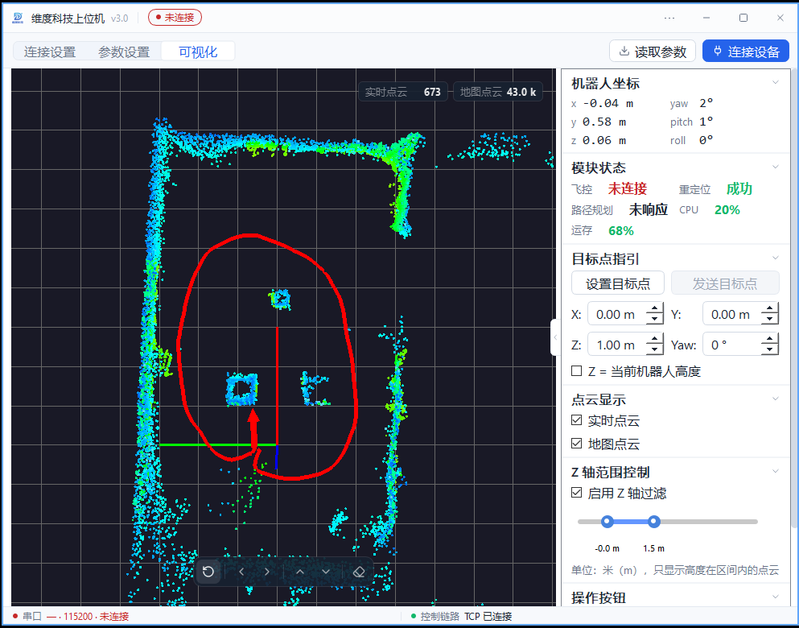
    </td>
  </tr>
</table>

保存地图和下载地图按钮；未展示保存成功

<table>
  <tr>
    <td style="border: 10px solid black; padding: 0;">
      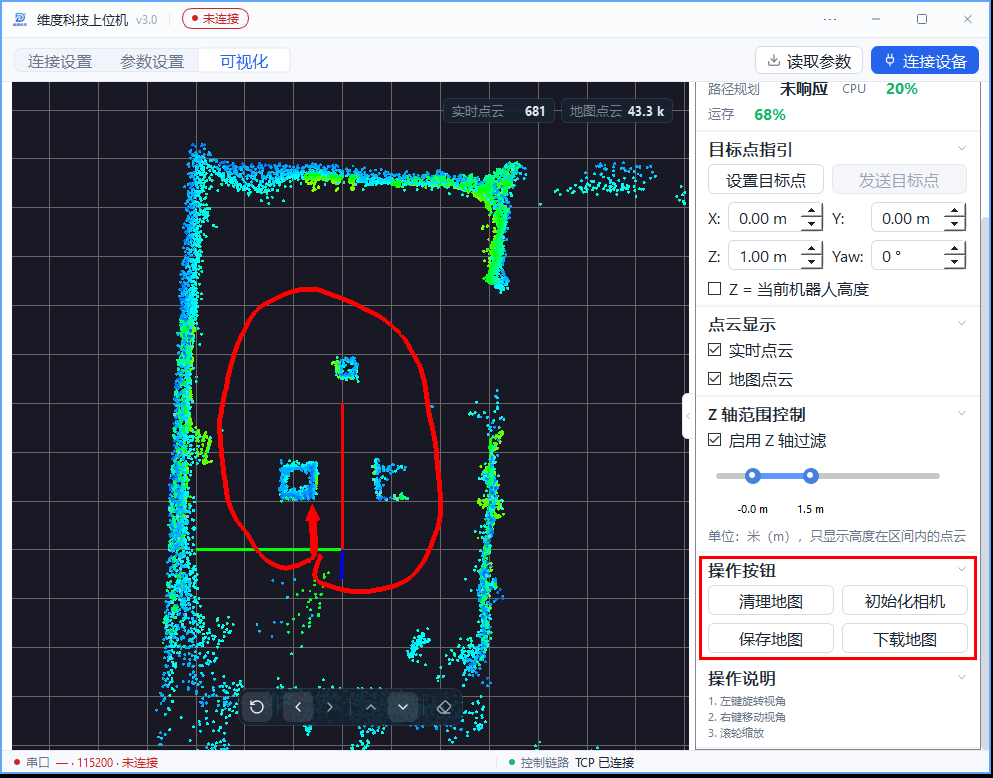
    </td>
  </tr>
</table>

### 2. 切换定位并启用导航

1. 确认地图已保存。在参数界面获取参数，将 `0x13` 设为 `1`（定位）；需要导航时将 `0x14` 设为 `1`（开启）。2D 导航版的 `0x25` 规划模式只支持 `0`（2D 平面路径规划）；其他导航版按设备和使用场景选择规划模式。
2. 点击 **写入参数**，确认保存和回读比对成功，再点击 **重启算法**。等待模块重新启动并重新连接；重启指令的回显只表示请求已收到。
3. 查看可视化页面的 **模块状态**，等待 **重定位**显示成功，再设置目标。进行中表示尚在处理，失败表示本次未成功，未响应表示尚未收到对应状态。失败或持续未响应时，先检查地图、雷达、设备位置及连接，再重试。

导航版启用导航后，运行时会强制使用定位模式，即使 `0x13` 回读仍为 `0`，也不能在该状态保存地图。需要重新建图时，关闭导航、将 `0x13` 设为 `0`，写入并重启后再保存。

图原点是建图那次开机时机器人中心的位置；重定位后，机器人坐标和目标点都按图原点系解释。**开机点**是本次开机位置在图中的位置，不一定与图原点重合。

### 3. 设置目标并查看结果

1. 重定位成功后，在可视化页面展开 **目标点指引**，点击 **设置目标点**，在地图内按住鼠标左键拖动生成目标箭头，再点击 **退出指点模式**确认目标；也可调整 X、Y、Z 和 Yaw。坐标单位为米，Yaw 为度，箭头方向表示目标朝向。按需要选择 **Z = 当前机器人高度**。
2. 确认目标位置和朝向后点击 **发送目标点**，查看 **模块状态**中的路径规划状态和地图上的轨迹。规划成功、失败、进行中和未响应分别表示不同结果；若失败，检查目标、障碍物和规划参数后重新设置。
3. 规划出轨迹不等于设备已到达目标，应结合设备实际运动和位置确认到达。通过串口发送目标时，目标回显只表示模块收到目标，也不表示规划成功或到达。

2D 导航版使用平面规划。串口目标的 Z 会被替换为配置的起飞高度；网络目标在规划时若与起点不在同一高度层，会被调整到起点所在层。因此不要把界面输入的 Z 当作该模式的最终规划高度。

目标箭头与坐标设置；路径规划未响应，未显示规划轨迹

<table>
  <tr>
    <td style="border: 10px solid black; padding: 0;">
      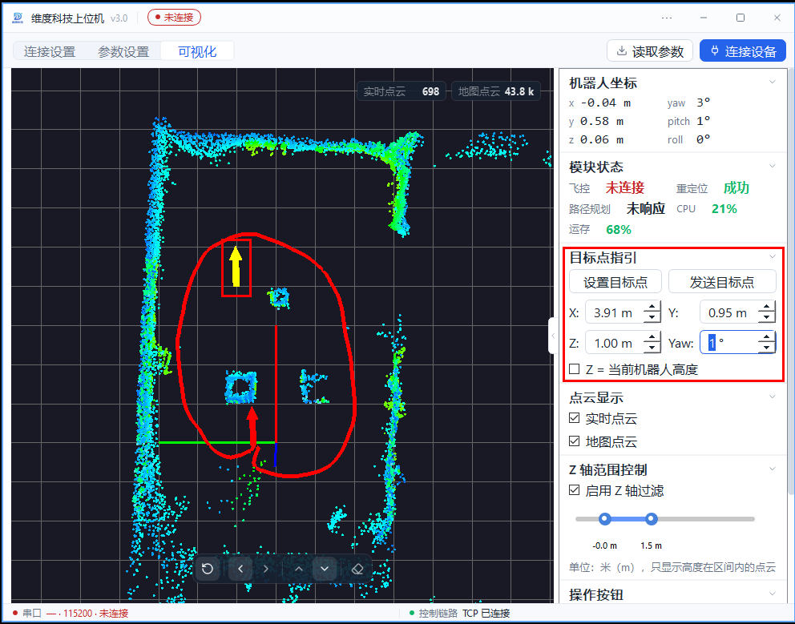
    </td>
  </tr>
</table>

规划成功及轨迹示例；规划成功不代表已到达目标

<table>
  <tr>
    <td style="border: 10px solid black; padding: 0;">
      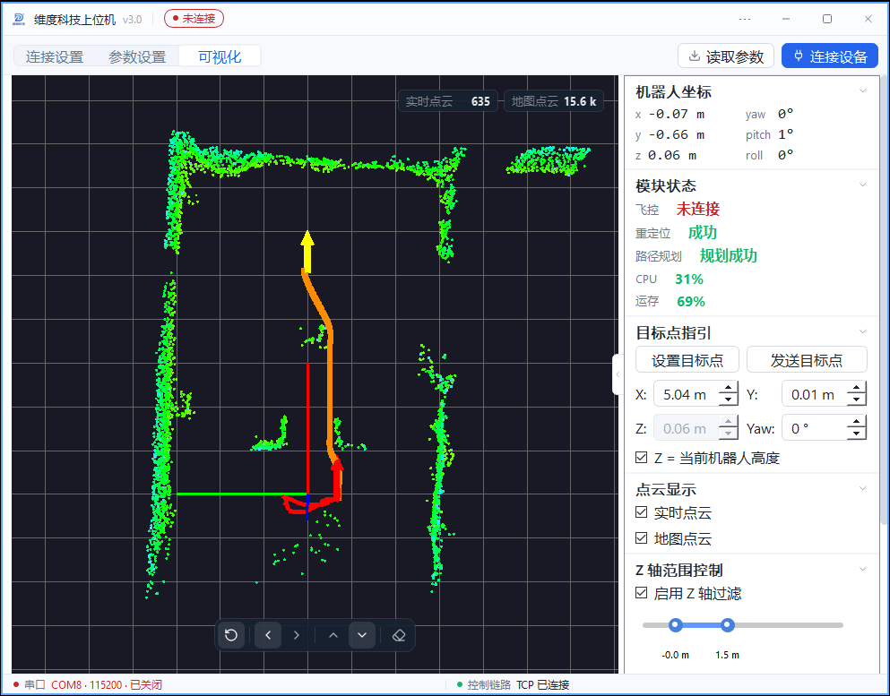
    </td>
  </tr>
</table>

### 4. 下载已保存的地图

1. 使用网络连接，在可视化页面点击 **下载地图**。下载的是模块磁盘上已保存的地图，并非当前尚未保存的扫描结果；串口不支持下载。
2. 等待接收和校验完成，在 **保存地图包**对话框选择路径并保存 ZIP。出现“地图下载成功”及保存路径后，到所选位置查看；取消保存不会生成文件。下载失败或超时时，检查连接和模块上是否已有可用地图，再重试。

参数与协议详情见[当前通信协议](https://github.com/weisama/super_mode/blob/v3.0/upper/config/通讯协议.md)。以上流程依据当前协议及上位机整理；实测范围和证据缺口见[教程实测核对记录](教程实测核对记录.md)。

---

## 串口读取与 STM32 示例

### 1. 接线与准备

1. 断电后连接 STM32F103C8 的 USART1：**PA9（TX）→ 模块 RX，PA10（RX）← 模块 TX，GND ↔ GND**。双方分别使用适合设备的稳定电源，确认串口电平兼容；STM32 为 3.3 V。
2. 模块与主控使用相匹配的协议版本，在模块参数中使能主控串口 `0x12=1`。串口设置为 **115200、8N1**。帧中没有版本号，能收到数据不代表两端协议版本匹配。
3. 通电后可先按[快速入门的串口连接步骤](#22-串口连接)用 USB 转串口和上位机检查位姿，再连接 STM32。没有数据时检查供电、共地、TX/RX 交叉、波特率和串口使能。

STM32 与模块接线示例；使用前确认接口与电平兼容。

<table>
  <tr>
    <td style="border: 10px solid black; padding: 0;">
      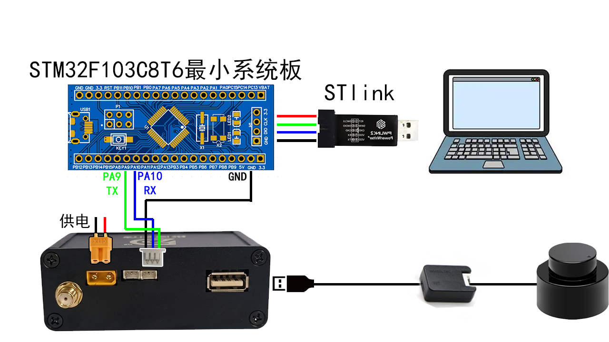
    </td>
  </tr>
</table>

### 2. 读取串口数据

串口帧固定 15 字节，以 `0xAA` 开头、`0x0A` 结尾，通过第 2 个字节的消息 ID 区分数据。位姿、目标和位置指令的六个数为大端有符号 int16，位置单位为 cm，角度单位为度；坐标使用地图原点系 `base_init_map`。完整格式见[当前通信协议](https://github.com/weisama/super_mode/blob/v3.0/upper/config/通讯协议.md#串口通信协议)。

| ID | 数据 | 查看结果 |
| --- | --- | --- |
| `0x01` | 当前位姿 | 约 10 Hz；读取 X、Y、Z 和姿态角。 |
| `0x02` | 目标点 | 主控发送后模块原样回显；回显只表示收到帧，不表示规划接受或到达。 |
| `0x03` | 位置控制指令 | 规划输出时约 100 Hz；读取位置和姿态指令。 |
| `0x04` | 实时速度 | 规划输出时约 100 Hz；线速度单位 cm/s，偏航角速度单位度/s。**不是状态帧**。 |
| `0x05` | 状态 | 约 1 Hz；依次为飞控、重定位、规划、CPU 和运存状态。重定位和规划的 `3` 表示未响应；CPU/运存的 `0xFF` 表示未知。资源字段仍待协议审核。 |

旧版将 `0x04` 描述为飞控状态；v3.0 应按上表读取，状态使用 `0x05`。`0x03`、`0x04` 依赖规划输出，未运行导航时收不到不能单独判定串口故障。

串口命令 `0x00` 支持通信测试、保存地图、读取参数、保存参数和重启算法；使用 `0x10` 参数帧修改参数，写入本身不回帧，按需保存并读回核对。保存地图成功才回显；重启回显只表示收到请求。串口**不支持下载地图**，请使用网络连接下载。命令、参数 ID 和应答细节见[协议](https://github.com/weisama/super_mode/blob/v3.0/upper/config/通讯协议.md#串口通信协议)。

### 3. 选择和编译工程

1. 保留完整的 [5_mode_v3.0](https://github.com/weisama/super_mode/tree/v3.0/stm32例程/5_mode_v3.0/) 目录，其中 `app/` 和 `protocol/` 为两个工程共用。
2. 根据使用的库，选择一个正式 Keil 工程：HAL 打开 `HAL/MDK-ARM/stm32f103c8t6.uvprojx`，标准库打开 `标准库/Project.uvprojx`。2D、3D 共用这两个工程；选择工程或示例不会切换模块类型。
3. 在所选工程的 `main.c` 设置 `SELECTED_EXAMPLE`：`EXAMPLE_LOCALIZATION` 为定位接收，`EXAMPLE_CAR` 为小车手动发点，`EXAMPLE_DRONE` 为无人机航点。两个工程默认均为 `EXAMPLE_CAR`。
4. 编译并烧录到 STM32，然后进入调试模式。新电脑需要确认 ST-Link / SWD 配置，详见[工程说明](https://github.com/weisama/super_mode/blob/v3.0/stm32例程/5_mode_v3.0/README.md)。

### 4. 定位与小车

1. 选择 `EXAMPLE_LOCALIZATION`，编译烧录后在调试器查看 `app_pose`，观察 `0x01` 位姿随设备移动变化。还可查看 `app_status` 和 `app_rx_overflows`；溢出计数增长时检查主循环是否及时处理接收。
2. 使用小车导航前，先完成[地图、定位和导航配置](#地图定位与导航)，并根据设备设置规划和运动参数；首次测试断开电机供电，先检查规划结果。
3. 选择 `EXAMPLE_CAR`，在主循环的明确操作入口调用 `app_send_goal(goal, now_ms)`。`goal` 为 X、Y、Z、roll、pitch、yaw 六个 int16 值，单位为 cm 和度；调用间隔至少 1000 ms。返回 1 表示本机已发送，0 表示发送受限或无人机例程活动。
4. 在调试器查看 `app_goal_echo`、`app_position_command`、`app_velocity` 和 `app_status`，并结合规划结果和设备实际位置判断运行情况。模块对不同目标的发布间隔至少 1 秒；即使未到间隔而未发布，仍可能回显。

调试器中的 app_pose 截图；其他变量尚未展开，代码版本待核对

<table>
  <tr>
    <td style="border: 10px solid black; padding: 0;">
      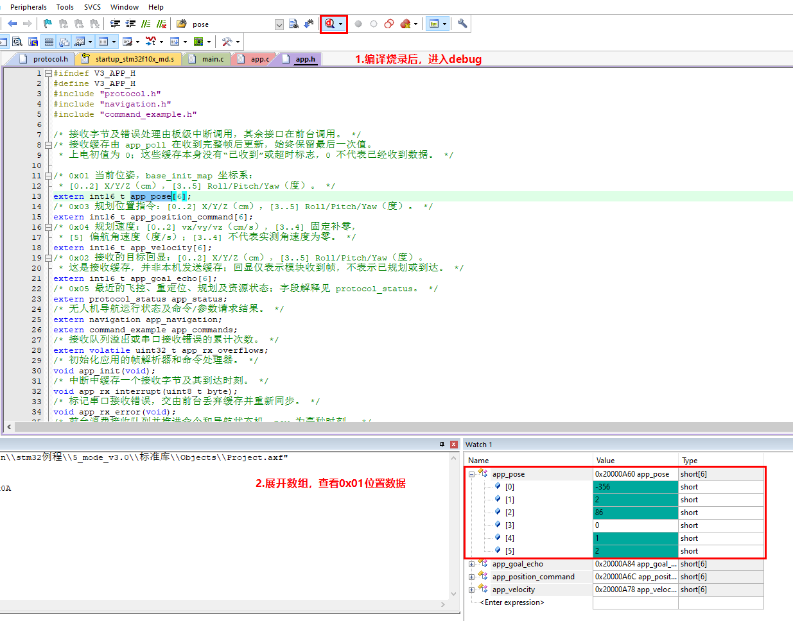
    </td>
  </tr>
</table>

### 5. 无人机航点示例

1. 完成地图与定位、导航使能 `0x14`，并由操作者配置和验证飞控连接、位置、定点和规划控制链。2D 导航的规划模式 `0x25` 必须为 0；根据现场设置起飞高度 `0x23` 等参数。
2. 在 `app/example.c` 配置适合场地且持续有效的航点，再在工程入口选择 `EXAMPLE_DRONE`，编译烧录。示例航点以厘米填写，默认三点为 `(4,0,1)`、`(4,-2,1)`、`(0,0,1)` 米。
3. 操作者负责解锁、起飞和降落。自动航点要求新鲜位姿、飞控状态为 3 或 4，且 Z > 50 cm 持续 1 秒；状态或位姿过期时会暂停。通用示例默认不强制人工高度确认，可选确认接口及暂停、重试规则见[开发接口](https://github.com/weisama/super_mode/blob/v3.0/stm32例程/5_mode_v3.0/protocol/README.md)。
4. 2D 位姿 Z 来自飞控位置，初始为零，模块可能重复发送缓存的旧高度；位姿帧新鲜不等于高度源新鲜，飞行前须独立验证高度有效且持续更新。2D 串口目标 Z 会被模块替换为配置的起飞高度；3D 位姿 Z 来自 TF，使用航点指定的 Z。

编译通过只能说明工程构建成功。串口联调要在实际模块上分别检查接收、命令和目标回显。用户于 2026-11-05 确认本轮 2D、3D 航点实飞通过；未提供飞行日志、最终参数及异常场景测试结果，详见[联调记录](https://github.com/weisama/super_mode/blob/v3.0/stm32例程/5_mode_v3.0/联调记录.md)。[工程说明](https://github.com/weisama/super_mode/blob/v3.0/stm32例程/5_mode_v3.0/README.md)记录了统一后编译结果，历史[台架记录](https://github.com/weisama/super_mode/blob/v3.0/stm32例程/5_mode_v3.0/台架验证-2026-11-03.md)使用统一前工程，不能替代当前固件的串口及飞行验收。

---

## PX4 或 APM 飞控使用模块

### 1. PX4 1.14.3 连接与参数

准备已完成基本配置的无人机、QGroundControl（QGC）和模块。下面以 PX4 1.14.3、模块连接 TELEM1 为例；其他飞控的接口定义和占用情况须按实际设备核对。

1. 断电后，将飞控 **TELEM1** 连接模块的**飞控输出**接口，核对两端接口引脚，TX 接对方 RX、RX 接对方 TX、GND 共地；供电按设备要求连接，勿凭接口外形判断线序。现场用户确认的连接是 TELEM1 → 模块飞控输出，电脑通过飞控 USB 连接 QGC。现场飞控型号及模块在线配置仍需核对。
2. 按[快速入门](#快速入门连接模块和使用上位机)连接上位机，读取模块参数，设置 `0x11=1` 使能飞控通信，保存、重启并读回。核对模块类型、雷达型号和安装位姿与实际设备一致。
3. 用 QGC 连接飞控，确认固件为 PX4 1.14.3，检查 TELEM1 未与其他外设冲突。在参数页面设置下表的接口和外部位姿融合项；若使用其他接口或 MAVLink 实例，按实际映射调整，不能直接照搬实例号。

> 下图展示的是 TELEM2 接线示例。本节使用 TELEM1；仅参考 TX/RX 与共地关系，接口、引脚及供电以实际设备和正文为准。

飞控接线示例：图中接口为 TELEM2。

<table>
  <tr>
    <td style="border: 10px solid black; padding: 0;">
      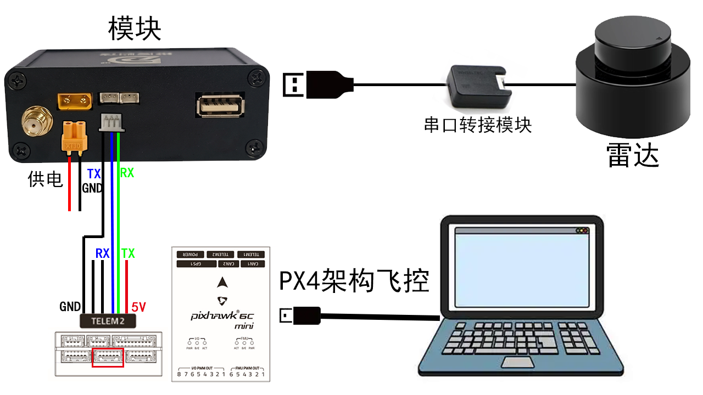
    </td>
  </tr>
</table>

| 参数 | TELEM1 示例及说明 |
| --- | --- |
| `MAV_0_CONFIG` | `101`（TELEM1），将 MAVLink 实例 0 指向模块接口。 |
| `MAV_0_MODE` | `2`（Onboard）。 |
| `SER_TEL1_BAUD` | `500000`；模块侧配置也须匹配。 |
| `EKF2_EV_CTRL` | 2D 示例 `9`：融合外部水平位置和偏航；3D 示例 `11`：额外融合外部垂直位置。 |
| `EKF2_HGT_REF` | 2D 按实际定高传感器选择；现场测距方案为 `2`（Range sensor）。3D 以模块高度为参考时为 `3`（Vision）。 |
| `EKF2_RNG_CTRL` | 2D 使用测距时按传感器与场地配置；现场为 `2`（连续融合），需确认地面条件和测距有效范围。3D 不使用测距时方案值为 `0`。 |
| `EKF2_EV_DELAY`、噪声和安装位置 | 按实际链路延迟、观测质量及安装测量配置，并通过日志核验；现场值不是通用值。 |

2D 模块的高度来自飞控，**需要额外定高传感器**，不能把模块返回的 Z 再作为独立外部高度融合。现场使用 N10P 和连接 TELEM2 的 MT-06；该传感器的供电、协议、接口及融合须单独检查。3D 模块的高度来自 3D 定位，可作为外部高度观测；两种方案均需检查高度方向、原点和持续有效性。

以上接口值参考[现场参数记录](https://github.com/weisama/super_mode/blob/v3.0/stm32例程/5_mode_v3.0/飞控参数/README.md)：2026-11-03 15:33 的 3D 快照读到 `EKF2_EV_CTRL=11`、`EKF2_HGT_REF=3`；[20:06 的 2D 快照](https://github.com/weisama/super_mode/blob/v3.0/docs/v3-user-manual/飞控现场记录-2026-11-03.md)读到 `9`、`2`、`EKF2_RNG_CTRL=2`。后者的 TELEM2 设置为 `MAV_1_CONFIG=102`、`MAV_1_MODE=0`、`SER_TEL2_BAUD=115200`。这些只是该机读值；3D 表中测距关闭是待验证方案，整机快照包含校准、机型和遥控配置，不要当作通用模板导入其他飞机。

4. 保存参数并按 QGC 提示重启飞控，再读回核对。确认模块已上电并完成初始化，在 QGC 的 MAVLink Inspector 查看外部位姿相关消息及变化；移动、转向模块，检查飞控本地位置、偏航和高度方向及原点，并确认估计器实际融合。2D 还要检查测距连续变化、实际距离与高度融合及遮挡或断开后的响应；3D 检查模块 Z 与飞控融合。收到消息不等于融合成功。

固件信息显示 1.14.3dev，与正式版 1.14.3 的关系待确认

<table>
  <tr>
    <td style="border: 10px solid black; padding: 0;">
      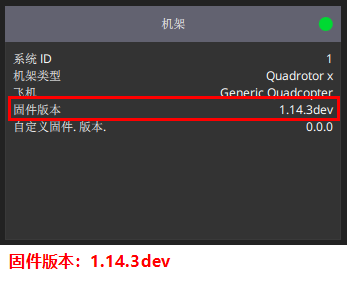
    </td>
  </tr>
</table>

EKF2_EV_CTRL 值为 11 的设置示例，按实际固件与配置核对

<table>
  <tr>
    <td style="border: 10px solid black; padding: 0;">
      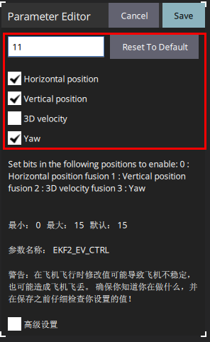
    </td>
  </tr>
</table>

### 2. APM 接入

APM 按[旧教程的 APM 部分](3.PX4或APM飞控使用模块.md#若机器人主控使用apm架构飞控设置参数如下可以进入loiter模式)配置，以下保留其参数作为入口。接口和参数名称须与实际 APM 固件和接线核对。

| 参数名称              | 设置值         | 说明                          |
| ----------------- | ----------- | --------------------------- |
| SERIAL2\_PROTOCOL | MAVLink2    | 将串口 2 协议设置为 MAVLink 2       |
| SERIAL2\_BAUD     | 500000      | 串口 2 波特率设置为 500000 bps      |
| BRD\_SER2\_RTSCTS | Disable     | 禁用串口 2 的硬件流控（RTS/CTS）       |
| AHRS\_EKF\_TYPE   | Enable EKF3 | 启用 EKF3 作为姿态估计器             |
| EK3\_SRC1\_POSXY  | ExternalNav | EKF3 主数据源：XY 平面位置使用外部导航数据   |
| EK3\_SRC1\_POSZ | 按实际高度来源设置 | 3D 使用外部高度；2D 根据额外定高传感器选择，具体枚举按固件确认 |
| EK3\_SRC1\_VELXY  | None | EKF3 主数据源：XY 平面速度无输入   |
| EK3\_SRC1\_YAW    | ExternalNav | EKF3 主数据源：航向角使用外部导航数据       |
| VISO\_TYPE        | MAVLink     | 视觉里程计类型设置为 MAVLink 协议       |

APM 接线和参数需按实际设备检查；2D 同样需要独立且有效的高度来源。先确认位置、高度和姿态融合，再验证 Loiter。

### 3. 定点、规划与飞行测试

1. 拆桨检查接线、传感器、外部位姿和估计器；按机体配置并验证遥控接管、紧急开关和失联动作。先确认飞控独立定点能力，再在合适场地验证模块定位下的定点，飞手保持接管能力。
2. 按[地图与导航](#地图定位与导航)完成建图、定位、导航使能和目标点测试，先观察规划结果。目标回显只表示收到目标，不代表规划成功或到达。
3. 如使用 STM32 航点，按[无人机航点示例](#5-无人机航点示例)配置并测试；操作人员负责解锁、起飞和降落。检查 Offboard 控制链及中断行为后，再逐步进行飞行测试。

[现场记录](https://github.com/weisama/super_mode/blob/v3.0/docs/v3-user-manual/飞控现场记录-2026-11-03.md)：2026-11-03 参数已读取；20:06 后约 12 秒监听未收到 `DISTANCE_SENSOR`，无法据此判断传感器是否工作或融合。用户于 2026-11-05 确认本轮 2D、3D 航点实飞通过，见[联调记录](https://github.com/weisama/super_mode/blob/v3.0/stm32例程/5_mode_v3.0/联调记录.md)；未提供飞行日志、最终参数及异常场景测试结果。参数快照或编译结果不能单独证明飞行通过。

---

## 进阶使用

### 1. 参数设置

按[快速入门](#3-测试通信和设置参数)获取参数、修改、写入并确认回读；需要重启生效的设置应重启后再次读取。设备当前值可能与下表默认值不同，请按设备和用途设置。首次导航测试先断开电机供电，查看规划结果。

| 参数 ID | 名称 | 范围和用途 |
| --- | --- | --- |
| `0x00` | 雷达型号 | 0=MID360、1=MID360s、2=MID360l、10=N10、11=N10_P；12/13 为占位。默认 0。 |
| `0x01`–`0x03` | 安装位置 X/Y/Z | -100～100 cm，默认 0；相对机器人中心。 |
| `0x04`–`0x06` | 安装角 Roll/Pitch/Yaw | -180～180°，默认 0；相对机器人坐标系。 |
| `0x11`、`0x12` | 飞控通信、主控通信 | 0 关闭、1 使能，默认 1。 |
| `0x13` | 模式 | 0 建图、1 定位，默认 0；定位需要已保存地图。 |
| `0x14` | 导航使能 | 0 关闭、1 开启，默认 0。导航版开启后运行时强制定位。 |
| `0x15` | 过滤半径 | 0～1000 cm，默认 10；3D 按机器人中心过滤，2D 用于扫描匹配的最小距离，见第 4 节。 |
| `0x21` | 最大移动速度 | 0～1000 cm/s，默认 100。 |
| `0x22` | 最大加速度 | 0～1000 cm/s²，默认 100。 |
| `0x23` | 起飞高度 | 0～1000 cm，默认 100；2D 串口目标 Z 使用此高度。 |
| `0x24` | 障碍膨胀半径 | 0～1000 cm，默认 10；协议名称为机器人半径，建议参考机器人半径加 10 cm 并按场地核对。 |
| `0x25` | 规划模式 | 0 平面、1 三维自由空间、2 三维贴地；默认 0，2D 导航版仅支持 0。 |
| `0x26` | 小车运动学模型 | 0 全向、1 差速，默认 0；仅规划模式 0 生效。 |
| `0x27` | 目标点容差 | 0～1000 cm，默认 15；小车模型判定到点的距离。 |
| `0x28` | 最大偏航角速率 | 0～1000 度/s，默认 43；用于小车模型。 |
| `0x29` | 最小转弯半径 | 0～1000 cm，默认 100；全向模型不生效。 |
| `0x99` | 模块类型 | 0  3D定位、1  3D导航、2  2D定位、3  2D导航；按实际设备核对。 |

具体说明及适用范围见[当前通信协议](https://github.com/weisama/super_mode/blob/v3.0/upper/config/通讯协议.md#参数id定义表)。不要使用旧版参数表或旧主控程序按相同编号写入：协议帧没有版本号，编号相同不代表含义相同。

新版参数界面（与图 1-4b 相同）

<table>
  <tr>
    <td style="border: 10px solid black; padding: 0;">
      
    </td>
  </tr>
</table>

### 2. 设置 MID360 雷达 IP

通常只需在更换雷达或网络配置不匹配时设置。当前 MID360 配置中，雷达地址为 `192.168.1.20`，模块接收地址为 `192.168.1.50`；其他设备或 MID360 变种须先核对实际配置，勿将两个地址混淆。

1. 记录电脑原网络设置。将电脑以太网 IPv4 设为与雷达同网段且不冲突的地址，例如 `192.168.1.51`、子网掩码 `255.255.255.0`；电脑、雷达和模块不能使用相同地址。
2. 雷达上电并用网线连接电脑，打开[览沃上位机](https://www.livoxtech.com/cn/downloads)，确认发现雷达并能看到点云。
3. 在雷达设置中将雷达 IP 改为设备所需地址，确认保存并重新给雷达上电。重新连接并核对地址；操作完成后恢复电脑网络设置，再将雷达接回模块，检查点云。

软件界面、实际地址及修改后的连接效果待实机核对；不确定设备网络配置时先向设备提供方确认。

电脑以太网 IPv4 设置入口示例。

<table>
  <tr>
    <td style="border: 10px solid black; padding: 0;">
      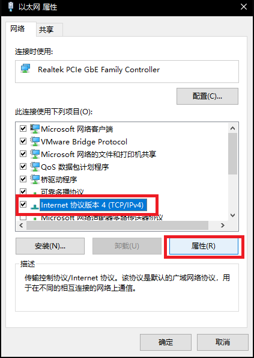
    </td>
  </tr>
</table>

雷达网络设置示例；地址以实际设备配置为准。

<table>
  <tr>
    <td style="border: 10px solid black; padding: 0;">
      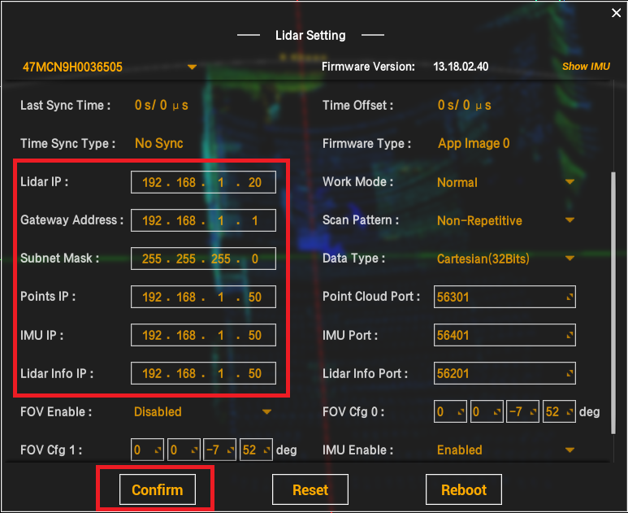
    </td>
  </tr>
</table>

### 3. 雷达安装位姿

3d模块可以适配任意位姿摆放的雷达，正确设置参数，可以使得得出的坐标为机器人自身坐标，而非仅仅只能得到雷达自身坐标。

例如：1️⃣为了感知前方障碍物，雷达向前倾斜以扫到前方环境；2️⃣室外无高大参照物，雷达倒装在无人机底部用地面建图定位。

以机器人中心为原点，采用 FLU：X 向前、Y 向左、Z 向上。测量雷达相对中心的 X/Y/Z，单位 cm；Roll、Pitch、Yaw 分别绕 X、Y、Z 轴，单位度。倾斜或倒装时尤其要检查方向和角度。

坐标系的表示除了xyz位置，还有yaw/pitch/roll三个欧拉角：

| 角度 | 英文名 | 旋转轴 | 描述 |
|------|--------|--------|------|
| **偏航角** | Yaw  | Z轴 | 绕垂直轴左右转向（如机器人原地自转） |
| **俯仰角** | Pitch | Y轴 | 绕横向轴上下俯仰（如机器人抬头/低头） |
| **横滚角** | Roll | X轴 | 绕纵向轴左右翻滚（如机器人左右倾斜） |

1. 测量雷达相对机器人中心的安装位置与角度。
2. 在参数页面填写 `0x01`–`0x06`，写入并确认回读，重启后再次读取。
3. 缓慢移动、转向设备，检查机器人位置和方向是否与实际一致；不一致时重新检查测量和符号。

雷达安装位置和机器人坐标系示例；安装数值按实际测量填写。

<table>
  <tr>
    <td style="border: 10px solid black; padding: 0;">
      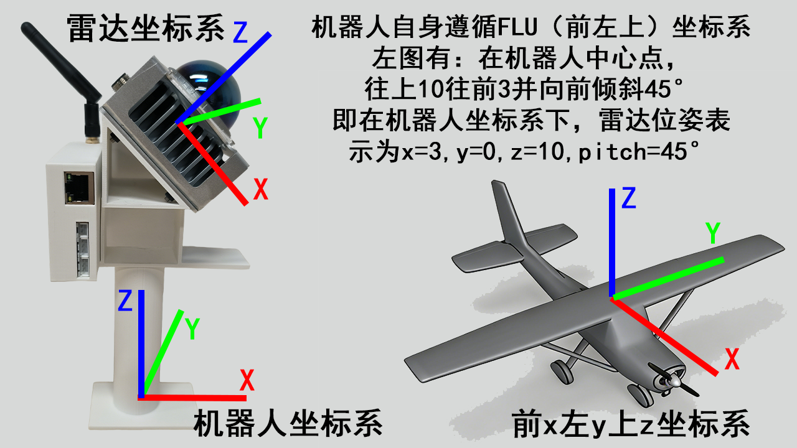
    </td>
  </tr>
</table>

举例：如左图，定义雷达手持支架与桌面的接触点中心为原点，建立FLU机器人坐标系。

在机器人坐标系下，雷达位置可以表述为：**x=3，y=0，z=10，yaw=0，pitch=45，roll=0**。位置单位为厘米，角度单位为度。

### 4. 可视化过滤点云

网络连接后进入可视化页面，展开 **Z 轴范围控制**，勾选 **启用 Z 轴过滤**，拖动上下限（单位 m）。界面只显示高度在区间内的点云；取消勾选可恢复显示。可用它减少地板、天花板对画面的遮挡。

这只是上位机显示过滤，不会改变模块收到的点云或规划障碍物。`0x15` 是模块过滤半径，二者用途不同。3D 链按机器人中心的距离过滤点云；2D 链以雷达原点为参考，仅影响建图定位的扫描匹配，不过滤实时点云，雷达本身的最小测距仍有效。`0x15=0` 关闭该参数的过滤；修改后按参数流程写入、重启并读回。

启用 Z 轴过滤及当前上下限，与图 1-5a 使用同一原图

<table>
  <tr>
    <td style="border: 10px solid black; padding: 0;">
      
    </td>
  </tr>
</table>

---

## 常见问题与免责声明

### 1. 连接、参数或命令没有回显

1. 检查供电、模块初始化、热点和目标 IP/端口；串口检查 TX/RX 交叉、共地、电平、115200 8N1 和 `0x12` 使能。
2. 先做通信测试，再获取参数。写入超时或读回不一致时不要当作成功；重启回显只表示收到请求，等待重新连接后再读回。
3. 确认上位机、主控和模块使用匹配的当前协议。旧版 `0x04` 状态解析和旧参数编号不适用于当前模块；目前 `0x04` 是速度，状态是 `0x05`。

### 2. 建图漂移或看不到点云

**2d版模块建图失败或漂移**

1.检查雷达是否被机器人结构大面积遮挡，被遮挡的扇面小于20%则对建图影响较小，最佳情况是将2d雷达置于机器人顶端水平放置无遮挡

2.在一些长走廊或空旷场地，建图算法无法锚定特征点，也可能会导致建图失败

**3d版模块建图失败或漂移**

1.mid360雷达上电时内部imu需要静置初始化，上电后抖动会导致imu初始化失败进而导致建图失败

2.雷达建图算法需一定初始化时间，不要在初始化完成前移动机器人

3.在一些长走廊或空旷场地，建图算法无法锚定特征点，也可能会导致建图失败

检查雷达型号、供电、连接和安装参数；MID360 检查 IP。检查上位机 Z 轴显示过滤，关闭后再观察。

### 3. 存图或重定位不成功

建图前确认 `0x13=0`、`0x14=0`，写入并重启；导航版开启导航会强制定位。保存后须收到成功提示，未回显可能是保存失败、定位模式拒绝或通信问题。定位前确认使用已保存的地图，检查雷达及设备所在环境，等待重定位成功；持续未响应表示没有收到状态，不能直接判断为失败。下载地图需要网络连接，下载的是已保存的地图。

### 4. 目标已回显但没有轨迹

确认模块为导航版，已启用导航并重启，重定位成功；2D 导航的 `0x25` 须为 0。检查目标、当前位置和障碍物，以及 `0x24` 膨胀半径等参数；3D 场景中地板也可能被视为障碍。等待规划状态和轨迹，检查失败原因后再调整目标。目标回显仅表示收到帧，不代表规划成功或到达；不同目标发送间隔至少 1 秒。

### 5. 飞控无法定点或退出定点

核对飞控接口、波特率、外部位置及偏航融合，移动设备检查位置和方向；查看估计器及其他传感器是否冲突。2D 模块的高度来自飞控，必须单独检查定高传感器及高度是否持续有效。根据具体固件和设备检查参数及日志，勿直接照搬其他飞机的整机参数。按[飞控连接](#px4-或-apm-飞控使用模块)逐步验证，飞手须随时能够接管。

# 免责声明 (Disclaimer)

本项目/模块（以下简称“本模块”）提供基于 Offboard 模式的无人机路径规划与避障功能。在使用本模块进行任何仿真或实体飞行测试之前，请务必仔细阅读并充分理解本免责声明。

**一旦您下载、安装、编译或以任何方式使用本模块，即表示您已阅读、理解并同意接受本声明的全部条款。**

#### 1. 实验性软件与测试环境局限
本模块的核心算法与功能均在**理想的实验/仿真环境中**进行开发与测试。真实世界的飞行环境具有极高的复杂性（如风扰、传感器噪声、障碍物材质反射率差异等）。开发者不保证本模块在真实、复杂的室外或室内应用场景中能达到与实验环境中一致的表现。本模块按“原样（AS IS）”提供，不带有任何明示或暗示的担保。

#### 2. 硬件差异与飞控（PX4）参数风险
无人机系统属于高度复杂的机电一体化设备。不同的机架尺寸、动力系统响应速度、传感器精度以及 **PX4 飞控底层的控制参数设置**，都会直接影响无人机的实际飞行动态。
* 将本模块直接应用于未经严格适配和调参的无人机硬件上，极易导致算法输出指令与飞机实际姿态不匹配，进而引发**无人机失控、炸机或伤及人员/财产**。
* 用户有责任针对自身的特定硬件平台，仔细调整相关参数，并在绝对安全的环境下进行验证。

#### 3. 模块定位与系统控制权限制
本模块**仅设计作为独立的“路径规划算法模块”使用**，旨在向上层应用提供路径生成与避障策略，**并非用于完全接管或替代控制 PX4 飞控的机载电脑核心系统**。
* 本模块通过 Offboard 模式发送控制设定点（Setpoints），但不对底层的安全保护机制（如失控返航、低电量保护、地理围栏触发等）负责。
* 飞手必须时刻手握遥控器，并确保在遇到突发情况或算法行为异常时，**能够随时通过遥控器硬件开关切出 Offboard 模式并手动接管无人机**。因未能及时接管导致的一切事故，开发者概不负责。

#### 4. 错误使用与算法失效风险
本模块的正常运行依赖于正确的数据输入与系统配置（如准确的外部定位数据/里程计、正确的坐标系对齐与频率设定等）。任何非正确方式的使用、非法参数的输入、或将其应用于超出其设计边界的极端场景，均可能直接导致算法逻辑出错、崩溃或输出危险的控制指令。

#### 5. 责任豁免
在适用法律允许的最大范围内，本模块的开发者、贡献者及相关主体，对因使用、滥用或无法使用本模块而产生的任何直接的、间接的、特殊的、附带的或惩罚性的损害（包括但不限于**无人机损坏、财产损失、人身伤亡、法律纠纷、数据丢失或业务中断**）概不承担任何法律及连带责任。

**使用本模块进行实体飞行的全部风险均由使用者本人自行承担。**

---

**⚠️ 强烈建议的安全飞行准则：**
1. 在实际部署到物理无人机之前，务必在 SITL（软件在环）或 HITL（硬件在环）仿真中进行充分的极端情况测试。
2. 首次实机测试请务必**卸下螺旋桨**，在地面观察机载电脑与 PX4 飞控的指令交互与电机响应是否符合预期。
3. 实飞测试请务必在空旷、合法且无人员聚集的场地进行，并配备必要的安全防护措施。
