# v3.0 使用手册 · 相对 v2 的审核稿

本稿以 v2 原文为底稿：无标记的文字沿用 v2；**🟩 修改／删除**为旧内容替换，展开可查看 v2 原文；**🟥 新增**为 v3 补充。图片沿用已有 v3 稿，适用的旧图继续复用。图片替换及章节链接转向 v3 不计作文字改写。

本稿供审核，折叠框中的旧编号和旧代码仅用于对照，实际操作以框外的 v3 正文为准。干净正文见各章节，逐项清单见[审核改动](审核改动.md)。

# 快速入门使用维度科技2d/3d-定位/导航模块，以及简单测试其功能

## 1.1接线介绍

印有logo为模块顶面，侧面USB/网口用于连接雷达，MX1.25端子用于串口输出/连接飞控，TX30用于连接5V-26V电源

<table>
  <tr>
    <td style="border: 10px solid black; padding: 0;">
      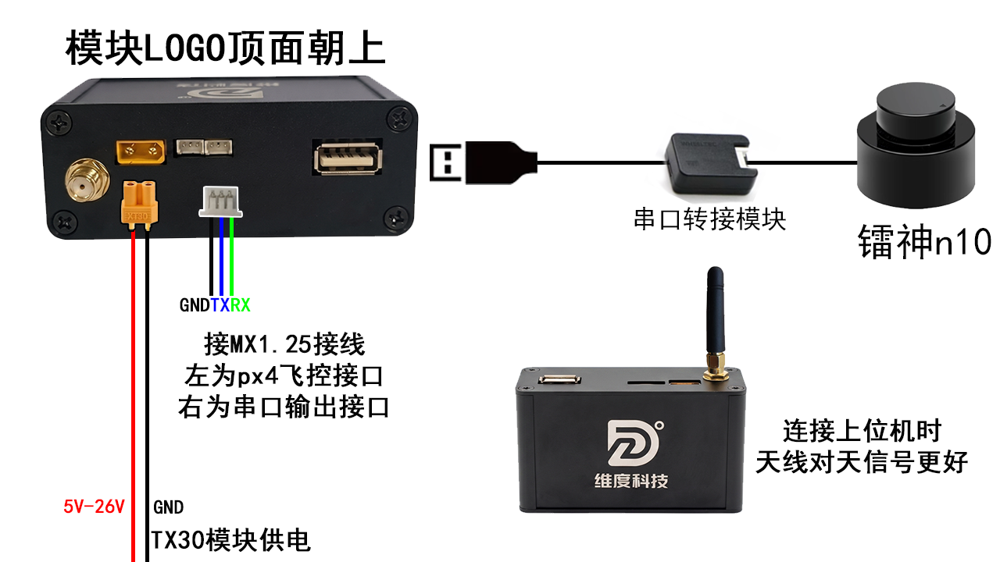
    </td>
  </tr>
</table>

**供电电压为5V-26V直流(内部降压为5V供模块使用)，建议直连到航模电池上，以满足2.5A的开机电流需求**

## 1.2使用模块前设置需正确设置模块参数

**mid360/mid360s需设置雷达IP**

[参数介绍及设置教程](https://github.com/weisama/slam_mode_book/blob/mode_v3.0/4.%E8%BF%9B%E9%98%B6%E4%BD%BF%E7%94%A8.md#1%E5%8F%82%E6%95%B0%E8%AE%BE%E7%BD%AE)

## 2.使用上位机

[下载对应版本上位机](https://github.com/kikiYang03/SerialPortAssistant3D/releases)

<table>
  <tr>
    <td style="border: 10px solid black; padding: 0;">
      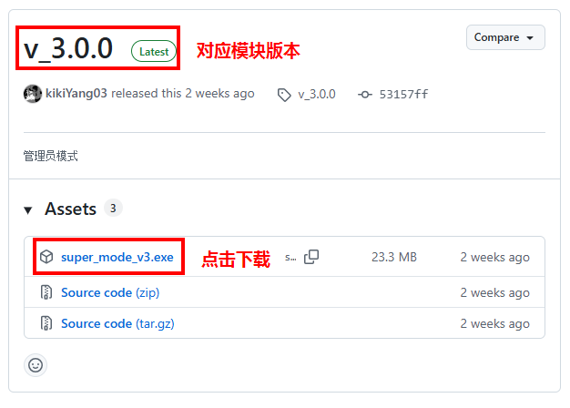
    </td>
  </tr>
</table>

模块接线如图：

<table>
  <tr>
    <td style="border: 10px solid black; padding: 0;">
      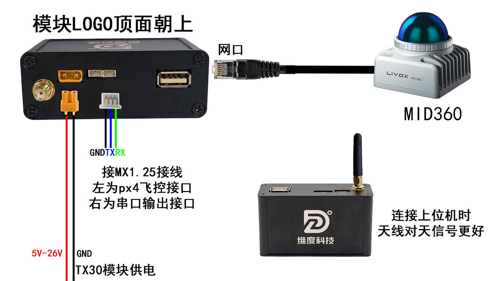
    </td>
  </tr>
</table>

上电后，等待模块初始化约15s，连接模块热点（密码12345678）：

<table>
  <tr>
    <td style="border: 10px solid black; padding: 0;">
      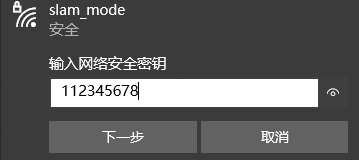
    </td>
  </tr>
</table>

**使用模块前设置需正确设置模块参数，详情见1.2**


<a name="v3-002"></a>

> **🟥 新增 · V3-002** — 补充 v3 网络连接设置。
>
> 在连接设置界面选择TCP，填入模块IP和端口，默认端口为6666；IP填写模块的实际地址。若IP和端口不能修改，先点击[管理员登录/退出]登录后修改。

启动上位机，点击[打开连接]，连接成功后可以看见上位机收到大量数据：


<a name="v3-001"></a>

> **🟩 修改 · V3-001** — 按 v3 界面按钮和结果修改。
>
> 点击[测试通信]，模块响应后显示测试成功：

<details>
<summary>🟩 查看已替换／删除的 v2 原文</summary>

~~~~text
点击[发送测试数据]，模块成功测试成功：
~~~~

</details>


<table>
  <tr>
    <td style="border: 10px solid black; padding: 0;">
      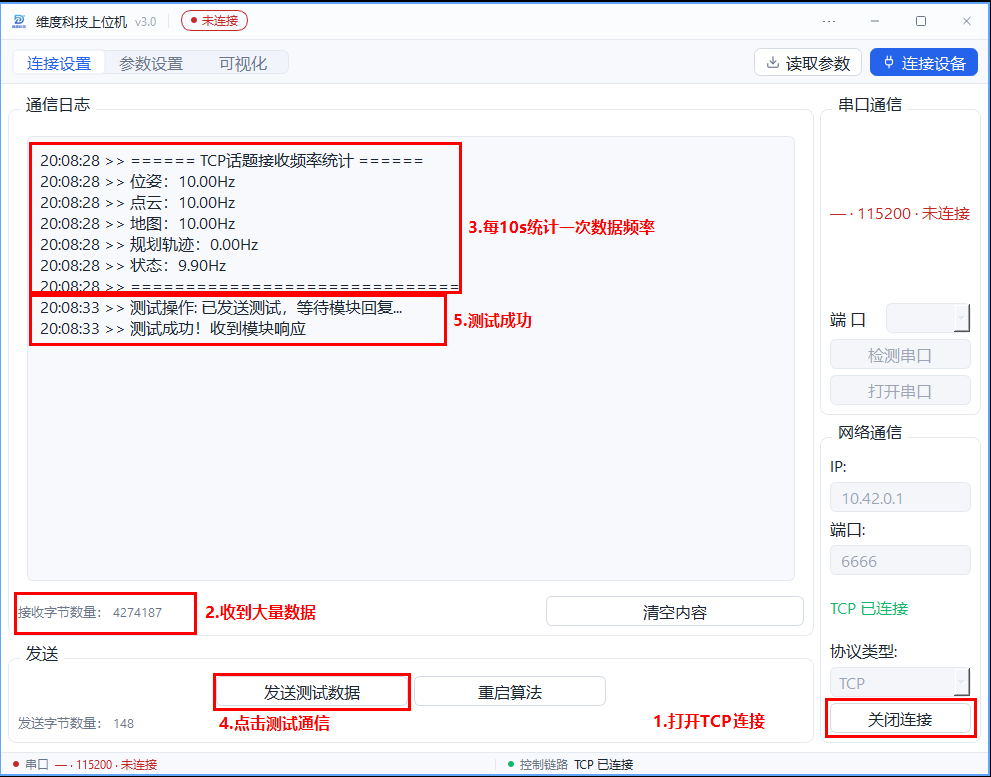
    </td>
  </tr>
</table>


<a name="v3-003"></a>

> **🟩 修改 · V3-003** — 按 v3 点云显示控件修改。
>
> 进入可视化界面，可以看见机器人坐标，箭头代表机器人，勾选[实时点云]和[地图点云]可以分别显示雷达实时点云和地图

<details>
<summary>🟩 查看已替换／删除的 v2 原文</summary>

~~~~text
进入可视化界面，可以看见机器人坐标，箭头代表机器人，3d版：蓝色点为雷达实时点云/彩色点为雷达建图，2d版：红色为雷达实时点云/灰黑色为雷达建图
~~~~

</details>


<a name="v3-004"></a>

> **🟩 修改 · V3-004** — 区分保存地图的图原点和本次开机点。
>
> **建图时以机器人上电位置和朝向建立图原点系，红色坐标轴（机器人前方）为X+方向，绿色坐标轴（机器人左方）为Y+方向，蓝色坐标轴（机器人上方）为Z+方向；定位模式重定位后，机器人坐标和目标点都以保存地图的图原点系为准**

<details>
<summary>🟩 查看已替换／删除的 v2 原文</summary>

~~~~text
**坐标轴遵循ENU，上电时以机器人朝向建立坐标轴，红色坐标轴（机器人前方）为X+方向，绿色坐标轴（机器人左方）为Y+方向，蓝色坐标轴（机器人上方）为Z+方向**
~~~~

</details>


<a name="v3-005"></a>

> **🟩 修改 · V3-005** — 重定位后偏航角仍参考保存地图的方向。
>
> **姿态角yaw：以图原点系X+方向为0度，向右顺时针转动范围0到-180度，向左逆时针转动范围0到180度；pitch，roll同理**

<details>
<summary>🟩 查看已替换／删除的 v2 原文</summary>

~~~~text
**姿态角yaw：模块启动时以X+为0度，向右顺时针转动范围0到-180度，向左逆时针转动范围0到180度；pitch，roll同理**
~~~~

</details>


<table>
  <tr>
    <td style="border: 10px solid black; padding: 0;">
      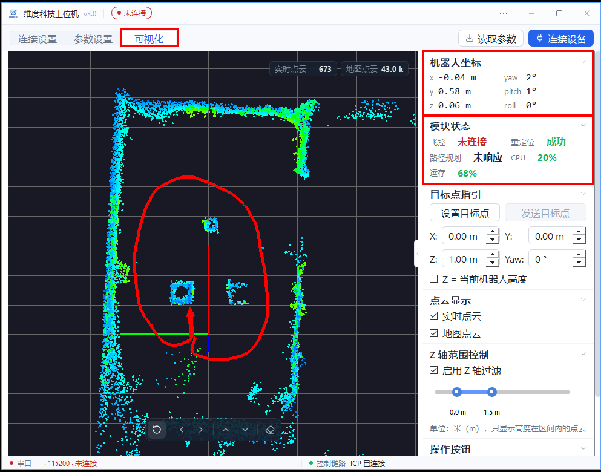
    </td>
  </tr>
</table>


<table>
  <tr>
    <td style="border: 10px solid black; padding: 0;">
      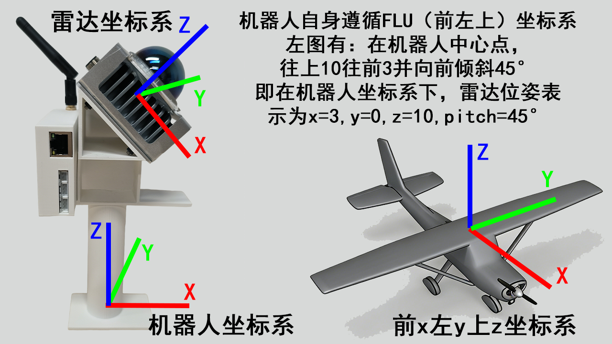
    </td>
  </tr>
</table>


<a name="v3-006"></a>

> **🟥 新增 · V3-006** — 补充状态查看、开机点及建图前的模式设置。
>
> 可视化界面的[模块状态]可以查看飞控、重定位、路径规划、CPU和运存。重定位和路径规划分别显示进行中、成功、失败、未响应；未响应表示尚未收到状态，不是正在运行或已经失败。CPU和运存显示“—”时表示没有可用读数。[开机点]表示本次开机位置在地图中的位置，不一定与图原点重合。
>
> 建图前将参数0x13模式设为0、0x14导航使能设为0，点击[写入参数]，确认保存和回读比对成功后重启算法，再扫描场地。导航版开启导航后会强制进入定位模式，不能在该状态保存地图。

机器人围绕房间一圈，可以看见曲线为机器人移动路径，建图逐渐完整显现出房间的轮廓

<table>
  <tr>
    <td style="border: 10px solid black; padding: 0;">
      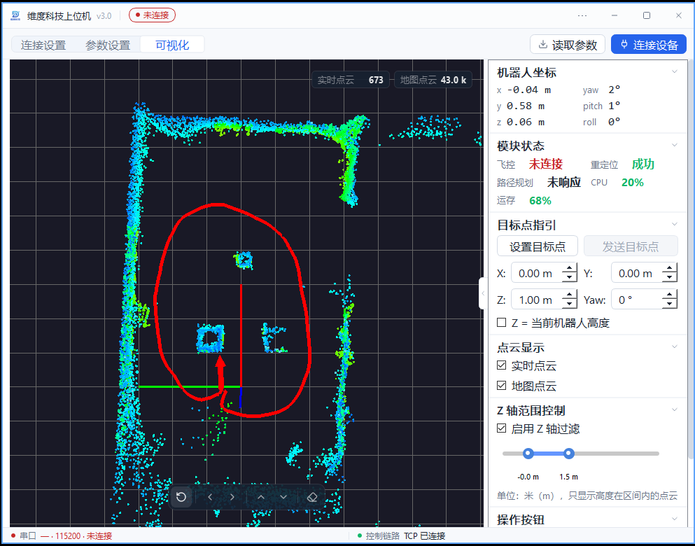
    </td>
  </tr>
</table>


## 3.若机器人主控使用单片机或其他可串口通信的设备，测试模块的串口输出坐标功能

模块接线如图：

<table>
  <tr>
    <td style="border: 10px solid black; padding: 0;">
      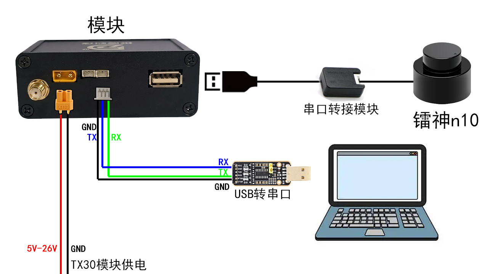
    </td>
  </tr>
</table>


<a name="v3-007"></a>

> **🟩 修改 · V3-007** — 串口直连不依赖热点。
>
> 上电后，等待模块初始化10s；串口连接不需要连接模块热点

<details>
<summary>🟩 查看已替换／删除的 v2 原文</summary>

~~~~text
上电后，等待模块初始化10s，连接模块热点（密码12345678）
~~~~

</details>


<a name="v3-008"></a>

> **🟩 修改 · V3-008** — 按 v3 串口控件修改。
>
> 打开上位机，点击[检测串口]，选择模块所在串口后点击[打开串口]，可以看见接收到大量数据

<details>
<summary>🟩 查看已替换／删除的 v2 原文</summary>

~~~~text
打开上位机，连接串口后，可以看见接接收到大量数据
~~~~

</details>


上位机从数据中解析出坐标，模块串口输出坐标功能测试成功

<table>
  <tr>
    <td style="border: 10px solid black; padding: 0;">
      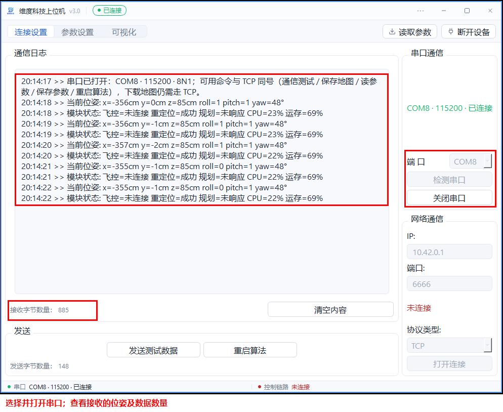
    </td>
  </tr>
</table>


<a name="v3-010"></a>

> **🟥 新增 · V3-010** — 补充串口命令能力及网络专用功能。
>
> 串口也可以测试通信、保存地图、获取和写入参数、保存参数及重启算法；查看点云、地图、规划轨迹和下载地图需要网络连接。切换连接方式前先关闭正在使用的连接。

#### **通信协议格式**

**波特率115200，字节格式为8N1**

| 字节序号       | 名称      | 长度     | 说明        | 单位       | 备注        |
| ---------- | ------- | ------ | --------- | -------- | --------- |
| **Byte 0** | 帧头      | 1 byte | 固定 `0xAA` | —        | 起始标志      |
| 🟩 **Byte 1** | 消息 ID    | 1 byte | 0x01 / 0x02 / 0x03 | —        | 本表为位姿、目标点和位置指令格式  |
| **Byte 2** | X 高字节   | 1 byte | X 坐标高 8 位 | **cm**   | int16 高字节 |
| **Byte 3** | X 低字节   | 1 byte | X 坐标低 8 位 | **cm**   | int16 低字节 |
| **Byte 4** | Y 高字节   | 1 byte | Y 坐标高 8 位 | **cm**   | int16 高字节 |
| **Byte 5** | Y 低字节   | 1 byte | Y 坐标低 8 位 | **cm**   | int16 低字节 |
| **Byte 6** | Z 高字节   | 1 byte | Z 坐标高 8 位 | **cm**   | int16 高字节 |
| **Byte 7** | Z 低字节   | 1 byte | Z 坐标低 8 位 | **cm**   | int16 低字节 |
| **Byte 8** | roll 高字节 | 1 byte | 翻滚角高字节    | **°（度）** | int16 高字节 |
| **Byte 9** | roll 低字节 | 1 byte | 翻滚角低字节    | **°（度）** | int16 低字节 |
| **Byte 10** | pitch 高字节 | 1 byte | 俯仰角高字节    | **°（度）** | int16 高字节 |
| **Byte 11** | pitch 低字节 | 1 byte | 俯仰角低字节    | **°（度）** | int16 低字节 |
| **Byte 12** | yaw 高字节 | 1 byte | 航向角高字节    | **°（度）** | int16 高字节 |
| **Byte 13** | yaw 低字节 | 1 byte | 航向角低字节    | **°（度）** | int16 低字节 |
| **Byte 14** | 帧尾      | 1 byte | 固定 `0x0A` | —        | 结束标志      |

例如串口收到数据：
AA 01 00 64 FF CE 00 1E 00 0A FF FB 00 5A 0A

解析后得到： 
id=1为位置数据，x = 100 cm，y = -50 cm，z = 30 cm ，roll  = 10° ，pitch = -5° ，yaw = 90°

[使用STM32单片机，串口接收并解析数据教程](https://github.com/weisama/slam_mode_book/blob/mode_v3.0/2.%E4%BD%BF%E7%94%A8STM32%E5%92%8C%E6%A8%A1%E5%9D%97%E9%80%9A%E4%BF%A1.md)

## 4.上位机测试路径规划功能（导航版）


<a name="v3-011"></a>

> **🟥 新增 · V3-011** — 补充导航测试前的建图配置。
>
> 先在参数界面将0x13设为0（建图）、0x14设为0（关闭导航），点击[写入参数]，确认保存和回读比对成功后点击[重启算法]，等待模块重启并重新连接。

在场地内放置三个障碍物，坐标分别为(1,0)、(2,1)、(1,2)：

<table>
  <tr>
    <td style="border: 10px solid black; padding: 0;">
      
    </td>
  </tr>
</table>

模块连接雷达并上电，环绕一圈扫描整个场地最终停留在(0,2)位置：

<table>
  <tr>
    <td style="border: 10px solid black; padding: 0;">
      
    </td>
  </tr>
</table>


<a name="v3-012"></a>

> **🟥 新增 · V3-012** — 新增存图、切换定位、导航使能和重定位步骤。
>
> 扫描完成后，在可视化界面的[操作按钮]中点击[保存地图]，等待“保存地图成功”提示。没有成功提示时先测试通信，再检查当前模式和地图，不要直接进入下一步。
>
> <table>
>   <tr>
>     <td style="border: 10px solid black; padding: 0;">
>       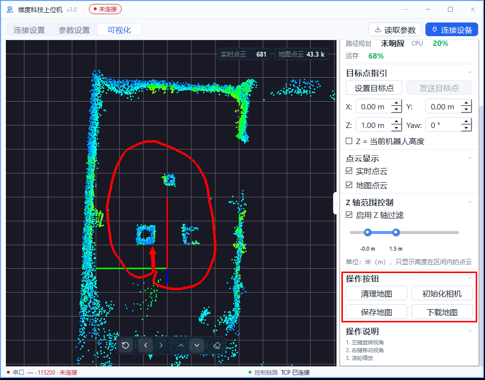
>     </td>
>   </tr>
> </table>
>
>
>
> 获取参数，将0x13设为1（定位）、0x14设为1（开启导航）。2d导航版的0x25规划模式只能设为0；3d导航版按场景选择0平面、1三维自由空间或2三维贴地。点击[写入参数]，确认保存和回读比对成功后点击[重启算法]，重连后等待[重定位]显示成功，再设置目标点。
>
> 重启指令回显只表示模块收到请求，仍需等待模块重新启动。需要重新建图时，将0x14设为0、0x13设为0，写入并重启后再扫描和保存。

点击右侧 [设置目标点] ，在地图内长按鼠标左键拖动，生成箭头(方向代表机器人朝向)代表目标点，也可通过输入具体xyz来设置目标点


<a name="v3-013"></a>

> **🟥 新增 · V3-013** — 补充 v3 目标点确认、单位和高度选项。
>
> 生成目标箭头后，点击[退出指点模式]确认目标。X、Y、Z单位为米，Yaw单位为度；可勾选[Z = 当前机器人高度]。目标点以保存地图的图原点系为准。


<a name="v3-014"></a>

> **🟩 修改 · V3-014** — 区分规划成功和设备实际到达。
>
> 点击 [发送目标点] ，查看[路径规划]状态，规划成功后可以看见生成了路径规划轨迹避开障碍物通往目标点

<details>
<summary>🟩 查看已替换／删除的 v2 原文</summary>

~~~~text
点击 [发送目标点] ，可以看见生成了路径规划轨迹避开障碍物到达目标点
~~~~

</details>


<table>
  <tr>
    <td style="border: 10px solid black; padding: 0;">
      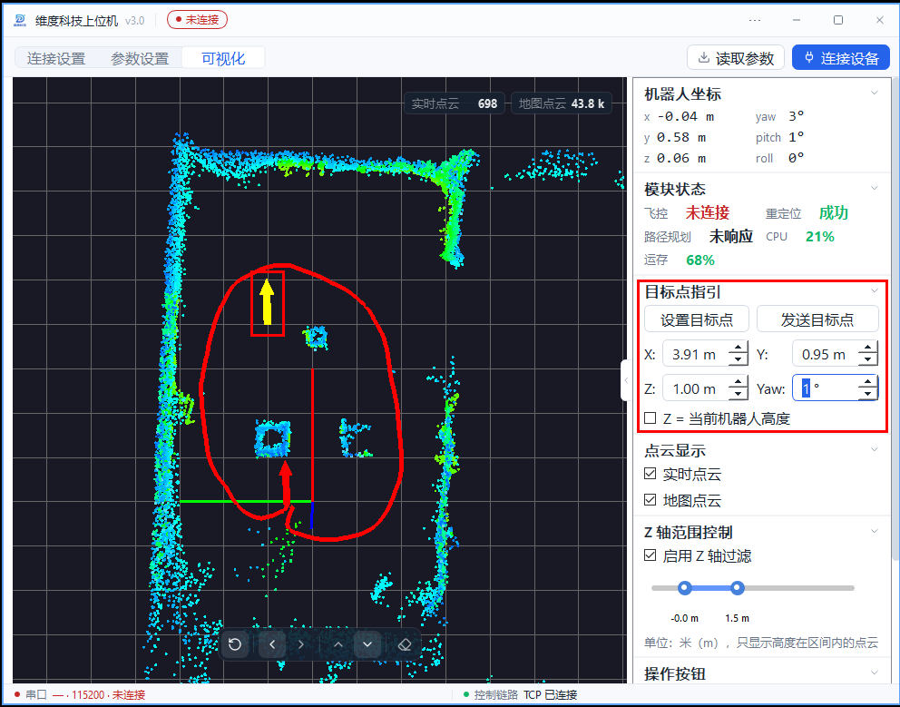
    </td>
  </tr>
</table>


<table>
  <tr>
    <td style="border: 10px solid black; padding: 0;">
      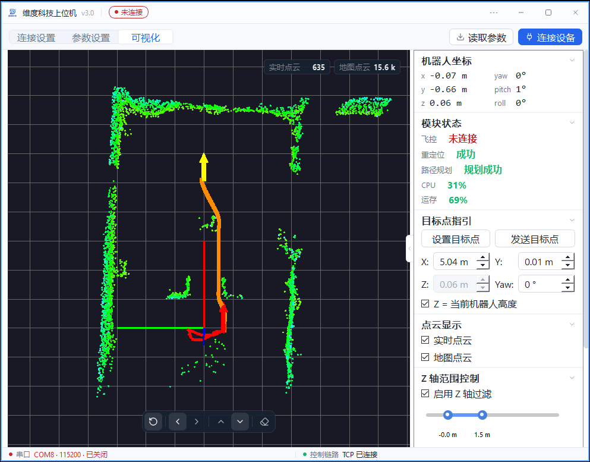
    </td>
  </tr>
</table>


<a name="v3-015"></a>

> **🟥 新增 · V3-015** — 补充目标结果判读、2D 高度行为和地图下载。
>
> 截图为新版界面操作示例，场地和坐标以实际地图为准。目标回显只表示模块收到目标，不代表规划成功或已到达；规划成功后还需观察设备实际位置。不同目标点发送间隔至少1s。
>
> 2d导航版使用平面规划。串口目标Z会被替换为0x23起飞高度；网络目标与起点不在同一高度层时，规划会调整到起点所在层，不能将输入的Z直接当作最终规划高度。
>
> ## 5.下载已保存的地图
>
> 使用网络连接模块，在可视化界面的[操作按钮]中点击[下载地图]，等待接收和校验完成，在[保存地图包]对话框选择路径保存ZIP文件。提示“地图下载成功”后，到所选路径查看地图包；取消保存不会生成文件。
>
> 下载的是模块已经保存的地图，不是尚未保存的扫描结果。串口不支持下载地图。

### 本章表格改动原文

<a name="v3-009"></a>

> **V3-009** — 消息 ID 已扩展，限定此表适用范围。

<details>
<summary>🟩 查看已替换的 v2 表格原文</summary>

~~~~text
| **Byte 1** | 消息 ID    | 1 byte | 0x01 / 0x02 / 0x03 | —        | 定位版只有0x01  |
~~~~

</details>


---

# 使用STM32和模块通信

## **1.通信协议格式**

### 1.1串口消息 ID 定义


<a name="v3-016"></a>

> **🟩 修改 · V3-016** — 补充 v3 消息范围。
>
> **定位版输出ID=0x01的当前位姿数据和0x05状态，导航版还支持目标点、位置控制指令和实时速度；命令帧和参数帧见下文**

<details>
<summary>🟩 查看已替换／删除的 v2 原文</summary>

~~~~text
**定位版只有ID=0x01的当前位姿数据**
~~~~

</details>


| 消息 ID | 消息类型 | 方向 | 发送频率 | 说明 |
| --- | --- | --- | --- | --- |
| **0x01** | 当前位姿数据 | 模块 → 单片机 | 10Hz | 模块输出机器人在地图中的位姿 |
| **0x02** | 导航目标点 | 单片机 → 模块 | 事件触发 | 模块接收目标点，模块收到后会**原封不动回发一次**作为应答 |
| **0x03** | 位置控制指令 | 模块 → 单片机 | 100Hz | 模块输出的规划指令,可以直接控制机器人跟随该轨迹 |
| 🟩 **0x04** | 实时速度 | 模块 → 单片机 | 100Hz | 输出规划的vx、vy、vz和偏航角速率，线速度单位cm/s，偏航角速率单位度/s |
| 🟥 **0x05** | 模块状态 | 模块 → 单片机 | 1Hz | 输出飞控、重定位、规划、CPU和运存状态 |
| 🟥 **0x00** | 命令帧 | 双向 | 事件触发 | 通信测试、保存地图、读参数、保存参数及重启算法 |
| 🟥 **0x10** | 参数帧 | 双向 | 事件触发 | 写参数、读参数应答和保存参数回显 |


### 1.2一帧数据格式如下（固定为15字节）

**波特率115200，字节格式为8N1**

| 字节序号       | 名称      | 长度     | 说明        | 单位       | 备注        |
| ---------- | ------- | ------ | --------- | -------- | --------- |
| **Byte 0** | 帧头      | 1 byte | 固定 `0xAA` | —        | 起始标志      |
| 🟩 **Byte 1** | 消息 ID    | 1 byte | 0x01 / 0x02 / 0x03 | —        | 本表为位姿、目标点和位置指令格式  |
| **Byte 2** | X 高字节   | 1 byte | X 坐标高 8 位 | **cm**   | int16 高字节 |
| **Byte 3** | X 低字节   | 1 byte | X 坐标低 8 位 | **cm**   | int16 低字节 |
| **Byte 4** | Y 高字节   | 1 byte | Y 坐标高 8 位 | **cm**   | int16 高字节 |
| **Byte 5** | Y 低字节   | 1 byte | Y 坐标低 8 位 | **cm**   | int16 低字节 |
| **Byte 6** | Z 高字节   | 1 byte | Z 坐标高 8 位 | **cm**   | int16 高字节 |
| **Byte 7** | Z 低字节   | 1 byte | Z 坐标低 8 位 | **cm**   | int16 低字节 |
| **Byte 8** | roll 高字节 | 1 byte | 翻滚角高字节    | **°（度）** | int16 高字节 |
| **Byte 9** | roll 低字节 | 1 byte | 翻滚角低字节    | **°（度）** | int16 低字节 |
| **Byte 10** | pitch 高字节 | 1 byte | 俯仰角高字节    | **°（度）** | int16 高字节 |
| **Byte 11** | pitch 低字节 | 1 byte | 俯仰角低字节    | **°（度）** | int16 低字节 |
| **Byte 12** | yaw 高字节 | 1 byte | 航向角高字节    | **°（度）** | int16 高字节 |
| **Byte 13** | yaw 低字节 | 1 byte | 航向角低字节    | **°（度）** | int16 低字节 |
| **Byte 14** | 帧尾      | 1 byte | 固定 `0x0A` | —        | 结束标志      |


<a name="v3-020"></a>

> **🟩 修改 · V3-020** — 状态帧改为 0x05。
>
> ### 模块状态帧格式（适用于 `0x05`）

<details>
<summary>🟩 查看已替换／删除的 v2 原文</summary>

~~~~text
### 飞控状态帧格式（适用于 `0x04`）
~~~~

</details>


| 字节序号 | 名称 | 长度 | 说明 | 备注 |
| --- | --- | --- | --- | --- |
| **Byte 0** | 帧头 | 1 byte | 固定 `0xAA` | 起始标志 |
| 🟩 **Byte 1** | 消息 ID | 1 byte | 固定 `0x05` | 状态帧标识 |
| **Byte 2** | 飞控状态枚举 | 1 byte | 详细定义见下表 | 取值范围 `0x00` ~ `0x04` |
| 🟩 **Byte 3** | 重定位状态 | 1 byte | 0=进行中，1=成功，2=失败，3=未响应 | 未响应不表示正在运行或失败 |
| 🟩 **Byte 4** | 路径规划状态 | 1 byte | 取值同重定位状态 |  |
| 🟩 **Byte 5** | CPU占用 | 1 byte | 0~100为百分比，0xFF为未知 | 不是255% |
| 🟩 **Byte 6** | 运存占用 | 1 byte | 0~100为百分比，0xFF为未知 | 不是255% |
| 🟩 **Byte 7~13**| 预留字段 | 7 bytes | 补零 (`0x00`) | 保持 15 字节帧长对齐 |
| **Byte 14** | 帧尾 | 1 byte | 固定 `0x0A` | 结束标志 |

| 枚举值 | 状态名称 | 含义说明 | 底层建议处理逻辑 (STM32) |
| --- | --- | --- | --- |
| `0x00` | **未连接/通信丢失** | ROS模块与飞控断连，或底层超 2 秒未收到心跳 | 🔴 **拦截目标点发送**，触发安全保护 / 熄灭指示灯 |
| `0x01` | **未解锁 (Unarmed)** | 飞控通讯正常，在地面处于安全加锁状态 | 🔴 **拦截目标点发送**，指示灯慢闪提示 |
| `0x02` | **已解锁，地面待命** | 电机已转动，但仍未起飞离开地面 | 🔴 **拦截目标点发送**，指示灯快闪警告 |
| `0x03` | **空中悬停 (Hovering)** | 飞机已起飞，处于定点等模式等待指令 | 🟢 **允许下发目标点**，指示灯常亮 |
| `0x04` | **执行航点 (Offboard)** | 飞机在空中，正在自动飞往 Ego-Planner 目标点 | 🟢 **允许下发目标点**，指示灯常亮 |


<a name="v3-023"></a>

> **🟥 新增 · V3-023** — 补充新增串口功能及兼容要求。
>
> ### 1.3速度、命令和参数
>
> 0x04速度帧的Byte 2~3、4~5、6~7分别为vx、vy、vz，Byte 8~11固定补零，Byte 12~13为偏航角速率，均为大端int16。0x03和0x04只有规划输出时才有数据。
>
> 0x00命令帧的Byte 2为子命令号：01通信测试、02保存地图、03读取参数、04保存参数、06重启算法，其余载荷补零。0x10参数帧的Byte 2为参数ID，Byte 3~4为大端int16参数值，其余载荷补零。两种帧均以AA开头、0A结尾，固定15字节。
>
> 读取参数返回22条参数帧，按参数ID读取；写参数本身不回帧，写完后发送保存参数命令，再读回核对。保存地图成功才回显；重启回显只表示收到请求。串口不支持地图下载。
>
> 帧中没有版本号，主控和模块需要使用匹配的协议，不能只看15字节帧长判断兼容。详细格式见[当前通信协议](https://github.com/weisama/super_mode/blob/v3.0/upper/config/通讯协议.md#串口通信协议)。

## 2.例程stm32f103c8t6串口1连接模块


<a name="v3-024"></a>

> **🟩 修改 · V3-024** — 修正串口使能参数编号。
>
> **注意需要设置参数0x12使能与主控串口通信**

<details>
<summary>🟩 查看已替换／删除的 v2 原文</summary>

~~~~text
**注意需要设置参数0x012使能与主控串口通信**
~~~~

</details>


<table>
  <tr>
    <td style="border: 10px solid black; padding: 0;">
      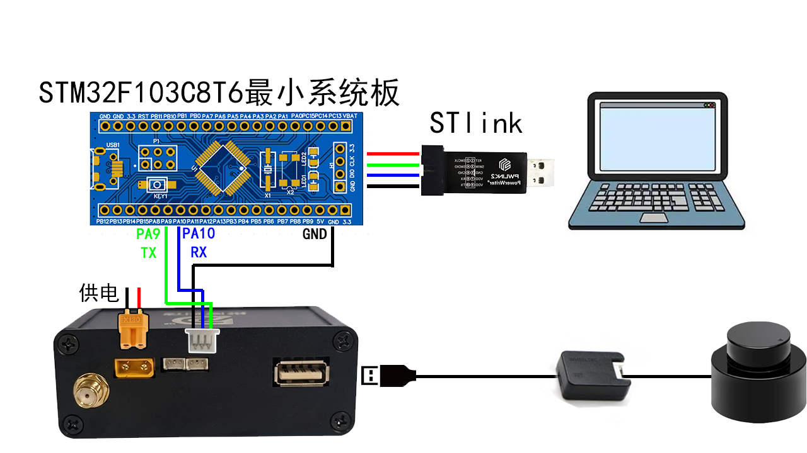
    </td>
  </tr>
</table>


<a name="v3-025"></a>

> **🟥 新增 · V3-025** — 补充新版工程对应引脚。
>
> USART1接线：PA9（TX）接模块RX，PA10（RX）接模块TX，双方GND相连，串口为115200、8N1。先断电接线，并确认双方串口电平兼容，STM32为3.3V。


<a name="v3-026"></a>

> **🟩 修改 · V3-026** — 替换 v2 压缩包和旧工程入口。
>
> ## [2.提供stm32f103c8t6例程（点击查看v3.0工程）](https://github.com/weisama/super_mode/tree/v3.0/stm32例程/5_mode_v3.0)
>
> 保留完整的5_mode_v3.0目录，HAL打开`HAL/MDK-ARM/stm32f103c8t6.uvprojx`，标准库打开`标准库/Project.uvprojx`。两个工程共用app和protocol目录，2d/3d共用，不需要分别选择雷达类型。
>
> 在所选工程的main.c中修改SELECTED_EXAMPLE：EXAMPLE_LOCALIZATION为定位接收，EXAMPLE_CAR为小车手动发点，EXAMPLE_DRONE为无人机航点。默认是EXAMPLE_CAR，开机不自动读取参数。

<details>
<summary>🟩 查看已替换／删除的 v2 原文</summary>

~~~~text
## [2.提供stm32f103c8t6例程（点击下载）](https://raw.githubusercontent.com/weisama/slam_mode_book/mode_v2.0/mode_v2.0_stm32f103c8t6.rar)
~~~~

</details>


#### 2.1运行代码(定位版)


<a name="v3-027"></a>

> **🟥 新增 · V3-027** — 给出新版定位示例选择。
>
> 将SELECTED_EXAMPLE设为EXAMPLE_LOCALIZATION：
>
> ```c
> #define SELECTED_EXAMPLE EXAMPLE_LOCALIZATION
> ```

编辑完代码，编译烧录进stm32f103c8t6，然后进入debug模式。


<a name="v3-028"></a>

> **🟩 修改 · V3-028** — 按新版观察变量修改。
>
> 在窗口一展开app_pose可观察到解析出的消息0x01当前位姿数据：

<details>
<summary>🟩 查看已替换／删除的 v2 原文</summary>

~~~~text
在窗口一展开pose_data可观察到解析出的消息0x01当前位姿数据：
~~~~

</details>


<table>
  <tr>
    <td style="border: 10px solid black; padding: 0;">
      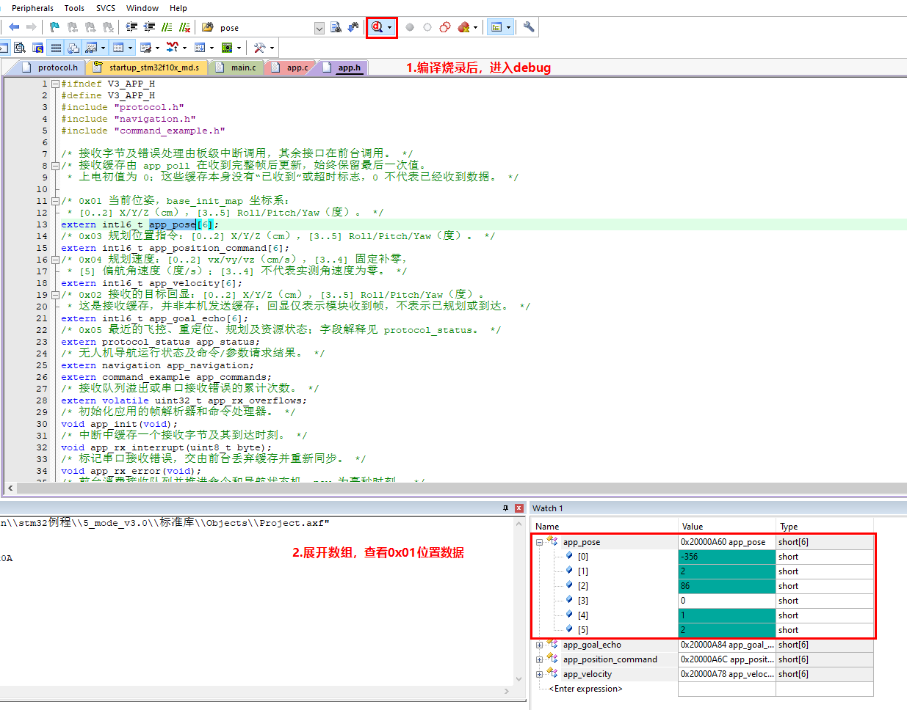
    </td>
  </tr>
</table>

**接收到的数据xyz单位为厘米，yaw单位为度**


<a name="v3-029"></a>

> **🟩 修改 · V3-029** — 位姿以保存地图的图原点系解释。
>
> **建图时以机器人上电位置和朝向建立图原点系，红色坐标轴（机器人前方）为X+方向，绿色坐标轴（机器人左方）为Y+方向，蓝色坐标轴（机器人上方）为Z+方向；定位模式重定位后，机器人坐标和目标点都以保存地图的图原点系为准**

<details>
<summary>🟩 查看已替换／删除的 v2 原文</summary>

~~~~text
**坐标轴遵循ENU，上电时以机器人朝向建立坐标轴，红色坐标轴（机器人前方）为X+方向，绿色坐标轴（机器人左方）为Y+方向，蓝色坐标轴（机器人上方）为Z+方向**
~~~~

</details>


<a name="v3-030"></a>

> **🟩 修改 · V3-030** — 重定位后偏航角仍参考保存地图的方向。
>
> **姿态角yaw：以图原点系X+方向为0度，向右顺时针转动范围0到-180度，向左逆时针转动范围0到180度；pitch，roll同理**

<details>
<summary>🟩 查看已替换／删除的 v2 原文</summary>

~~~~text
**姿态角yaw：模块启动时以X+为0度，向右顺时针转动范围0到-180度，向左逆时针转动范围0到180度；pitch，roll同理**
~~~~

</details>


#### 2.2运行代码(导航版)


<a name="v3-031"></a>

> **🟩 修改 · V3-031** — 用 v3 手动发点入口替换旧自动循环发点状态机。
>
> 通过修改SELECTED_EXAMPLE，可以选择小车手动发点：
>
> ```c
> #define SELECTED_EXAMPLE EXAMPLE_CAR
> ```
>
> 可自行设置目标点，六个值依次为x、y、z、roll、pitch、yaw，单位为cm和度：
>
> ```c
> static const int16_t goal[6] = {200, 0, 100, 0, 0, 0};
> ```
>
> 在主循环的按键或其他明确操作入口调用`app_send_goal(goal, board_now_ms())`发送目标点，调用间隔至少1000ms；返回1表示本机已发送，返回0表示发送受限。不要直接放进循环中反复发送。
>
> 先按[快速入门](1.快速入门.md#4上位机测试路径规划功能导航版)完成建图、保存地图、切换定位和启用导航，等待重定位成功后再发点。首次测试应断开电机供电，先查看规划结果。
>

<details>
<summary>🟩 查看已替换／删除的 v2 原文</summary>

~~~~text
通过修改CURRENT_TEST_MODE，可以选择通信测试

```
    // 改变这个常量的值，即可切换：飞行测试/通信测试 MODE_FLIGHT_TEST/MODE_COMM_TEST
    const TestMode_t CURRENT_TEST_MODE = MODE_COMM_TEST;
```

可自行设置目标点

```
// 参数：任务点个数与任务点数组 (单位: cm, deg)
#define WAYPOINT_COUNT 3
Waypoint_t mission_waypoints[WAYPOINT_COUNT] = {
    {200, 0,   100, 0},   // 航点1: 往前2m，高度1m
    {200, 200, 100, 180},  // 航点2: 往左2m，高度1m，偏航180度
    {0,   0,   100, 180}    // 航点3: 回到起点，高度1m
};
```

通信测试流程为：阶段0等待模块发来当前位姿数据，阶段1等待10s路径规划程序启动，阶段2循环发送设置的目标点，代码如下：

```
            // ================= 通信测试：等待算法启动稳定后再发送 =================
            static uint8_t comm_init_stage = 0;      // 通信测试初始化的局部状态机
            static uint32_t delay_start_time = 0;    // 10秒延时的起始时间戳

            if (comm_init_stage == 0)
            {
                // [阶段 0]：等待 0x01(当前位姿) 帧率大于 5Hz
                if (freq_0x01 > 5)
                {
                    comm_init_stage = 1;
                    delay_start_time = sys_tick_ms; // 使用系统滴答定时器记录满足帧率要求的时间戳
                }
            }
            else if (comm_init_stage == 1)
            {
                // [阶段 1]：帧率达标，等待 10s (10000ms) 让建图与规划算法完全初始化
                if (sys_tick_ms - delay_start_time >= 10000)
                {
                    comm_init_stage = 2;            // 10s 倒计时结束，进入工作阶段
                    last_send_time = sys_tick_ms;   // 初始化发送定时器
                }
                else if (freq_0x01 <= 5)
                {
                    // 防御性设计：如果在 10s 等待期内，ROS 节点重启或数据断供，打断计时并退回阶段 0
                    comm_init_stage = 0;
                }
            }
            else if (comm_init_stage == 2)
            {
                // [阶段 2]：算法就绪，正常执行每 5 秒发一次目标点的循环
                if (sys_tick_ms - last_send_time >= 5000)
                {
                    last_send_time = sys_tick_ms; // 更新时间戳
                    
                    // 获取当前需要发送的航点
                    Waypoint_t wp = mission_waypoints[current_wp_index];
                    
                    // 发送目标点 (带有重试机制)
                    Send_Nav_Goal_With_Retry(wp.x, wp.y, wp.z, wp.yaw);
                    
                    // 切换到下一个航点
                    current_wp_index++;
                    
                    // 如果发完了所有的点，归零重新开始循环
                    if (current_wp_index >= WAYPOINT_COUNT)
                    {
                        current_wp_index = 0; 
                    }
                }
                
                // 运行中保护：如果通信测试中途算法挂了导致帧率掉回 5Hz 以下，停止发送并重新等待
                if (freq_0x01 <= 5)
                {
                    comm_init_stage = 0; 
                }
            }
```
~~~~

</details>

在场地内放置三个障碍物，坐标分别为(1,0)、(2,1)、(1,2)：

<table>
  <tr>
    <td style="border: 10px solid black; padding: 0;">
      
    </td>
  </tr>
</table>


<a name="v3-032"></a>

> **🟩 修改 · V3-032** — 补齐 v3 导航前提。
>
> 模块连接雷达并上电，环绕一圈扫描整个场地，保存地图后切换定位、启用导航并重启，等待重定位成功：

<details>
<summary>🟩 查看已替换／删除的 v2 原文</summary>

~~~~text
模块连接雷达并上电，环绕一圈扫描整个场地最终停留在(0,2)位置：
~~~~

</details>


<table>
  <tr>
    <td style="border: 10px solid black; padding: 0;">
      
    </td>
  </tr>
</table>

编辑完代码，编译烧录进stm32f103c8t6，然后进入debug模式


<a name="v3-033"></a>

> **🟩 修改 · V3-033** — 按新版帧和手动发点行为修改。
>
> 可以看见收到了：0x01当前位姿约10hz，0x02在发送目标后回显，0x03位置控制指令和0x04实时速度在规划输出时约100hz，0x05状态约1hz；分别查看app_pose、app_goal_echo、app_position_command、app_velocity和app_status

<details>
<summary>🟩 查看已替换／删除的 v2 原文</summary>

~~~~text
可以看见收到了：0x01当前位姿10hz，0x02回发目标点每5s一帧，0x03位置控制指令100hz
~~~~

</details>


<a name="v3-034"></a>

> **🟩 修改 · V3-034** — 新版小车入口不自动循环发点。
>
> 打开上位机，发送目标点后可以看见模块规划出前往目标点的路径

<details>
<summary>🟩 查看已替换／删除的 v2 原文</summary>

~~~~text
打开上位机，可以看见模块循环规划出前往目标点的路径
~~~~

</details>


<table>
  <tr>
    <td style="border: 10px solid black; padding: 0;">
      
    </td>
  </tr>
</table>


<a name="v3-035"></a>

> **🟥 新增 · V3-035** — 补充回显、接收缓存及命令示例入口。
>
> 目标回显只表示模块收到帧，不代表规划成功或已经到达；需要结合规划状态、轨迹和设备实际位置判断。接收变量会保留最后一次的值，上电初值0不代表已经收到数据。无人机航点示例见[飞控使用模块](3.PX4或APM飞控使用模块.md#22单片机控制无人机固定路线巡航例程)。
>
> 命令和参数操作入口见[工程说明](https://github.com/weisama/super_mode/blob/v3.0/stm32例程/5_mode_v3.0/README.md)及[协议示例](https://github.com/weisama/super_mode/blob/v3.0/stm32例程/5_mode_v3.0/protocol/README.md)。

### 本章表格改动原文

<a name="v3-017"></a>

> **V3-017** — 0x04 改为速度帧。

<details>
<summary>🟩 查看已替换的 v2 表格原文</summary>

~~~~text
| **0x04** | 飞控实时状态 | 模块 → 单片机 | 1Hz | 发布飞控(PX4)的连接、解锁及着陆状态，用于底层防呆保护 |
~~~~

</details>

<a name="v3-018"></a>

> **V3-018** — 补充状态、命令和参数消息。

🟥 新增表格行，无对应 v2 原文。

<a name="v3-019"></a>

> **V3-019** — 限定原有六字段表的适用范围。

<details>
<summary>🟩 查看已替换的 v2 表格原文</summary>

~~~~text
| **Byte 1** | 消息 ID    | 1 byte | 0x01 / 0x02 / 0x03 | —        | 定位版只有0x01  |
~~~~

</details>

<a name="v3-021"></a>

> **V3-021** — 替换状态帧 ID。

<details>
<summary>🟩 查看已替换的 v2 表格原文</summary>

~~~~text
| **Byte 1** | 消息 ID | 1 byte | 固定 `0x04` | 状态帧标识 |
~~~~

</details>

<a name="v3-022"></a>

> **V3-022** — 原预留字节用于重定位、规划和资源状态。

<details>
<summary>🟩 查看已替换的 v2 表格原文</summary>

~~~~text
| **Byte 3~13**| 预留字段 | 11 bytes | 补零 (`0x00`) | 保持 15 字节帧长对齐 |
~~~~

</details>


---

# 1.若机器人主控使用px4架构飞控（pixhawk），测试模块作为飞控的位置输入传感器

模块接线如图（以pixhawk 6c mini飞控为例）：

**注意需要设置参数0x11使能与px4飞控通信**

<table>
  <tr>
    <td style="border: 10px solid black; padding: 0;">
      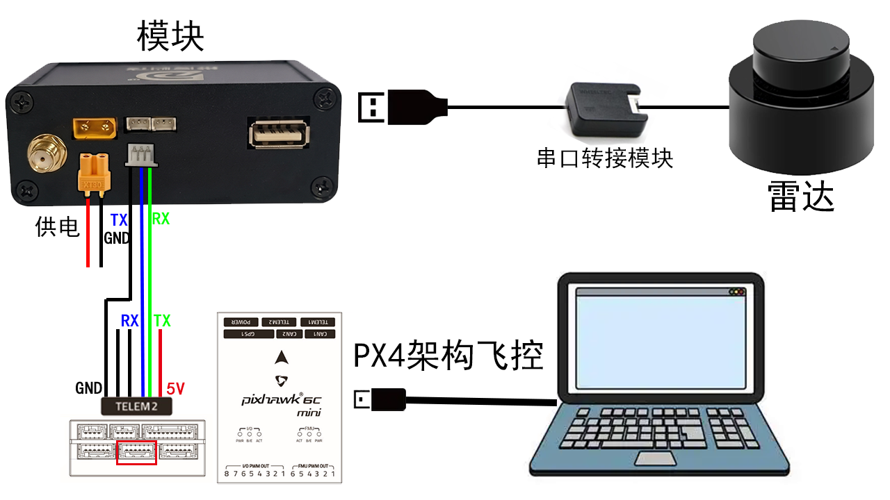
    </td>
  </tr>
</table>


<a name="v3-036"></a>

> **🟥 新增 · V3-036** — 说明保留接线图与当前接口的差别。
>
> 本节模块飞控输出接飞控TELEM1，TX接对方RX、RX接对方TX，GND共地。上图为旧TELEM2接线示例，只参考TX/RX和共地关系，实际按TELEM1引脚连接。

需准备一架可起飞的飞控为px4架构飞控的无人机，电脑下载上QGC


<a name="v3-037"></a>

> **🟩 修改 · V3-037** — 统一 PX4 教程版本。
>
> 本教程以pixhawk 6c mini，固件PX4 1.14.3为例，飞控连接上QGC后设置参数如下：

<details>
<summary>🟩 查看已替换／删除的 v2 原文</summary>

~~~~text
本教程以pixhawk 6c mini，固件px4v1.13.3为例，飞控连接上QGC后设置参数如下：
~~~~

</details>


<table>
  <tr>
    <td style="border: 10px solid black; padding: 0;">
      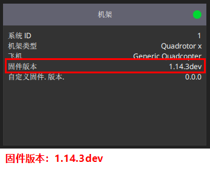
    </td>
  </tr>
</table>

<table>
  <tr>
    <td style="border: 10px solid black; padding: 0;">
      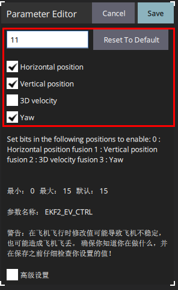
    </td>
  </tr>
</table>

| 🟩 参数名称 | 设置值 | 说明 |
|---------|--------|------|
| 🟩 MAV_0_CONFIG | 101（TELEM1） | 将MAVLink实例0映射到TELEM1，接口不可与其他设备冲突 |
| 🟩 MAV_0_MODE | 2（Onboard） | 用于连接模块 |
| 🟩 SER_TEL1_BAUD | 500000 | 模块侧波特率也需匹配，8N1 |
| 🟩 EKF2_EV_CTRL | 2d为9，3d为11 | 9=水平位置和偏航；11=额外融合模块垂直位置 |
| 🟩 EKF2_HGT_REF | 2d按定高传感器设置，3d为3（Vision） | 2d现场测距方案为2（Range sensor） |
| 🟩 EKF2_RNG_CTRL | 2d按测距方案设置，3d按实际高度方案设置 | 2d现场为2（连续融合），需确认测距范围和地面条件 |
| 🟩 EKF2_EV_DELAY、EKF2_EVP_NOISE、EKF2_EVA_NOISE | 按实际设备调试 | 延迟、位置和偏航噪声不直接照搬其他机型 |


<a name="v3-039"></a>

> **🟩 修改 · V3-039** — 修正版本和串口示例。
>
> 以上参数为pixhawk 6c mini，固件PX4 1.14.3为例，模块飞控接口接到飞控TELEM1；其他接口需按实际MAVLink实例调整

<details>
<summary>🟩 查看已替换／删除的 v2 原文</summary>

~~~~text
以上参数为pixhawk 6c mini，固件px4v2.03.3为例，模块飞控接口接到飞控telem2
~~~~

</details>


<a name="v3-040"></a>

> **🟥 新增 · V3-040** — 补充 2D 高度来源及现有截图适用范围。
>
> 2d模块需要额外定高传感器，模块位姿Z来自飞控，不能再作为独立外部高度输入融合；3d模块可使用模块输出的高度。2d现场使用TELEM2连接MT-06，其接口和融合需单独设置。
>
> 上述QGC固件截图显示1.14.3dev，实际固件版本以QGC读值为准。截图EKF2_EV_CTRL=11为3d示例，2d按上表设置。现场整机参数含机型和校准信息，不要直接导入其他飞机；参考[现场参数说明](https://github.com/weisama/super_mode/blob/v3.0/stm32例程/5_mode_v3.0/飞控参数/README.md)。

设置参数后断电重连飞控确保参数生效
给模块上电，等待模块初始化10s，可在QGC的mavlink控制器中看见模块传给飞控的数据：

<table>
  <tr>
    <td style="border: 10px solid black; padding: 0;">
      
    </td>
  </tr>
</table>


<a name="v3-041"></a>

> **🟥 新增 · V3-041** — 补充融合结果检查。
>
> 移动和转向模块，检查QGC中的本地位置、偏航和高度方向，并确认估计器实际融合；2d还需检查定高传感器数据持续有效。收到外部位姿消息不等于已经融合。

QGC中可以把飞控模式设置为定点

<table>
  <tr>
    <td style="border: 10px solid black; padding: 0;">
      
    </td>
  </tr>
</table>

## 若机器人主控使用apm架构飞控，设置参数如下可以进入Loiter模式

| 参数名称              | 设置值         | 说明                          |
| ----------------- | ----------- | --------------------------- |
| SERIAL2\_PROTOCOL | MAVLink2    | 将串口 2 协议设置为 MAVLink 2       |
| SERIAL2\_BAUD     | 500000      | 串口 2 波特率设置为 500000 bps      |
| BRD\_SER2\_RTSCTS | Disable     | 禁用串口 2 的硬件流控（RTS/CTS）       |
| AHRS\_EKF\_TYPE   | Enable EKF3 | 启用 EKF3 作为姿态估计器             |
| EK3\_SRC1\_POSXY  | ExternalNav | EKF3 主数据源：XY 平面位置使用外部导航数据   |
| 🟩 EK3\_SRC1\_POSZ   | 按高度来源选择 | 3d使用ExternalNav；2d根据额外定高传感器设置，枚举值按实际APM固件确认 |
| EK3\_SRC1\_VELXY  | None | EKF3 主数据源：XY 平面速度无输入   |
| EK3\_SRC1\_YAW    | ExternalNav | EKF3 主数据源：航向角使用外部导航数据       |
| VISO\_TYPE        | MAVLink     | 视觉里程计类型设置为 MAVLink 协议       |

# 2.导航版测试offboard模式控制无人机进行路径规划

⚠️⚠️⚠️⚠️⚠️⚠️⚠️⚠️⚠️⚠️⚠️⚠️⚠️⚠️⚠️

请先仔细阅读[5.常见问题&免责声明](https://github.com/weisama/slam_mode_book/blob/mode_v3.0/5.%E5%B8%B8%E8%A7%81%E9%97%AE%E9%A2%98%26%E5%85%8D%E8%B4%A3%E5%A3%B0%E6%98%8E.md)

请先进行以下测试，并且多次测试运行结果正常：

1️⃣正确设置无人机参数，并可以稳定定点飞行

2️⃣完成测试[模块作为飞控的位置输入传感器，能稳定进行定点模式飞行](https://github.com/weisama/slam_mode_book/blob/mode_v3.0/3.PX4%E6%88%96APM%E9%A3%9E%E6%8E%A7%E4%BD%BF%E7%94%A8%E6%A8%A1%E5%9D%97.md#1%E8%8B%A5%E6%9C%BA%E5%99%A8%E4%BA%BA%E4%B8%BB%E6%8E%A7%E4%BD%BF%E7%94%A8px4%E6%9E%B6%E6%9E%84%E9%A3%9E%E6%8E%A7pixhawk%E6%B5%8B%E8%AF%95%E6%A8%A1%E5%9D%97%E4%BD%9C%E4%B8%BA%E9%A3%9E%E6%8E%A7%E7%9A%84%E4%BD%8D%E7%BD%AE%E8%BE%93%E5%85%A5%E4%BC%A0%E6%84%9F%E5%99%A8)

3️⃣完成测试[上位机测试路径规划功能（导航版）](https://github.com/weisama/slam_mode_book/blob/mode_v3.0/1.%E5%BF%AB%E9%80%9F%E5%85%A5%E9%97%A8.md#4%E4%B8%8A%E4%BD%8D%E6%9C%BA%E6%B5%8B%E8%AF%95%E8%B7%AF%E5%BE%84%E8%A7%84%E5%88%92%E5%8A%9F%E8%83%BD%E5%AF%BC%E8%88%AA%E7%89%88)

4️⃣完成测试[使用STM32和模块通信](https://github.com/weisama/slam_mode_book/blob/mode_v3.0/2.%E4%BD%BF%E7%94%A8STM32%E5%92%8C%E6%A8%A1%E5%9D%97%E9%80%9A%E4%BF%A1.md#22%E8%BF%90%E8%A1%8C%E4%BB%A3%E7%A0%81%E5%AF%BC%E8%88%AA%E7%89%88)


<a name="v3-043"></a>

> **🟩 修改 · V3-043** — 统一飞行流程的固件版本。
>
> 本教程以F290机架四旋翼无人机，飞控pixhawk 6c mini，固件PX4 1.14.3为例，测试过程需飞手全程拿着遥控准备接管无人机控制,每次降落后都必须断电重启

<details>
<summary>🟩 查看已替换／删除的 v2 原文</summary>

~~~~text
本教程以F290机架四旋翼无人机，飞控pixhawk 6c mini，固件px4v2.03.3为例，测试过程需飞手全程拿着遥控准备接管无人机控制,每次降落后都必须断电重启
~~~~

</details>


⚠️⚠️⚠️⚠️⚠️⚠️⚠️⚠️⚠️⚠️⚠️⚠️⚠️⚠️⚠️

## 设定px4飞控参数用于紧急情况下接管无人机

| 参数名称 | 推荐设置值 | 说明 |
| :--- | :--- | :--- |
| 🟩 `COM_RC_OVERRIDE` | `2`（Offboard）或`3`（Auto和Offboard） | PX4 1.14按位启用接管，包含Offboard位后，大幅拨动摇杆切回Position；位置不可用时切回Altitude。 |
| `COM_RC_STICK_OV` | 30% | 摇杆拨动的百分比阈值判断飞手触发了紧急接管 |
| 🟩 `RC_MAP_KILL_SW` | 对应的遥控器通道 (例如 `11`) | 映射急停（锁桨）拨杆通道。紧急情况下拨动此开关，飞控将切断电机动力，先拆桨检查开关是否有效。 |
| 🟩 `CBRK_FLIGHTTERM` | 按飞行终止方案设置 | 此参数控制飞行终止，不是RC_MAP_KILL_SW急停开关的使能；急停开关需独立配置并拆桨验证。 |


<a name="v3-047"></a>

> **🟥 新增 · V3-047** — 给出新版接管参数依据。
>
> PX4参数含义见[1.14官方参数表](https://docs.px4.io/v1.14/en/advanced_config/parameter_reference.html#COM_RC_OVERRIDE)，接管和急停功能需在当前机型上检查后再飞行。

## 2.1上位机设置目标点

模块设置了一键起飞和一键降落，通过与飞控通信读取：通道7的按键或拨杆进行一次 高->低 或 低->高 通道值的切换，则认为触发了一次一键起飞或一键降落


<a name="v3-048"></a>

> **🟩 修改 · V3-048** — 用存图和重定位流程替换固定等待建图步骤。
>
> 无人机和模块上电后，等待模块初始化完成并连接上位机，按快速入门完成建图、保存地图、切换定位和启用导航，重启后等待重定位成功

<details>
<summary>🟩 查看已替换／删除的 v2 原文</summary>

~~~~text
无人机和模块上电后，等待模块初始化完成并连接上位机，无人机建图完成后等待10s路径规划算法初始化
~~~~

</details>


<a name="v3-050"></a>

> **🟩 修改 · V3-050** — 起飞高度参数由0x24改为0x23。
>
> qgc确保无人机各项数据正常，按下通道7的按键或拨杆，进行一键起飞，爬升量为参数0x23起飞高度；起飞前确认参数与现场巡航高度一致

<details>
<summary>🟩 查看已替换／删除的 v2 原文</summary>

~~~~text
qgc确保无人机各项数据正常，按下通道7的按键或拨杆，进行一键起飞到设置的参数0x24起飞高度
~~~~

</details>


无人机稳定悬停后，可以在上位机设置目标点让无人机路沿着规划轨迹到达指定位置

<table>
  <tr>
    <td style="border: 10px solid black; padding: 0;">
      
    </td>
  </tr>
</table>

到达目标点稳定悬停后，进行一键降落，飞控会切到降落模式进行降落

## 2.2单片机控制无人机固定路线巡航例程


<a name="v3-052"></a>

> **🟩 修改 · V3-052** — 用 v3 航点入口和数组替换旧飞行状态机代码。
>
> 通过修改SELECTED_EXAMPLE，可以选择飞行测试：
>
> ```c
> #define SELECTED_EXAMPLE EXAMPLE_DRONE
> ```
>
> 可自行设置目标点，在`app/example.c`修改航点数组，单位为cm和度，六个值为x、y、z、roll、pitch、yaw：
>
> ```c
> static const int16_t waypoints[][6] = {
>     {400, 0, 100, 0, 0, 0},
>     {400, -200, 100, 0, 0, 0},
>     {0, 0, 100, 0, 0, 0}
> };
> ```
>
> 编辑完代码，编译烧录进stm32f103c8t6。示例等待新鲜位姿、飞控状态3或4，以及Z>50cm持续1s后发送航点；位姿或状态过期时暂停。解锁、起飞和降落仍由操作者、模块及飞控完成，STM32示例不执行这些操作。
>
> 2d位姿Z来自飞控，需独立确认定高数据持续有效，收到新的位姿帧不代表高度源仍在更新。2d串口目标Z会被替换为0x23起飞高度；3d使用航点设置的Z。
>

<details>
<summary>🟩 查看已替换／删除的 v2 原文</summary>

~~~~text
通过修改CURRENT_TEST_MODE，可以选择飞行测试

```
    // 改变这个常量的值，即可切换：飞行测试/通信测试 MODE_FLIGHT_TEST/MODE_COMM_TEST
    const TestMode_t CURRENT_TEST_MODE = MODE_FLIGHT_TEST;
```

可自行设置目标点

```
// 参数：任务点个数与任务点数组 (单位: cm, deg)
#define WAYPOINT_COUNT 3
Waypoint_t mission_waypoints[WAYPOINT_COUNT] = {
    {200, 0,   100, 0},   // 航点1: 往前2m，高度1m
    {200, 200, 100, 180},  // 航点2: 往左2m，高度1m，偏航180度
    {0,   0,   100, 180}    // 航点3: 回到起点，高度1m
};
```

飞行测试流程为：

1️⃣起飞阶段等待无人机悬停在0.5m以上1s

2️⃣目标点发送阶段会发送目标点直到收到回发

3️⃣飞行阶段会判断无人机到达目标点，并发送下一目标点直至抵达最好一个目标点

代码如下：

```
            // ================= 飞行测试：状态机顺序飞三个目标点 =================
            switch (current_task_state)
            {
                case TASK_WAIT_TAKEOFF:
                    // 任务1: 等待起飞到 0.5m (50cm) 以上 
                    if (current_pose.z > 50) 
                    {
                        if (!condition_met_flag) {
                            condition_start_time = sys_tick_ms; // 开始计时
                            condition_met_flag = 1;
                        } else if (sys_tick_ms - condition_start_time >= 1000) {
                            // 满足 1s 条件，切换到发送任务
                            current_task_state = TASK_SEND_GOAL;
                            condition_met_flag = 0; // 清除标志供下次使用
                        }
                    } 
                    else 
                    {
                        condition_met_flag = 0; // 还没到高度或掉下去了，重新计时
                    }
                    break;

                case TASK_SEND_GOAL:
                    // 任务2: 发送当前目标点
                    if (current_wp_index < WAYPOINT_COUNT) 
                    {
                        Waypoint_t wp = mission_waypoints[current_wp_index];
                        Send_Nav_Goal_With_Retry(wp.x, wp.y, wp.z, wp.yaw);
                        
                        // 发送完成后，立刻切换到等待到达状态
                        current_task_state = TASK_WAIT_REACH;
                        condition_met_flag = 0; 
                    } 
                    else 
                    {
                        // 索引越界保护，直接切到结束状态
                        current_task_state = TASK_FINISHED;
                    }
                    break;

                case TASK_WAIT_REACH:
                {
                    // 任务3: 等待无人机到达任务点 ±0.1m (10cm) 内
                    Waypoint_t wp = mission_waypoints[current_wp_index];
                    int16_t dx = current_pose.x - wp.x;
                    int16_t dy = current_pose.y - wp.y;
                    int16_t dz = current_pose.z - wp.z;

                    // X, Y, Z 三轴误差必须同时 <= 20cm
                    if (ABS(dx) <= 20 && ABS(dy) <= 20) 
                    {
                        if (!condition_met_flag) {
                            condition_start_time = sys_tick_ms;
                            condition_met_flag = 1;
                        } else if (sys_tick_ms - condition_start_time >= 1000) {
                            // 稳定在目标点内 1s，索引加1，切回发送或结束
                            current_wp_index++;
                            if (current_wp_index >= WAYPOINT_COUNT) {
                                current_task_state = TASK_FINISHED;
                            } else {
                                current_task_state = TASK_SEND_GOAL;
                            }
                            condition_met_flag = 0;
                        }
                    } 
                    else 
                    {
                        condition_met_flag = 0; // 偏离目标，重新计时
                    }
                    break;
                }

                case TASK_FINISHED:
                    // 任务4: 所有任务点都已到达，结束任务。
                    break;
            }
            // =================================================================
```
~~~~

</details>


<a name="v3-049"></a>

> **🟩 修改 · V3-049** — 用存图和重定位流程替换固定等待建图步骤。
>
> 无人机和模块上电后，等待模块初始化完成并连接上位机，按快速入门完成建图、保存地图、切换定位和启用导航，重启后等待重定位成功

<details>
<summary>🟩 查看已替换／删除的 v2 原文</summary>

~~~~text
无人机和模块上电后，等待模块初始化完成并连接上位机，无人机建图完成后等待10s路径规划算法初始化
~~~~

</details>


<a name="v3-051"></a>

> **🟩 修改 · V3-051** — 起飞高度参数由0x24改为0x23。
>
> qgc确保无人机各项数据正常，按下通道7的按键或拨杆，进行一键起飞，爬升量为参数0x23起飞高度；起飞前确认参数与现场巡航高度一致

<details>
<summary>🟩 查看已替换／删除的 v2 原文</summary>

~~~~text
qgc确保无人机各项数据正常，按下通道7的按键或拨杆，进行一键起飞到设置的参数0x24起飞高度
~~~~

</details>


无人机稳定悬停后，单片机程序会自行发送目标点直到抵达最后一个目标点

<table>
  <tr>
    <td style="border: 10px solid black; padding: 0;">
      
    </td>
  </tr>
</table>

到达目标点稳定悬停后，进行一键降落，飞控会切到降落模式进行降落


### 本章表格改动原文

<a name="v3-038"></a>

> **V3-038** — 替换旧版 PX4 接口和融合参数。

<details>
<summary>🟩 查看已替换的 v2 表格原文</summary>

~~~~text
| 参数名称 | 设置值 | 说明 |
|---------|--------|------|
| MAV_1_CONFIG | TELLEM2 | 将 MAVLink 第 1 通道映射到飞控的 TELEM2 接口 |
| MAV_1_MODE | Onboard | 设定为 Onboard 模式，用于连接模块 |
| SER_TEL2_BAUD | 500000 8N1 | 设定 TELEM2 串口波特率为 500000 bps，8 位数据位、无校验、1 位停止位 |
| MAV_1_RATE | 0 | 设定 MAVLink 通道 1 的数据速率（bytes/s），0 表示由飞控自适应 |
| EKF2_AID_MASK | 24 | 设定飞控EKF2模块数据：24=16+8，启用模块输入的位置（EV_POS）与偏航（EV_YAW） |
| EKF2_EVP_NOISE | 0.1 | 默认外部位置观测噪声（m） |
| EKF2_EVA_NOISE | 2.56 | 默认外部角度（偏航）观测噪声（deg） |
| EKF2_EV_DELAY | 175 | 默认外部数据相对 IMU 的延迟补偿（ms） |
| EKF2_HGT_MODE | ? | **设定高度数据来源，3d版设置为2表示为启用模块输入，2d版根据自己的高度传感器设置** |
~~~~

</details>

<a name="v3-042"></a>

> **V3-042** — 仅明确 APM 高度项，其余 APM 原表沿用。

<details>
<summary>🟩 查看已替换的 v2 表格原文</summary>

~~~~text
| EK3\_SRC1\_POSZ   | ？ | 设定高度数据来源，3d版为EK3_SRC1_POSZ表示为启用模块输入，2d版根据自己的高度传感器设置 |
~~~~

</details>

<a name="v3-044"></a>

> **V3-044** — 按 PX4 1.14 参数定义修正 Offboard 接管位。

<details>
<summary>🟩 查看已替换的 v2 表格原文</summary>

~~~~text
| `COM_RC_OVERRIDE` | `1` (Enabled) | 启用摇杆接管。在 Offboard 模式下大幅拨动遥控器摇杆，飞控会自动退出该模式并切回 Position (定点) 模式。 |
~~~~

</details>

<a name="v3-045"></a>

> **V3-045** — 区分飞行终止和遥控急停。

<details>
<summary>🟩 查看已替换的 v2 表格原文</summary>

~~~~text
| `CBRK_FLIGHTTERM` | `0` | 禁用飞行终止断路器。确保设为 0，以允许 Kill Switch (急停拨杆) 能够正常生效。 |
~~~~

</details>

<a name="v3-046"></a>

> **V3-046** — 补全旧表残句并明确检查方法。

<details>
<summary>🟩 查看已替换的 v2 表格原文</summary>

~~~~text
| `RC_MAP_KILL_SW` | 对应的遥控器通道 (例如 `11`) | 映射急停（锁桨）拨杆通道。紧急情况下拨动此开关，飞控将立即切断所有电机动力，QGC |
~~~~

</details>


---

## 1.参数设置

首次使用需要设置雷达型号参数，模块上电连接上位机后，可以进入参数设置界面


<a name="v3-053"></a>

> **🟩 修改 · V3-053** — 按 v3 保存、回读和重启流程修改。
>
> ⚠️参数设置后需要[写入参数]，等待保存和回读比对成功，需要重启生效的设置重启后再[获取参数]查看是否修改成功

<details>
<summary>🟩 查看已替换／删除的 v2 原文</summary>

~~~~text
⚠️参数设置后需要[写入参数]，写入后重新上电再[读取参数]查看是否修改成功
~~~~

</details>


<table>
  <tr>
    <td style="border: 10px solid black; padding: 0;">
      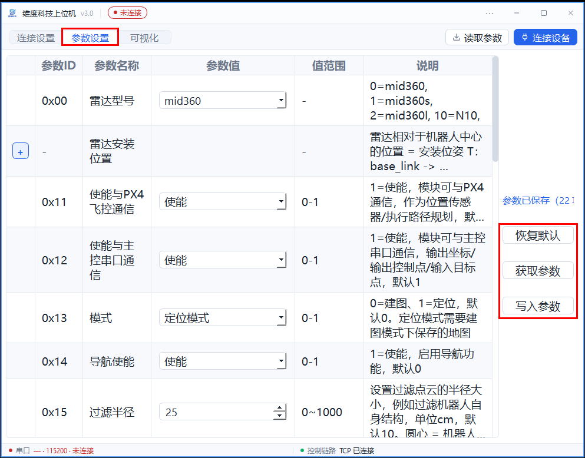
    </td>
  </tr>
</table>

| 参数ID | 参数名称 | 值范围 | 说明 |
| --- | --- | --- | --- |
| 🟩 0x00 | 雷达型号 | - | 0=MID360, 1=MID360s, 2=MID360l, 10=N10, 11=N10_P，12/13为占位，默认0 |
| 0x01~0x06 | 雷达安装位置 |  | 雷达相对于机器人中心的位置（base_link->laser_link），遵循FLU（X前，Y左，Z上） |
| 0x01 | X坐标 | -100~100 | 雷达位置X坐标值，单位厘米，默认0 |
| 0x02 | Y坐标 | -100~100 | 雷达位置Y坐标值，单位厘米，默认0 |
| 0x03 | Z坐标 | -100~100 | 雷达位置Z坐标值，单位厘米，默认0 |
| 0x04 | Roll角度 | -180~180 | 雷达滚转角，单位度，默认0 |
| 0x05 | Pitch角度 | -180~180 | 雷达俯仰角，单位度，默认0 |
| 0x06 | Yaw角度 | -180~180 | 雷达偏航角，单位度，默认0 |
| 0x11 | 使能与PX4通信 | 0-1 | 1=使能，模块可与PX4通信，作为位置传感器/执行路径规划，默认1 |
| 0x12 | 使能与主控通信 | 0-1 | 1=使能，模块可与主控串口通信，输出坐标/输出控制点/输入目标点，默认1 |
| 🟥 0x13 | 模式 | 0-1 | 0=建图，1=定位，默认0；定位需先保存地图 |
| 🟥 0x14 | 导航使能 | 0-1 | 0=关闭，1=开启，默认0；导航版开启后强制定位 |
| 🟥 0x15 | 过滤半径 | 0~1000 | 过滤自身结构等近距离点云，单位cm，默认10；3d以机器人中心为圆心，2d用于扫描匹配的最小距离 |
| 🟩 0x21~0x29 | 路径规划与小车模型参数 | 0~1000 | 首次使用应断开电机供电，查看规划结果无误 |
| 0x21 | 最大移动速度 | 0~1000 | 路径规划输出轨迹的最大移动速度，单位cm/s，默认100 |
| 🟩 0x22 | 最大加速度 | 0~1000 | 路径规划输出轨迹的最大加速度，单位cm/s²，默认100 |
| 🟩 0x23 | 起飞高度 | 0~1000 | 一键起飞设定的高度，单位cm，默认100；2d串口目标Z使用此高度 |
| 🟩 0x24 | 障碍膨胀半径 | 0~1000 | 界面名称为膨胀半径，协议名称为机器人半径，单位cm，默认10；建议参考机器人半径+10并按场地核对 |
| 🟩 0x25 | 规划模式 | 0~2 | 0=平面，1=三维自由空间，2=三维贴地；默认0，2d导航版仅支持0 |
| 🟩 0x26 | 小车运动学模型 | 0~1 | 0=全向，1=差速，默认0；仅规划模式0生效 |
| 🟩 0x27 | 目标点容差 | 0~1000 | 小车判定到点的距离，单位cm，默认15 |
| 🟥 0x28 | 最大偏航角速率 | 0~1000 | 小车模型参数，单位度/s，默认43 |
| 🟥 0x29 | 最小转弯半径 | 0~1000 | 小车模型参数，单位cm，默认100；全向模型不生效 |
| 🟥 0x99 | 模块类型 | 0~3 | 0=3d定位，1=3d导航，2=2d定位，3=2d导航 |

完整含义见[当前通信协议](https://github.com/weisama/super_mode/blob/v3.0/upper/config/通讯协议.md#参数id定义表)。v2与v3的参数编号不完全相同，请勿按旧表写入。

### 参数设置须知

1️⃣3d版雷达非水平放置需设置雷达放置位置参数组，设置教程见进阶使用第3节

2️⃣如无需与px4飞控通信，或无需串口输出，可以设置0x11或0x12参数为不能，减少对应输出带来的算力占用


<a name="v3-060"></a>

> **🟩 修改 · V3-060** — 旧最大高度和安全距离参数已不适用。
>
> 3️⃣导航版需正确设置路径规划参数组：建议首次测试，建议最大移动速度和最大加速度默认100；0x25按平面、三维自由空间或三维贴地场景选择，2d导航版只能设为0，不再按旧表调整最大高度和安全距离

<details>
<summary>🟩 查看已替换／删除的 v2 原文</summary>

~~~~text
3️⃣导航版需正确设置路径规划参数组：建议首次测试，建议最大移动速度和最大加速度默认100；规划出的轨迹不从障碍物中间穿过而是从上方经过，可以适当减小0x23最大高度和0x26安全距离
~~~~

</details>


<a name="v3-061"></a>

> **🟩 修改 · V3-061** — 按 v3 膨胀半径更新障碍物说明。
>
> 4️⃣2d/3d导航版需正确设置0x24障碍膨胀半径，当前位置或目标点位于膨胀后的障碍物内则会规划失败；障碍物包括地板，所以3d导航版在地面测试路径规划失败，需检查机器人中心与地板距离和膨胀半径，不要按旧编号调整机器人半径和安全距离

<details>
<summary>🟩 查看已替换／删除的 v2 原文</summary>

~~~~text
4️⃣2d/3d导航版需正确设置0x25机器人半径和0x26安全距离，当前无人机位置或目标点与障碍物距离小于机器人半径则会规划失败；障碍物包括地板，所以3d导航版在地面测试路径规划失败，很可能是机器人中心距离地板小于设置的机器人半径，路径规划算法认为机器人在地板内则规划失败
~~~~

</details>


<a name="v3-062"></a>

> **🟩 修改 · V3-062** — 更新起飞高度编号及两种目标入口行为。
>
> 5️⃣2d导航版使用平面规划，需设置0x23起飞高度=巡航高度；串口目标Z会被替换为该高度，网络目标跨高度层时会调整到起点所在层

<details>
<summary>🟩 查看已替换／删除的 v2 原文</summary>

~~~~text
5️⃣2d导航版会强制在z=0x24起飞高度的平面内进行规划，故设置起飞高度=巡航高度
~~~~

</details>


<a name="v3-063"></a>

> **🟩 修改 · V3-063** — 更新过滤参数编号和适用范围。
>
> 6️⃣2d/3d导航版需正确设置0x15过滤半径；3d用于过滤机器人中心附近点云，2d用于扫描匹配最小距离，不能将其当作障碍膨胀半径

<details>
<summary>🟩 查看已替换／删除的 v2 原文</summary>

~~~~text
6️⃣2d/3d导航版需正确设置0x27过滤半径，否则可能出现机器人自身结构被扫描认为是障碍物，导致路径规划失败
~~~~

</details>


## 2.设置览沃MID360雷达的IP

准备一台有网口的windows电脑，使用系统搜索找到网络连接

<table>
  <tr>
    <td style="border: 10px solid black; padding: 0;">
      
    </td>
  </tr>
</table>

找到以太网，右键属性

<table>
  <tr>
    <td style="border: 10px solid black; padding: 0;">
      
    </td>
  </tr>
</table>

修改IPv4协议属性

<table>
  <tr>
    <td style="border: 10px solid black; padding: 0;">
      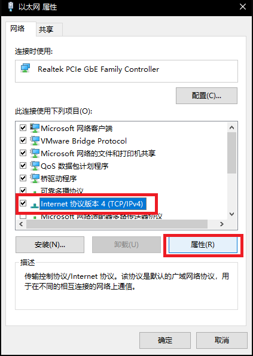
    </td>
  </tr>
</table>


<a name="v3-064"></a>

> **🟩 修改 · V3-064** — 防止电脑、雷达和模块 IP 冲突。
>
> 电脑IPv4地址设置为与雷达同网段且不冲突的地址，例如192.168.1.51，子网掩码255.255.255.0；记录原设置以便恢复：

<details>
<summary>🟩 查看已替换／删除的 v2 原文</summary>

~~~~text
修改IP地址如下：
~~~~

</details>


览沃官网下载上位机

[下载连接](https://www.livoxtech.com/cn/downloads)

<table>
  <tr>
    <td style="border: 10px solid black; padding: 0;">
      
    </td>
  </tr>
</table>

雷达上电后网线连接电脑，打开览沃上位机，可以看到雷达点云，左上角点击设置

<table>
  <tr>
    <td style="border: 10px solid black; padding: 0;">
      
    </td>
  </tr>
</table>


<a name="v3-065"></a>

> **🟩 修改 · V3-065** — 明确当前接收地址并保留旧设置步骤。
>
> 设置雷达IP如图，点击确认，重新上电后再次核对；当前配置雷达IP为192.168.1.20，模块接收地址为192.168.1.50，其他设备按实际配置设置

<details>
<summary>🟩 查看已替换／删除的 v2 原文</summary>

~~~~text
设置雷达IP如图，点击确认，重新上电则修改成功
~~~~

</details>


<table>
  <tr>
    <td style="border: 10px solid black; padding: 0;">
      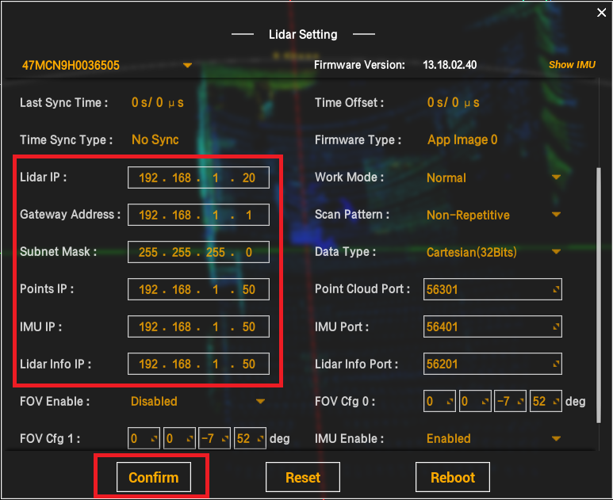
    </td>
  </tr>
</table>

## 3.非水平摆放雷达

3d模块可以适配任意位姿摆放的雷达，正确设置参数，可以使得得出的坐标为机器人自身坐标，而非仅仅只能得到雷达自身坐标。

例如：1️⃣为了感知前方障碍物，雷达向前倾斜以扫到前方环境；2️⃣室外无高大参照物，雷达倒装在无人机底部用地面建图定位。

### 3.1在机器人坐标系下得到位姿

机器人自身坐标系用FLU（front-left-up）即前左上坐标系描述，如图所示：无人机前为x，左为y，上为z。

坐标系的表示除了xyz位置，还有yaw/pitch/roll三个欧拉角：

| 角度 | 英文名 | 旋转轴 | 描述 |
|------|--------|--------|------|
| **偏航角** | Yaw  | Z轴 | 绕垂直轴左右转向（如机器人原地自转） |
| **俯仰角** | Pitch | Y轴 | 绕横向轴上下俯仰（如机器人抬头/低头） |
| **横滚角** | Roll | X轴 | 绕纵向轴左右翻滚（如机器人左右倾斜） |

<table>
  <tr>
    <td style="border: 10px solid black; padding: 0;">
      
    </td>
  </tr>
</table>

举例：如左图，定义雷达手持支架与桌面的接触点中心为原点，建立FLU机器人坐标系。

在机器人坐标系下，雷达位置可以表述为：**x=3，y=0，z=10，yaw=0，pitch=45，roll=0**

### 3.2正确设置模块参数

连接上位机后进入到参数设置界面，将机器人坐标系下雷达坐标的参数填入，点击写入参数并断电重启

<table>
  <tr>
    <td style="border: 10px solid black; padding: 0;">
      
    </td>
  </tr>
</table>


<a name="v3-066"></a>

> **🟥 新增 · V3-066** — 补充 v3 参数保存结果检查。
>
> 写入后等待保存和回读比对成功，重启后点击[获取参数]再次确认安装参数。

重启后，相较于默认全为0的参数，模块输出的坐标参考系变为机器人坐标系，而非默认的雷达坐标系

## 4.可视化界面过滤点云

上位机的可视化界面设置了z轴过滤，可以过滤掉z轴上非设定范围的点云，使环境结构更清晰。

如图，通过设置z轴上下限，过滤掉房间天花板和地板，只剩下物品和房间墙壁：

<table>
  <tr>
    <td style="border: 10px solid black; padding: 0;">
      
    </td>
  </tr>
</table>

如图：无z轴过滤，箭头和轨迹被天花板的点云遮挡

<table>
  <tr>
    <td style="border: 10px solid black; padding: 0;">
      
    </td>
  </tr>
</table>

如图：过滤天花板点云

<table>
  <tr>
    <td style="border: 10px solid black; padding: 0;">
      
    </td>
  </tr>
</table>


<a name="v3-067"></a>

> **🟥 新增 · V3-067** — 区分上位机显示过滤和模块过滤。
>
>
>
> 该过滤只影响上位机显示，不改变模块点云和规划障碍物；参数0x15模块过滤半径与此不同。

### 本章表格改动原文

<a name="v3-054"></a>

> **V3-054** — 补充当前雷达型号枚举。

<details>
<summary>🟩 查看已替换的 v2 表格原文</summary>

~~~~text
| 0x00 | 雷达型号 | - | 0=mid360, 10=N10, 11=N10_P，默认0 |
~~~~

</details>

<a name="v3-055"></a>

> **V3-055** — 新增建图定位、导航和过滤参数。

🟥 新增表格行，无对应 v2 原文。

<a name="v3-056"></a>

> **V3-056** — 更新规划参数范围。

<details>
<summary>🟩 查看已替换的 v2 表格原文</summary>

~~~~text
| 0x21~0x27 | 路径规划参数 | 0~1000 | 首次使用应断开电机供电，查看规划结果无误 |
~~~~

</details>

<a name="v3-057"></a>

> **V3-057** — 修正加速度单位。

<details>
<summary>🟩 查看已替换的 v2 表格原文</summary>

~~~~text
| 0x22 | 最大加速度 | 0~1000 | 路径规划输出轨迹的最大加速度，单位cm/s，默认100 |
~~~~

</details>

<a name="v3-058"></a>

> **V3-058** — 替换 0x23–0x27 的旧含义。

<details>
<summary>🟩 查看已替换的 v2 表格原文</summary>

~~~~text
| 0x23 | 最大高度 | 0~1000 | 3d版的轨迹最大高度，设置虚拟天花板防止超出，单位cm，默认200 |
| 0x24 | 起飞高度 | 0~1000 | 一键起飞设定的高度，2d版会在这个高度的平面内路径规划 |
| 0x25 | 机器人半径 | 0~1000 | 中心点到最远端距离至少加5cm作为半径，单位cm，默认30 |
| 0x26 | 安全距离 | 0~1000 | 机器人中心到障碍安全距离，建议=机器人半径+10，优先选择大于该安全半径路径，单位cm，默认40 |
| 0x27 | 过滤半径 | 0~1000 | 若雷达会扫到自身结构需加大，建议=机器人半径，单位cm，默认30 |
~~~~

</details>

<a name="v3-059"></a>

> **V3-059** — 补充新增参数和版本核对入口。

🟥 新增表格行，无对应 v2 原文。


---

### 1️⃣2d版模块建图失败或漂移

1.检查雷达是否被机器人结构大面积遮挡，被遮挡的扇面小于20%则对建图影响较小，最佳情况是将2d雷达置于机器人顶端水平放置无遮挡

2.在一些长走廊或空旷场地，建图算法无法锚定特征点，也可能会导致建图失败


<a name="v3-068"></a>

> **🟩 修改 · V3-068** — 修正 v2 标题笔误，正文讨论 MID360。
>
> ### 2️⃣3d版模块建图失败或漂移

<details>
<summary>🟩 查看已替换／删除的 v2 原文</summary>

~~~~text
### 2️⃣2d版模块建图失败或漂移
~~~~

</details>


1.mid360雷达上电时内部imu需要静置初始化，上电后抖动会导致imu初始化失败进而导致建图失败

2.雷达建图算法需一定初始化时间，禁止上位机刚出点云就移动机器人

3.在一些长走廊或空旷场地，建图算法无法锚定特征点，也可能会导致建图失败

### 3️⃣导航版路径规划失败


<a name="v3-069"></a>

> **🟩 修改 · V3-069** — 按 v3 规划状态区分失败和未响应。
>
> 路径规划失败表现为：[路径规划]显示失败，或未生成可用轨迹；未响应表示尚未收到状态，不能直接判为失败

<details>
<summary>🟩 查看已替换／删除的 v2 原文</summary>

~~~~text
路径规划失败表现为：上位机可视化的规划轨迹一直跳动或完全不可见
~~~~

</details>


<a name="v3-070"></a>

> **🟩 修改 · V3-070** — 替换旧机器人半径与安全距离建议。
>
> 1.路径规划算法会考虑0x24障碍膨胀半径，若当前位置或目标点位于膨胀后的障碍物内，则路径规划失败；先检查目标点、当前位置和膨胀半径

<details>
<summary>🟩 查看已替换／删除的 v2 原文</summary>

~~~~text
1.路径规划算法会考虑机器人半径和安全距离，规划出一条与障碍物距离大于机器人半径，尽量大于安全半径的路径；若当前位置或目标点与障碍物距离小于机器人半径，则路径规划失败
~~~~

</details>


<a name="v3-071"></a>

> **🟩 修改 · V3-071** — 替换旧地板距离反向描述和改假安装参数的建议。
>
> 2.3d导航版需注意地板也被认为是障碍物，若机器人在地面测试路径规划，需检查机器人中心是否位于膨胀后的障碍物内；小车使用平面规划时将0x25设为0，雷达安装位置按实际测量填写，不要用虚假的0x03安装高度绕过障碍物检查

<details>
<summary>🟩 查看已替换／删除的 v2 原文</summary>

~~~~text
2.3d导航版需注意地板也被认为是障碍物，若机器人在地面测试路径规划，需确保与地面距离小于机器人半径；如果小车使用3d导航版，可以将机器人中心的z设置大于机器人半径，具体方法为减小0x03z坐标参数
~~~~

</details>


<a name="v3-072"></a>

> **🟩 修改 · V3-072** — 以 v3 重定位状态作为导航前提。
>
> 3.路径规划算法需一定初始化时间，禁止上位机刚出点云就设置目标点；先保存地图，切换定位并启用导航，重启后等待重定位成功，2d导航版的0x25必须为0

<details>
<summary>🟩 查看已替换／删除的 v2 原文</summary>

~~~~text
3.路径规划算法需一定初始化时间，禁止上位机刚出点云就设置目标点，等待约10s初始化
~~~~

</details>


<a name="v3-073"></a>

> **🟩 修改 · V3-073** — 替换旧重发判据。
>
> 4.禁止频繁设置目标点，不同目标点至少间隔1s；目标回显只表示收到帧，不代表已发布给规划器、规划成功或到达。没有轨迹时检查规划状态和通信，再重新设置目标

<details>
<summary>🟩 查看已替换／删除的 v2 原文</summary>

~~~~text
4.收到目标点到规划出路径需要0.3s-1s，每次收到目标点都会重新规划，禁止频繁设置目标点，发送目标点无响应后3s再次发生
~~~~

</details>


### 4️⃣px4飞控使用模块可以进入定点模式，但起飞后退出

1.px4架构的飞控型号各异，固件版本不同，参数设置不同，模块与飞控通信方式不同，都有可能导致退出定点模式；模块仅作为类似于gps的全局位置传感器输出位姿，飞控是否接收该数据作为定位来源需正确设置参数

2.px4飞控内部会融合多传感器数据，比较不同传感器之间的数据差异，可能会导致飞控不信任模块的位置数据；检查其他传感器的数据是否冲突，例如自带激光测距光流的z与模块输出不一致，需调整 EKF2_EVP_NOISE/EKF2_EVA_NOISE/EKF2_EV_DELAY 等参数


<a name="v3-074"></a>

> **🟥 新增 · V3-074** — 补充新版 PX4 和 2D 定高排查。
>
> 2d模块需额外定高传感器，检查高度持续有效；PX4 1.14.3使用EKF2_EV_CTRL和EKF2_HGT_REF配置融合，不要照搬旧版EKF2_AID_MASK和EKF2_HGT_MODE。

### 5️⃣不建议直接使用导航版模块控制无人机

1.导航版模块内置offboard模式控制无人机，但局限于：px4架构的飞控型号各异，固件版本不同，参数设置不同，模块与飞控通信方式不同,无人机机架等硬件结构不同，以上等等原因都可能导致通信失败或控制失败，进而导致无人机跟随轨迹失败，增大无人机失控伤人风险

2.请使用另一台机载电脑offboard模式控制无人机跟随轨迹，模块仅用于输出坐标和轨迹，原因如下：自行设置程序控制无人机可以融合多传感器减少无人机失控伤人风险；模块仅通过一键起飞后到达指定位置的简单巡航例程，自行设置程序方便编写状态机完成视觉跟随等任务；模块oddboard通信不能适应不同的飞控型号/固件版本/不同机型


<a name="v3-075"></a>

> **🟥 新增 · V3-075** — 补充新版通信、存图和重定位故障排查。
>
> ### 6️⃣连接、参数或命令没有回显
>
> 1.先测试通信，网络检查热点、模块IP和端口，串口检查TX/RX交叉、共地、电平、115200 8N1和0x12使能。
>
> 2.写入参数后等待保存和回读比对，超时或不一致时重新获取参数，不要当作成功。重启回显只表示收到请求，等待重新连接后再读回。
>
> 3.主控、模块和上位机使用匹配的协议，当前0x04为速度，0x05为状态，0x23~0x29的参数含义与旧版不同。
>
> ### 7️⃣保存地图或重定位不成功
>
> 1.建图前确认0x13=0、0x14=0，写入后重启；导航版启用导航会强制定位，定位模式不能保存地图。保存地图只在成功后回显，没有回显时先检查通信和当前模式，再重试。
>
> 2.定位前确认地图已经保存，检查雷达、设备位置和所在环境，等待重定位成功；持续未响应表示没有收到状态。下载地图需要网络，下载的是已经保存的地图。
>

---

# 免责声明 (Disclaimer)

本项目/模块（以下简称“本模块”）提供基于 Offboard 模式的无人机路径规划与避障功能。在使用本模块进行任何仿真或实体飞行测试之前，请务必仔细阅读并充分理解本免责声明。

**一旦您下载、安装、编译或以任何方式使用本模块，即表示您已阅读、理解并同意接受本声明的全部条款。**

#### 1. 实验性软件与测试环境局限
本模块的核心算法与功能均在**理想的实验/仿真环境中**进行开发与测试。真实世界的飞行环境具有极高的复杂性（如风扰、传感器噪声、障碍物材质反射率差异等）。开发者不保证本模块在真实、复杂的室外或室内应用场景中能达到与实验环境中一致的表现。本模块按“原样（AS IS）”提供，不带有任何明示或暗示的担保。

#### 2. 硬件差异与飞控（PX4）参数风险
无人机系统属于高度复杂的机电一体化设备。不同的机架尺寸、动力系统响应速度、传感器精度以及 **PX4 飞控底层的控制参数设置**，都会直接影响无人机的实际飞行动态。 
* 将本模块直接应用于未经严格适配和调参的无人机硬件上，极易导致算法输出指令与飞机实际姿态不匹配，进而引发**无人机失控、炸机或伤及人员/财产**。
* 用户有责任针对自身的特定硬件平台，仔细调整相关参数，并在绝对安全的环境下进行验证。

#### 3. 模块定位与系统控制权限制
本模块**仅设计作为独立的“路径规划算法模块”使用**，旨在向上层应用提供路径生成与避障策略，**并非用于完全接管或替代控制 PX4 飞控的机载电脑核心系统**。
* 本模块通过 Offboard 模式发送控制设定点（Setpoints），但不对底层的安全保护机制（如失控返航、低电量保护、地理围栏触发等）负责。
* 飞手必须时刻手握遥控器，并确保在遇到突发情况或算法行为异常时，**能够随时通过遥控器硬件开关切出 Offboard 模式并手动接管无人机**。因未能及时接管导致的一切事故，开发者概不负责。

#### 4. 错误使用与算法失效风险
本模块的正常运行依赖于正确的数据输入与系统配置（如准确的外部定位数据/里程计、正确的坐标系对齐与频率设定等）。任何非正确方式的使用、非法参数的输入、或将其应用于超出其设计边界的极端场景，均可能直接导致算法逻辑出错、崩溃或输出危险的控制指令。

#### 5. 责任豁免
在适用法律允许的最大范围内，本模块的开发者、贡献者及相关主体，对因使用、滥用或无法使用本模块而产生的任何直接的、间接的、特殊的、附带的或惩罚性的损害（包括但不限于**无人机损坏、财产损失、人身伤亡、法律纠纷、数据丢失或业务中断**）概不承担任何法律及连带责任。

**使用本模块进行实体飞行的全部风险均由使用者本人自行承担。**

---

**⚠️ 强烈建议的安全飞行准则：**
1. 在实际部署到物理无人机之前，务必在 SITL（软件在环）或 HITL（硬件在环）仿真中进行充分的极端情况测试。
2. 首次实机测试请务必**卸下螺旋桨**，在地面观察机载电脑与 PX4 飞控的指令交互与电机响应是否符合预期。
3. 实飞测试请务必在空旷、合法且无人员聚集的场地进行，并配备必要的安全防护措施。


---

